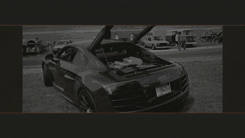

<p align="center"></p>

<h1 align="center">SEMEVIA</h1>

<p align="center"><b>Vehicle identity through evidence</b><br>
Upload a photo of a car. SEMEVIA tells you its make, model and year, and how sure it really is.</p>

<p align="center">
<a href="https://semevia.web.app"></a>
<a href="https://github.com/DuhItzAniket/SEMEVIA/actions/workflows/ci.yml"></a>
<a href="https://doi.org/10.5281/zenodo.24026963"></a>
<a href="LICENSE"></a>
<a href="eval_P5_T35.md"></a>
</p>

<p align="center">


</p>

<p align="center">
<a href="https://semevia.web.app"><b>Try it live</b></a> ·
<a href="eval_P5_T35.md">Results</a> ·
<a href="#video-showing-it-live">Demo video</a>
</p>

---

## Introduction

Many cars look almost the same: the same brand, the same shape, only a different year or trim. SEMEVIA is our
answer to **Intelligent Fine-Grained Vehicle Recognition and Analysis**.

You give it a photo. It finds the car, names it among **196 car models** from the Stanford Cars dataset, and shows its top 5 guesses. It also gives an **Evidence Passport**: instead of
always claiming one exact answer, it says what the photo actually supports. Sometimes that is the exact model;
sometimes only the model family or just the brand.

**Live app:** <https://semevia.web.app> (direct Cloud Run address: <https://semevia-298534486429.asia-south1.run.app>)

## Project Documents

Everything the problem statement asks for, in one place:

| Deliverable | Where to find it |
|---|---|
| Live hosted application | <https://semevia.web.app> |
| Complete source code | This repository: [app/](app/) (website), [src/](src/) (vision and models), [scripts/](scripts/) (training and evaluation) |
| System architecture diagram | [docs/architecture.md](docs/architecture.md) |
| Design document | [docs/design.md](docs/design.md) |
| Comparative evaluation results | [eval_P5_T35.md](eval_P5_T35.md) (Top-1/Top-5, IoU, mAP, model size and speed, robustness, confidence) |
| Ablation study | [eval_P5_T35.md, section 7](eval_P5_T35.md#7-ablations) |
| Failure-case analysis | [eval_P5_T35.md, section 8](eval_P5_T35.md#8-failure-analysis) |
| Raw result files and charts | [reports/](reports/), charts in [reports/figures/](reports/figures/) |
| How to reproduce the results | [Reproduce the Results](#reproduce-the-results) below, full commands in [docs/runbook_other_pc.md](docs/runbook_other_pc.md) |
| Limitations and ethics | [Limitations](#limitations) and [Ethics and Privacy](#ethics-and-privacy) below |
| Demo script and viva notes | [docs/demo.md](docs/demo.md), [docs/viva_prep.md](docs/viva_prep.md) |
| Licences | [LICENSE](LICENSE) (code), [LICENSE-MODELS.md](LICENSE-MODELS.md) (model files and third-party material) |


## Technologies Used

| Area | Tools |
|---|---|
| Language | Python 3.11 |
| Finding the car in the photo | YOLO11n (Ultralytics), a small ready-made detector |
| Recognising the model | EfficientNet-B0 (PyTorch), a pretrained network we fine-tuned on a GPU |
| Classic image features | OpenCV, scikit-image (edges, shapes, texture, colour) |
| Final classifier and confidence | scikit-learn |
| Website | FastAPI (backend), plain HTML, CSS and JavaScript (frontend) |
| Packaging and hosting | Docker, Google Cloud Run; model files on GitHub Releases |
| Speed-up and compression | ONNX Runtime (8-bit final classifier) |

## Features

- **Upload, take a photo or tap an example.** Works on phone and laptop; four one-tap example photos are built in.
- **Finds the car** and draws a box around it.
- **Names the car**: make, model and year, with the top 5 guesses and a confidence score.
- **Three recognition modes**:
  - **Classical**: hand-made image features only.
  - **Deep**: the trained neural network.
  - **Hybrid** (default): both together.
- **Evidence Passport**: shows which car models are still possible and whether the photo supports the exact
  model, only the family, or only the brand.
- **Six-region challenge**: blurs one part of the car at a time to show which parts the answer depends on.
- **Similar training cars**: the closest matches from the training data.
- **Behind the scenes**: the cropped car, edges, outlines and simple measurements.
- **Compare all three modes** on the same photo with one click.
- **Download the result** as a small JSON file.
- **Clear messages** for wrong files (not an image, too large, empty) and for photos with no car.
- **Privacy**: uploaded photos are never saved; they are kept in memory briefly and then deleted.

## What Makes SEMEVIA Different

Most car-recognition projects stop at "here is the model name and a confidence score". SEMEVIA also tries to
show how far that answer can be trusted.

| | A typical approach | SEMEVIA |
|---|---|---|
| **The answer** | One model name with a confidence % | An Evidence Passport that says when the photo only supports the model family or the brand |
| **Explaining it** | A heatmap over the image | A six-region challenge that measures how hiding each part changes the answer |
| **Comparing methods** | One model | Classical, deep and hybrid compared on the same photos |
| **Testing** | Test photos often reused while tuning | Model locked first, then tested once on photos kept aside |
| **Scoring** | Accuracy on ready-cut car images | A hit counts only if both the box and the name are right |
| **Hard cases** | Clean photos only | Darker, blurred and partly hidden photos, plus non-car photos; known failures listed |
| **Running it** | Works on the team's laptop | Always-on public site, one-command Docker setup, automatic tests |
| **Sharing it** | Code on GitHub | Also archived on Zenodo with a permanent, citable DOI |


## The Process

1. **Prepare the data.** We used Stanford Cars (16,185 photos, 196 models). We checked every photo and box, then
   split the photos into four groups: training, tuning, calibration and a test set that stayed untouched until
   the very end.
2. **Find the car.** A small ready-made detector (YOLO11n) finds the car. It already worked on over 99% of
   photos, so we did not need to train our own.
3. **Recognise the model.** We first tried classic hand-made image features, then a pretrained neural network
   (EfficientNet-B0), which we fine-tuned on a GPU over three training rounds. The third round, trained on
   larger images, was the best and is the one in the app. Combining both kinds of features gives the Hybrid mode.
4. **Make the confidence honest.** We tuned the confidence on a separate set of photos, so the Passport only
   claims what the evidence supports.
5. **Lock it, then test once.** We froze the final model, then tested it a single time on 8,041 photos it had
   never seen.
6. **Try to make it smaller and faster.** We converted the network to ONNX and tried 8-bit compression.
   Compressing the whole network lost too much accuracy, so it stays full precision. Only the small final
   classifier runs in 8-bit, with the same test accuracy.
7. **Ship it.** We packaged everything in Docker and put it online on Google Cloud Run.

### How well it works

Measured on the 8,041 unseen test photos (full details in [eval_P5_T35.md](eval_P5_T35.md)):

| Mode | Correct first guess (Top-1) | Right answer in top 5 guesses (Top-5) |
|---|---|---|
| **Hybrid** (used in the app) | **91.8%** | **98.0%** |
| Deep | 91.8% | 97.9% |
| Classical | 6.3% | 14.8% |

- The car was found correctly in **99.1%** of the photos.
- A result comes back in about **half a second** on the live site (508 ms typical).
- The classical features on their own are weak at telling 196 similar models apart; the neural network makes
  the big difference.

## What We Learnt

- **Finding a car is easy; telling similar cars apart is hard.** The ready-made detector was enough, and almost
  all the effort went into recognising the model.
- **Pretrained networks are powerful.** Fine-tuning one took us from about 6% (classic features) to about 92%.
- **Keep the test set hidden until the end.** Otherwise it is easy to fool yourself with results that are too good.
- **A confidence score is not a guarantee.** It has to be checked on separate photos before you can trust it.
- **Smaller is not always better.** Compressing the model made it faster but broke its accuracy.
- **Deployment takes real work.** Disk space, Docker images and free hosting limits took as much care as the model.

## Limitations

- **Only 196 car models, up to 2012.** Newer cars and other vehicles are outside the dataset, so the app can
  give a wrong name for them.
- **Rejecting non-car photos is not perfect.** On 40 held-out test photos that should be rejected, 5 were wrongly
  accepted: 4 of 10 other vehicle types and 1 of 10 newer cars (0 of 10 non-vehicle photos and 0 of 10
  motorbikes). A coach and a tram were named as a GMC Savana Van, a tipper lorry and a tuk-tuk as a Hummer SUV,
  and a 2022 Lucid Air as a Nissan 240SX.
- **One car per photo.** If there are several cars, the app picks the largest one.
- **Some dataset labels disagree.** Stanford Cars has 37 groups of duplicate photos with different labels,
  mostly neighbouring model years, so some years cannot be told apart reliably.
- **Viewing-angle results are a small sample.** They come from 60 test photos whose angle labels were made
  automatically and are still to be checked by us.
- **The six-region challenge does not name car parts.** It only measures how much blurring each region changes
  the answer.
- **Only part of the model is compressed.** 8-bit compression of the whole network lost too much accuracy, so
  only the final classifier is 8-bit.
- **Hosting runs on free-trial credit.** The live site stays up while the Google Cloud credit lasts.

## How It Could Be Improved

- **Newer cars.** The dataset stops at 2012 models; newer cars and other vehicle types are not recognised.
- **Several cars in one photo.** The app always picks the largest car.
- **A smaller, faster model** that keeps its accuracy, for phones and cheaper servers.
- **Show pictures of similar cars.** Reference matches are shown as names only, because of the dataset's image rights.

## Ethics and Privacy

- **Uploaded photos are never stored.** They are kept in memory for a short time to show the result, then
  deleted. They are not written to disk or logs, and the downloadable result contains no image pixels.
- **It identifies car models, not people.** It does not read number plates, track vehicles or recognise faces,
  and its answer is not proof of a car's identity.
- **Dataset rights are respected.** Stanford Cars is for non-commercial research only. Its photos are not copied
  into this repository or the app, which is also why similar cars are shown as names, not pictures. The trained
  model files carry the same non-commercial condition.
- **Other photos are credited.** The example and test photos we added are openly licensed, with their sources
  and authors recorded ([app/static/examples/credits.json](app/static/examples/credits.json),
  [artifacts/negative_manifests/](artifacts/negative_manifests/)).
- **Results are reported honestly.** Every number comes from saved result files, the test set was used once
  per model version, and known failures are listed instead of hidden.

## How to Run the Project

You need [Docker](https://www.docker.com/) and about 4 GB of free disk space. No passwords or keys are needed.

```bash
git clone https://github.com/DuhItzAniket/SEMEVIA
cd SEMEVIA
git checkout semevia/implementation
docker compose up --build
```

Open <http://localhost:8000> in your browser. The first build downloads the model files automatically and
checks them.

<details>
<summary>Without Docker (for development)</summary>

```bash
python -m venv venv
venv/Scripts/pip install -r requirements.lock --extra-index-url https://download.pytorch.org/whl/cpu
venv/Scripts/python -m src.release fetch
venv/Scripts/python -m uvicorn app.main:app --port 8000
```

On macOS or Linux use `venv/bin/` instead of `venv/Scripts/`. Optional local settings: copy `.env.example`
to `.env`.
</details>

## Reproduce the Results

Running the app needs no dataset. Retraining and re-testing do, and a GPU is strongly recommended. The full,
step-by-step commands (with checks after each step) are in [docs/runbook_other_pc.md](docs/runbook_other_pc.md).
In short:

1. **Get the data.** `git clone --depth 1 https://github.com/jhpohovey/StanfordCars.git`, then set
   `SEMEVIA_DATA_ROOT` to its `stanford_cars` folder (see [.env.example](.env.example)).
2. **Rebuild and check the splits.** `python scripts/prepare_data.py --config configs/data.yaml`. The result must
   match [artifacts/manifests/](artifacts/manifests/) exactly, so everyone gets the same train, tune,
   calibration and test photos.
3. **Fine-tune the network.** `python scripts/train.py --config configs/train_v3.yaml --resume auto`
4. **Build the classifiers and calibration**, then **lock the model** with `scripts/freeze.py`.
5. **Test once** on the 8,041 test photos with `scripts/evaluate.py --partition test --confirm-frozen`.
6. **Write the results file.** `python scripts/report.py --team-id T35 --usns "1RUA24CSE0051,1RUA24CSE0097"`
   regenerates [eval_P5_T35.md](eval_P5_T35.md) from the saved result files.

The released model files are on GitHub Release `model-v3`, with their checksums in
[artifacts/release_manifest.json](artifacts/release_manifest.json), so the app can be checked without retraining.

## Video Showing It Live

<p align="center"></p>

<!-- Full video player: paste the GitHub video link on the line below (see the note in the commit message). -->

**[Watch the 3-minute demo on YouTube](https://youtu.be/6CdDN6YsZAE)**: a short intro, how SEMEVIA works, then a live
demo on a photo the model has never seen (all six PS5 outputs, in order). The narration uses synthetic voices
(Kokoro TTS) and the music was generated in code for this video. Photo credits: Bugatti Veyron by M 93
(CC BY-SA 3.0 DE) and the app's example photos (Wikimedia Commons, credited in the app and in the video description).

## Citation

If you use SEMEVIA, please cite it as:

> Aniket Kumar and C Lakshanaa (2026). *SEMEVIA: fine-grained vehicle recognition with an Identity Evidence
> Passport* (Version 1.0.0). Zenodo. <https://doi.org/10.5281/zenodo.24026963>

The project is archived on Zenodo (the DOI above covers all versions; v1.0.0 alone is
[10.5281/zenodo.24026964](https://doi.org/10.5281/zenodo.24026964)). GitHub's **Cite this repository** button,
in the sidebar, gives the same citation in APA and BibTeX from [CITATION.cff](CITATION.cff).

<details>
<summary>BibTeX (for LaTeX)</summary>

```bibtex
@software{kumar_lakshanaa_2026_semevia,
  author    = {Kumar, Aniket and Lakshanaa, C},
  title     = {SEMEVIA: fine-grained vehicle recognition with an Identity Evidence Passport},
  year      = {2026},
  version   = {1.0.0},
  publisher = {Zenodo},
  doi       = {10.5281/zenodo.24026963},
  url       = {https://doi.org/10.5281/zenodo.24026963}
}
```
</details>

**Dataset used:** Stanford Cars, by J. Krause, M. Stark, J. Deng and L. Fei-Fei, "3D Object Representations
for Fine-Grained Categorization", 4th IEEE Workshop on 3D Representation and Recognition, at ICCV 2013.

---

**Team Hypermetropia (T35)**: Aniket Kumar (1RUA24CSE0051), C Lakshanaa (1RUA24CSE0097)

**More detail:** [results](eval_P5_T35.md) · [how it works](docs/architecture.md) ·
[design](docs/design.md) · [licences](LICENSE-MODELS.md) (code AGPL-3.0; model files non-commercial,
because Stanford Cars is for non-commercial research only)
