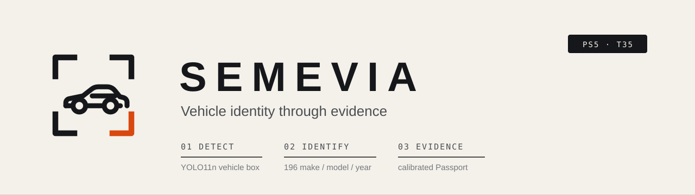
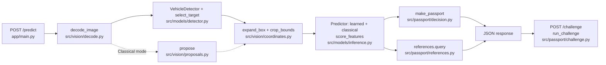

<p align="center"></p>

# SEMEVIA

**Vehicle identity through evidence.** SEMEVIA recognises the make, model and year of a car in a photo
(196 Stanford Cars categories) and shows how much of that answer the evidence actually supports.

**Status (2026-11-07):** the released iteration is **r3** (run `effb0_r3`: r2's full-network fine-tuning
recipe at 320 px input with the same seed, [configs/train_v3.yaml](configs/train_v3.yaml); backbone tag
`ckpt_98b1fb55cc6e`, bundle `ft_ckpt_98b1fb55cc6e_5d755416fd`; model files to be published as GitHub Release
`model-v3`). It was frozen ([artifacts/production_freeze.json](artifacts/production_freeze.json), production
mode Hybrid, reject threshold chosen with the 40 tune negatives), evaluated once on the official test split,
and is the version served at the live URL. Its release rule was pre-registered in [NEXT.md](NEXT.md)
("Iteration r3 decision record") before r3 was trained: r3 is released only if its tune end-to-end Hybrid top-1
beats r2's by at least 1.0 percentage point (>= 740/815); otherwise r3 never touches the test split. The rule
outcome (met) was recorded and pushed before r3's single test run.

Earlier iterations are superseded and kept as history; their test results are listed in the evaluation file
under "Model iterations":

* **r1** (`effb0_r1`, last-stage fine-tuning at 224 px, bundle `ft_ckpt_2339418979e1_0920511710`, GitHub
  Release `model-v1`): freeze, calibration and config in [artifacts/history/r1/](artifacts/history/r1/).
* **r2** (`effb0_r2`, full fine-tuning at 224 px, [configs/train_v2.yaml](configs/train_v2.yaml), bundle
  `ft_ckpt_4f3584f597d5_9662c2e703`, GitHub Release `model-v2`): freeze, calibration and config in
  [artifacts/history/r2/](artifacts/history/r2/). r2 was designed after r1's test result was known; the
  decision that r2 replaces r1 whatever its result was recorded in [NEXT.md](NEXT.md) ("Iteration r2 decision
  record") before r2's test run.

The test split was evaluated end to end once per iteration (three times in total). In addition, the frozen r2
bundle had one standard-protocol (ground-truth crop) test run after its result was known, disclosed in the status
line of [eval_P5_T35.md](eval_P5_T35.md).

## Live application

**Live application URL:** <https://readings-agency-respond-bacteria.trycloudflare.com>

Served from the team laptop through a Cloudflare quick tunnel (see [docs/hosting_lock.md](docs/hosting_lock.md)).
Checked through the public URL on 2026-11-07, after the r3 deployment: page, readiness, 20 fresh uploads, 4 simultaneous clients and
six bad-input cases ([reports/release_acceptance.json](reports/release_acceptance.json)). The URL works only
while that laptop, Docker and the tunnel are running. If `cloudflared` restarts, the address changes; this
README and the submission are then updated and the check is rerun.

## What it does

SEMEVIA is our solution to PS5, *Intelligent Fine-Grained Vehicle Recognition and Analysis*, on the Stanford
Cars dataset (196 categories, 16,185 images: 8,144 train and 8,041 test). For one uploaded photo it:

1. **Detects** the vehicle with YOLO11n (COCO car, bus and truck mapped to "vehicle") and selects the primary
   target: the largest box with detector score >= 0.25. In Classical mode the region comes from a classical
   contour proposal instead of YOLO.
2. **Classifies** the crop in one of three modes: **Classical** (1816 handcrafted features: HOG, LBP, HSV,
   geometry, flags), **Deep** (the 1280-d fine-tuned EfficientNet-B0 embedding) or **Hybrid** (the embedding
   plus the handcrafted features reduced by PCA to 64; the production mode). It shows the best guess and Top-5
   with a classification score kept separate from the detector score.
3. Issues an **Identity Evidence Passport**: decision state (one candidate, several remain, rejected,
   insufficient evidence, no vehicle), a calibrated conformal candidate set, and the most specific level the
   set supports (exact category, family, make). Only the production mode (Hybrid) uses the final
   calibration; Deep and Classical are shown as "comparison mode".
4. Runs the **Evidence Challenge** on request: blurs each of six crop regions in turn and shows how the margin
   between the two leading categories (a fixed A/B pair) changes, with the modified crop and **Restore original**.
5. Lists **nearest training references** from a training-only index (identifiers, labels and similarity; no
   thumbnails, see [Ethics and licences](#ethics-and-licences)).
6. Shows intermediate processing (crop, grayscale, Canny edges, contours, geometric measurements) and offers
   **Download Passport JSON** (hashes, boxes, scores and versions; no image pixels).

Bad inputs (not an image, over 10 MB, over 25 megapixels, empty file) get a typed error with a recovery
action. Without the recognition bundle the app serves detection only and says so. A one-tap example row
(Audi R8, Lamborghini Aventador, 2021 Kia EV6, motorcycle; Wikimedia Commons photos, credits in
[app/static/examples/credits.json](app/static/examples/credits.json)) shows a supported car, an unsupported
newer car and a non-car without needing your own photo.



Full diagrams (runtime, training and evaluation, partitions): [docs/architecture.md](docs/architecture.md).

## Features

| Feature | State |
|---|---|
| Upload, validation, typed errors | Implemented, tested |
| Vehicle detection (YOLO11n, COCO car/bus/truck) with primary-target rule | Implemented, evaluated |
| Verified Stanford Cars manifests and class hierarchy | Implemented, tested |
| Classical features (edges, contours, HOG, LBP, HSV, geometry), classical ROI proposals | Implemented, tested, shown in the app |
| Classical, Deep and Hybrid modes with Top-5 and separate scores | Implemented on the fine-tuned backbone; evaluated on test |
| EfficientNet-B0 fine-tuning | r3 released (`effb0_r3`, full network at 320 px, [summary](reports/training/effb0_r3_summary.json)); superseded: r2 (`effb0_r2`, full network at 224 px, [summary](reports/training/effb0_r2_summary.json)) and r1 (`effb0_r1`, last stage at 224 px, [summary](reports/training/effb0_r1_summary.json)) |
| Encoder input size travels with the backbone file | Implemented: `backbone_input_size` in [src/models/backbone.py](src/models/backbone.py) reads the size stored in the backbone file (224 for bundles before r3), and inference and ONNX export use it; `preprocess_version` names the preprocessing per size |
| Identity Evidence Passport (candidate set, specificity, decision states, JSON export) | Implemented; final calibration from the untouched calibration split |
| Evidence Challenge (six blurred regions, fixed A/B margin) | Implemented, tested |
| Nearest training references (588-entry training-only index: 3 per class) | Implemented; identifiers, labels and similarity only (no thumbnails, licence decision) |
| Optimization: ONNX FP32 encoder, INT8 encoder attempts, INT8 linear head | Measured; every INT8 encoder failed our accuracy policy; the release keeps the PyTorch FP32 encoder |
| End-to-end evaluator (Top-1/5 with IoU gating, IoU, AP, Passport, calibration) | Run on tune, calibration and (once per iteration, after its freeze) test |
| Standard Stanford Cars protocol (ground-truth car crop, no detector), [scripts/evaluate_oracle.py](scripts/evaluate_oracle.py) | Run on test with the released bundle and reported beside the end-to-end numbers ([oracle file](reports/oracle_test_ft_ckpt_98b1fb55cc6e_5d755416fd.json)) |
| Robustness: 6 fixed stress conditions on a predeclared 392-image test subset | Run for r1, r2 and r3 |
| Viewpoint subgroups: 60 viewpoint-labelled test photos | Labelled by an agent before any test result; blind second pass by agents ([reports/viewpoint_label_check.json](reports/viewpoint_label_check.json)); not human-reviewed |
| Negative (unsupported-input) suite: 80 images, 40 tune + 40 test, 10 per bucket | Collected ([artifacts/negative_manifests/](artifacts/negative_manifests/)); used in the r2 and r3 freezes and test runs |
| One-tap example row in the app (Audi R8, Lamborghini Aventador, 2021 Kia EV6, motorcycle) | Implemented; Wikimedia Commons photos, credits in [app/static/examples/credits.json](app/static/examples/credits.json) |
| Evaluation file [eval_P5_T35.md](eval_P5_T35.md) | Generated from reports by `scripts/report.py` |
| Report figures ([reports/figures/](reports/figures/)) | Drawn from the report files by [scripts/make_figures.py](scripts/make_figures.py) |
| Docker image, offline start, public deployment | Done for r3; checks re-run on the r3 bundle ([reports/container_check.json](reports/container_check.json), [reports/release_acceptance.json](reports/release_acceptance.json)) |
| Continuous integration ([.github/workflows/ci.yml](.github/workflows/ci.yml)) | Workflow defined: test suite with the release assets fetched and SHA256-verified, and a Docker image built from a clean checkout that must become ready with no network |
| Demo video recorder ([scripts/record_demo.py](scripts/record_demo.py)) | Records a silent, captioned walk-through of the live app following [docs/demo.md](docs/demo.md) (Playwright, separate environment); the team adds the voice-over |
| Open limitations | Tracked as GitHub issues #1-#5 in the [repository](https://github.com/DuhItzAniket/SEMEVIA/issues) |

Supported vehicle categories: the 196 Stanford Cars classes (49 makes, model years 1991-2012), listed in
[artifacts/class_metadata.json](artifacts/class_metadata.json).

## Results

All results are in **[eval_P5_T35.md](eval_P5_T35.md)**, in the PS5 metric order: Top-1/Top-5, IoU, mAP,
model size and latency, robustness, and confidence/threshold analysis, followed by ablations and three
rule-selected failure cases. The file is generated by `scripts/report.py` from the report files below; no
number in it or in this README is typed by hand. It is generated for r3 and lists the superseded r1 and r2
test results under "Model iterations".

<!-- RESULTS:START -->
Generated by `scripts/report.py` from `reports/e2e_test_ft_ckpt_98b1fb55cc6e_5d755416fd.json` (official test split, 8041 images, bundle `ft_ckpt_98b1fb55cc6e_5d755416fd`). Full results: [eval_P5_T35.md](eval_P5_T35.md).

| Mode | End-to-end top-1 | End-to-end top-5 | Box recall @ IoU 0.5 | 196-class AP50 |
|---|---|---|---|---|
| classical | 6.3% | 14.8% | 63.3% | 0.027 |
| deep | 91.8% | 97.9% | 99.1% | 0.896 |
| hybrid | 91.8% | 98.0% | 99.1% | 0.896 |

Also: standard protocol (ground-truth car crop, no detector) hybrid top-1 92.7%, top-5 98.7% (`reports/oracle_test_ft_ckpt_98b1fb55cc6e_5d755416fd.json`); unsupported-input false acceptance 12.5% (5/40 held-out negatives, `reports/negatives_test_ft_ckpt_98b1fb55cc6e_5d755416fd.json`); public-URL latency p50 463 ms / p95 680 ms (`reports/release_acceptance.json`).
<!-- RESULTS:END -->

Report files. File names carry the bundle id (test runs use the released bundle
`ft_ckpt_98b1fb55cc6e_5d755416fd`; tune-side freeze inputs use the bundle at freeze
`ft_ckpt_98b1fb55cc6e_f99e386191`) or the backbone tag `ckpt_98b1fb55cc6e`; the evaluation file always names
the files it was generated from. The links below are the current r3 release.

| What | File pattern | r3 file |
|---|---|---|
| End-to-end test evaluation (all three modes, Passport, calibration) | `reports/e2e_test_<bundle>.json` | [e2e_test_ft_ckpt_98b1fb55cc6e_5d755416fd.json](reports/e2e_test_ft_ckpt_98b1fb55cc6e_5d755416fd.json) |
| Standard protocol on test (ground-truth crop, no detector) | `reports/oracle_test_<bundle>.json` | [oracle_test_ft_ckpt_98b1fb55cc6e_5d755416fd.json](reports/oracle_test_ft_ckpt_98b1fb55cc6e_5d755416fd.json) |
| Robustness on the 392-image test stress subset | `reports/robustness_stress_test_<bundle>.md` / `.json` | [robustness_stress_test_ft_ckpt_98b1fb55cc6e_5d755416fd.md](reports/robustness_stress_test_ft_ckpt_98b1fb55cc6e_5d755416fd.md), [.json](reports/robustness_stress_test_ft_ckpt_98b1fb55cc6e_5d755416fd.json) |
| Viewpoint subgroups and failure cases | `reports/analysis_test_<bundle>.json` | [analysis_test_ft_ckpt_98b1fb55cc6e_5d755416fd.json](reports/analysis_test_ft_ckpt_98b1fb55cc6e_5d755416fd.json) |
| Bootstrap 95% intervals (all modes, paired deep minus hybrid), confusion pairs by kind, reliability raw vs temperature-scaled ([scripts/analyze_extra.py](scripts/analyze_extra.py), saved test predictions, no new inference) | `reports/extra_test_<bundle>.json` | [extra_test_ft_ckpt_98b1fb55cc6e_5d755416fd.json](reports/extra_test_ft_ckpt_98b1fb55cc6e_5d755416fd.json); figures [reliability_test.png](reports/figures/reliability_test.png), [confusions_test.png](reports/figures/confusions_test.png) |
| 5-fold cross-validation of the classical head on train ([scripts/crossval_classical.py](scripts/crossval_classical.py); deep and hybrid not cross-validated on train, the CNN was trained on those images) | `reports/crossval_classical.json` | [crossval_classical.json](reports/crossval_classical.json) |
| End-to-end tune and calibration runs (freeze inputs; the tune run decided the r3 release rule) | `reports/e2e_<partition>_<bundle>.json` | [e2e_tune_ft_ckpt_98b1fb55cc6e_f99e386191.json](reports/e2e_tune_ft_ckpt_98b1fb55cc6e_f99e386191.json), [e2e_calibration_ft_ckpt_98b1fb55cc6e_f99e386191.json](reports/e2e_calibration_ft_ckpt_98b1fb55cc6e_f99e386191.json) |
| Head selection and ablations (tune) | `reports/heads_tune_<tag>.json` | [heads_tune_ckpt_98b1fb55cc6e.json](reports/heads_tune_ckpt_98b1fb55cc6e.json) |
| Nearest-reference check (tune) | `reports/references_tune_<tag>.json` | [references_tune_ckpt_98b1fb55cc6e.json](reports/references_tune_ckpt_98b1fb55cc6e.json) |
| Optimization (ONNX FP32 / INT8 encoder; INT8 linear head) | `reports/optimization_<tag>.json`, `reports/optimization_head_hybrid_<tag>.json` | [optimization_ckpt_98b1fb55cc6e.json](reports/optimization_ckpt_98b1fb55cc6e.json), [optimization_head_hybrid_ckpt_98b1fb55cc6e.json](reports/optimization_head_hybrid_ckpt_98b1fb55cc6e.json) |
| Fine-tuning run | `reports/training/<run>_summary.json` | [effb0_r3_summary.json](reports/training/effb0_r3_summary.json) |
| Negative suite (unsupported inputs): tune (used at the freeze) and held-out test | `reports/negatives_<partition>_<bundle>.json` | [negatives_tune_ft_ckpt_98b1fb55cc6e_f99e386191.json](reports/negatives_tune_ft_ckpt_98b1fb55cc6e_f99e386191.json), [negatives_test_ft_ckpt_98b1fb55cc6e_5d755416fd.json](reports/negatives_test_ft_ckpt_98b1fb55cc6e_5d755416fd.json) |
| Viewpoint label check | `reports/viewpoint_label_check.json` | [viewpoint_label_check.json](reports/viewpoint_label_check.json) |
| Container and public-URL release checks (re-run on r3) | `reports/container_check.json`, `reports/release_acceptance.json` | [container_check.json](reports/container_check.json), [release_acceptance.json](reports/release_acceptance.json) |
| Report figures | `reports/figures/*.png` | [reports/figures/](reports/figures/) (from `scripts/make_figures.py`) |
| Superseded r2 test evaluation (history) | `reports/*_ft_ckpt_4f3584f597d5_9662c2e703.*` | [e2e_test_ft_ckpt_4f3584f597d5_9662c2e703.json](reports/e2e_test_ft_ckpt_4f3584f597d5_9662c2e703.json); r2 freeze, calibration and config in [artifacts/history/r2/](artifacts/history/r2/); [effb0_r2_summary.json](reports/training/effb0_r2_summary.json) |
| Superseded r1 test evaluation (history) | `reports/*_ft_ckpt_2339418979e1_0920511710.*` | [e2e_test_ft_ckpt_2339418979e1_0920511710.json](reports/e2e_test_ft_ckpt_2339418979e1_0920511710.json); r1 freeze, calibration and config in [artifacts/history/r1/](artifacts/history/r1/); [effb0_r1_summary.json](reports/training/effb0_r1_summary.json) |

Note on mode choice: the production mode (Hybrid) was fixed on the tuning split before each iteration's test
run. For r2, Deep and Hybrid were level on tune, and the project rule keeps Hybrid unless Deep is clearly
better on tune; this was recorded in [NEXT.md](NEXT.md) before r2's test run. For r3, the decision record fixed
Hybrid as the production mode before r3 was trained. The Deep/Hybrid comparison on
test is in [eval_P5_T35.md](eval_P5_T35.md) (section 1). We did not switch modes after seeing test results.

## Quick start (Docker)

Prerequisites: Docker with about 4 GB of free disk for the image.

```bash
docker compose up --build
```

Then open <http://localhost:8000>. The build downloads the public weights listed in
[artifacts/release_manifest.json](artifacts/release_manifest.json) (YOLO11n from Ultralytics, plus the
fine-tuned backbone, heads and reference index from the GitHub Release named there) and verifies their SHA256
(`python -m src.release fetch` and `verify` in the [Dockerfile](Dockerfile)); the running container makes
no downloads. r3's model files are to be published as GitHub Release `model-v3`; until their URLs are added to
the manifest, a clean build serves detection only. The r3 image, built with the release assets present, serves
all three modes, also with `--network none` ([reports/container_check.json](reports/container_check.json)). `compose.yaml` limits the container to
2 CPUs and 4 GB. Readiness: `GET /readyz`.

Without Docker (development; this exact install-from-lock sequence has not been tested from a clean virtual
environment, while `uvicorn` and the tests were run in our pinned venv):

```bash
python -m venv venv && venv/Scripts/pip install -r requirements.lock --extra-index-url https://download.pytorch.org/whl/cpu
python -m src.release fetch
python -m uvicorn app.main:app --port 8000
```

Copy [.env.example](.env.example) to `.env` for local paths. Inference needs no secrets.

## Reproduce the results

Training and evaluation need the Stanford Cars data; inference does not. The exact commands (Windows
PowerShell, with environment setup and the checks to run after each step) are in
**[docs/runbook_other_pc.md](docs/runbook_other_pc.md)**. GPU fine-tuning details:
[docs/training_handoff.md](docs/training_handoff.md). The order is:

1. **Data.** Get the original layout (`git clone --depth 1 https://github.com/jhpohovey/StanfordCars.git`),
   set `SEMEVIA_DATA_ROOT` and `SEMEVIA_ARTIFACT_STORE`, then run `scripts/prepare_data.py --config
   configs/data.yaml` and `scripts/declare_subsets.py`. It checks the test annotations against the TFDS
   published SHA256, decodes all 16,185 images, validates boxes, finds duplicates and must reproduce
   [artifacts/manifests/](artifacts/manifests/) byte for byte (train 6,514 / tune 815 / calibration 815 /
   test 8,041). Findings, including 37 duplicate image groups with conflicting labels:
   [reports/data_audit.json](reports/data_audit.json), [docs/checkpoints/P1.md](docs/checkpoints/P1.md).
   Then `python -m pytest`.
2. **Fine-tune.** `scripts/train.py --config configs/train_v3.yaml --resume auto` (r3, the released recipe:
   r2's recipe at 320 px input), or `--config configs/train_v2.yaml` (superseded r2) or `--config
   configs/train.yaml` (superseded r1). Rerunning the same command resumes. The input size is stored in the
   backbone file and picked up by every later step.
3. **Features and heads.** `scripts/cache_features.py --features classical --partitions train tune`, then
   `scripts/cache_features.py --features learned --backbone <checkpoint> --partitions train tune` (prints the
   backbone tag `ckpt_<sha12>`), `scripts/fit_heads.py --head classical`, `scripts/fit_heads.py --head
   learned --backbone <tag>`. Optional: `scripts/crossval_classical.py --folds 5` cross-validates the classical
   head on train ([reports/crossval_classical.json](reports/crossval_classical.json)); deep and hybrid are not
   cross-validated there because the CNN was trained on those images.
4. **Development calibration, references, bundle.** `scripts/calibrate.py --development --mode hybrid
   --backbone <tag>`, `scripts/build_references.py --backbone <tag>`, `scripts/promote_bundle.py --backbone
   <checkpoint>`; optimization evidence with `scripts/optimize.py --backbone <tag>` and
   `scripts/optimize_head.py --mode hybrid --backbone <tag>`; detector check with
   `scripts/evaluate_detector.py --partition tune`.
5. **Negative suite (tune).** `scripts/evaluate_negatives.py --partition tune` with `SEMEVIA_NEG_ROOT` set
   (see [docs/negative_suite.md](docs/negative_suite.md)).
6. **Freeze and final calibration.** `scripts/evaluate.py --partition tune`, `scripts/freeze.py --mode hybrid
   --negatives reports/negatives_tune_<bundle>.json`, `scripts/evaluate.py --partition calibration`,
   `scripts/calibrate.py --final`, `scripts/promote_bundle.py --backbone <checkpoint> --calibration
   artifacts/calibration_final.json`.
   After the freeze nothing in the model, crop, features, runtime or thresholds changes.
7. **Single test run.** `scripts/evaluate.py --partition test --confirm-frozen`, the seven stress runs
   (`--subset stress_test --condition clean|bright_0.5|bright_1.5|down_0.50|down_0.25|occl_0.15|occl_0.30`),
   `scripts/report_robustness.py --subset stress_test`, `scripts/analyze_results.py --partition test`,
   `scripts/evaluate_negatives.py --partition test`, and the standard protocol
   `scripts/evaluate_oracle.py --partition test --confirm-frozen`. Then `scripts/analyze_extra.py --partition
   test` reads the saved test predictions (no new inference) for bootstrap intervals, confusion pairs and
   reliability bins; it stops unless its recomputed counts equal the end-to-end report.
8. **Report.** `python scripts/report.py --team-id T35 --usns "1RUA24CSE0051,1RUA24CSE0097" --readme` writes
   [eval_P5_T35.md](eval_P5_T35.md) and refreshes the results block in this README;
   `python scripts/make_figures.py` draws [reports/figures/](reports/figures/).
9. **Release.** Upload the files that `promote_bundle.py` lists with `"url": null` (backbone, heads, reference
   index) to a GitHub Release (for r3: to be published as `model-v3`) and put each download URL into
   [artifacts/release_manifest.json](artifacts/release_manifest.json) (SHA256 values unchanged; without the
   URLs a clean build serves detection only). Then `docker compose build`, deploy, and run
   `scripts/check_container.py` and `scripts/check_release.py --url <public url>`.

## Repository layout

| Path | Contents |
|---|---|
| [app/main.py](app/main.py) | FastAPI service: `/predict`, `/challenge`, `/request-image`, `/benchmarks`, `/healthz`, `/readyz`; in-memory request store |
| [app/static/](app/static/) | Web UI (`index.html`, `app.js`, `style.css`) and the one-tap examples ([app/static/examples/](app/static/examples/), with `credits.json`) |
| [src/data/](src/data/) | Manifests, class metadata and hierarchy input, crops |
| [src/vision/](src/vision/) | Image decoding and limits, box coordinates, classical features, contour proposals |
| [src/models/](src/models/) | YOLO11n detector wrapper, EfficientNet-B0 backbone, training, heads, feature caches, ONNX export, `Predictor` |
| [src/passport/](src/passport/) | Calibration, conformal sets, decision states, class hierarchy, Evidence Challenge, reference index |
| [src/evaluation/](src/evaluation/) | Metrics, stress conditions and subsets, subgroup and failure analysis, hardware description |
| [src/release.py](src/release.py) | Release manifest: fetch and SHA256-verify model assets |
| [scripts/](scripts/) | Pipeline steps, in the order listed under [Reproduce the results](#reproduce-the-results) |
| [configs/](configs/) | Data, features, heads, calibration, evaluation, runtime and training (`train.yaml` r1, `train_v2.yaml` r2, `train_v3.yaml` r3) |
| [artifacts/](artifacts/) | Frozen manifests, negative-suite manifests, class metadata, release manifest and config, calibration, freeze record, archived earlier releases (`artifacts/history/r1/`, `artifacts/history/r2/`) (model weights live in `artifacts/store/`, outside Git) |
| [reports/](reports/) | Every generated result file (JSON/Markdown) and data figures |
| [tests/](tests/) | Pytest suite (contracts, metrics, Passport, features, upload limits, bundle parity) |
| [docs/](docs/) | Documentation (see below) |
| [Dockerfile](Dockerfile), [compose.yaml](compose.yaml) | Inference image and local deployment |
| [.github/workflows/ci.yml](.github/workflows/ci.yml) | CI: test suite, and a clean-build container that must become ready offline |
| `requirements-infer.txt`, `requirements.lock` | Pinned dependencies (inference image, full environment) |
| [NEXT.md](NEXT.md) | Hand-off log: what was done, commits, next step |

## Documentation

| Document | What it covers |
|---|---|
| [docs/architecture.md](docs/architecture.md) | Diagrams of the runtime request flow and the training/evaluation flow, matching the code |
| [docs/design.md](docs/design.md) | Design document: goals, data, architecture, interfaces, decisions, Passport semantics, evaluation plan, limitations, ethics |
| [docs/timeline.md](docs/timeline.md) | What was built when during the 24 hours, including the r1, r2 and r3 iterations |
| [docs/demo.md](docs/demo.md) | Three-minute demo script (recorded as a captioned silent video by [scripts/record_demo.py](scripts/record_demo.py)) |
| [docs/report_kit.md](docs/report_kit.md) | Guide for the team's own report: suggested structure, where each fact and number lives, figures (AI-content limit 30%, no ready-made prose) |
| [docs/viva_prep.md](docs/viva_prep.md) | Viva preparation: questions both members should be able to answer |
| [docs/runbook_other_pc.md](docs/runbook_other_pc.md) | Step-by-step reproduction on a GPU machine |
| [docs/hosting_lock.md](docs/hosting_lock.md) | Hosting choice, what runs where, tunnel limits |
| [docs/negative_suite.md](docs/negative_suite.md) | Unsupported-input suite: buckets, rules, how images are recorded |
| [docs/api_schema.json](docs/api_schema.json) | Response contract (`semevia.v1`) |
| [docs/training_handoff.md](docs/training_handoff.md) | Fine-tuning hand-off |
| [docs/checkpoints/](docs/checkpoints/) | Checkpoint notes P0-P5 |

## Limitations

* **Dataset scope.** Stanford Cars covers 196 car categories up to model year 2012, mostly clean,
  catalogue-style photos. Newer models, other vehicles and real street photos are outside its scope.
* **Label noise.** The dataset contains duplicate images with conflicting labels (37 groups, often adjacent
  model years), so some year distinctions are inherently ambiguous.
* **Generic detector.** YOLO11n is a COCO model; it finds cars, buses and trucks, not specific models. Stanford
  Cars annotates one car per image, so real background cars count as false positives in detection AP.
* **Rejection is fallible.** The reject rule is softmax-based. The negative suite (80 images) is a small stress
  set, not an open-world guarantee. The r3 reject threshold was chosen at the freeze with the 40 tune
  negatives and checked on the 40 held-out test negatives
  ([reports/negatives_test_ft_ckpt_98b1fb55cc6e_5d755416fd.json](reports/negatives_test_ft_ckpt_98b1fb55cc6e_5d755416fd.json));
  some negatives still pass it (see [eval_P5_T35.md](eval_P5_T35.md)). YOLO's motorcycle class is not mapped,
  so a motorcycle photo returns `no_vehicle`. A city bus can pass the threshold: on the live r3 app one was
  accepted as "AM General Hummer SUV 2000", a known failure we show openly. (r2 was frozen the same way; r1 was
  frozen before the suite existed, so its threshold came from known tune images only.)
* **Viewpoint labels are not human-reviewed.** The 60 viewpoint labels and the blind second pass were made by
  agents, not by people ([reports/viewpoint_label_check.json](reports/viewpoint_label_check.json)).
* **INT8 encoder.** Every INT8 version of the encoder failed our predeclared accuracy policy
  ([reports/optimization_ckpt_98b1fb55cc6e.json](reports/optimization_ckpt_98b1fb55cc6e.json)), so the release
  runs the FP32 encoder. An INT8 linear head was measured separately; it shrinks only a tiny part of the model.
* **No reference thumbnails.** References show identifiers, labels and similarity only (see below), which makes
  them less intuitive to check.
* **Hosting.** The live URL is a quick tunnel to the team laptop. It has no uptime guarantee and stops working
  when the laptop, Docker or `cloudflared` stops; a restart changes the address.
* **Evidence Challenge.** It measures how blurring a region changes the A/B margin; it does not name car parts.

Open limitations are also tracked as GitHub issues #1-#5 in the
[repository](https://github.com/DuhItzAniket/SEMEVIA/issues).

## Ethics and licences

* **Stanford Cars** is licensed for non-commercial research use only. Its images are not redistributed by this
  repository or the container. For the same reason the app shows no reference thumbnails: references show
  identifiers, labels and similarity only.
* **YOLO11n and Ultralytics** are AGPL-3.0.
* **Negative-suite images** come under Creative Commons (CC BY, CC BY-SA, CC0) or public-domain licences. The
  source URL, author and licence of every image are recorded in
  [artifacts/negative_manifests/](artifacts/negative_manifests/); the images themselves are kept outside Git.
* **No user images are stored.** Uploads and derived images live only in an in-memory, request-scoped store
  that expires (`request_ttl_seconds` in [configs/runtime.yaml](configs/runtime.yaml)); they are never written
  to disk or logged. The JSON export contains hashes and coordinates, not pixels.
* The app identifies vehicle models, not people or number plates, and makes no ownership, insurance or legal
  claims. A Passport is not a certificate.
* **Licences:** code under [AGPL-3.0](LICENSE) (compatible with Ultralytics); trained model files (GitHub Releases
  `model-v1` to `model-v3`) under CC BY-NC 4.0 because Stanford Cars is non-commercial; reports, figures and docs
  under CC BY 4.0. Details and third-party material: [LICENSE-MODELS.md](LICENSE-MODELS.md).
* **Citation:** [CITATION.cff](CITATION.cff) (GitHub shows a "Cite this repository" button); `.zenodo.json` holds
  the metadata for a Zenodo DOI once the team enables the Zenodo GitHub integration.

## Team and submission

Team **Hypermetropia**, Team ID **T35**, problem statement **PS5** (Computer Vision Hackathon 2026).
Repository: <https://github.com/DuhItzAniket/SEMEVIA> (branch `semevia/implementation`).

| Member | USN |
|---|---|
| Aniket Kumar | 1RUA24CSE0051 |
| C Lakshanaa | 1RUA24CSE0097 |
