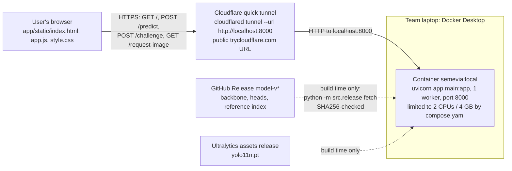
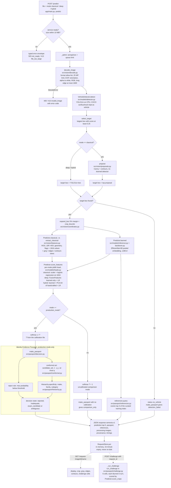
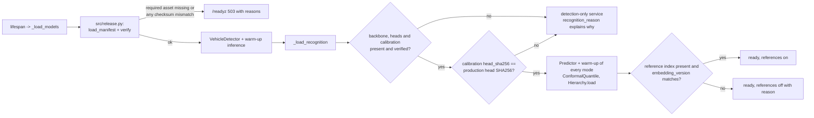
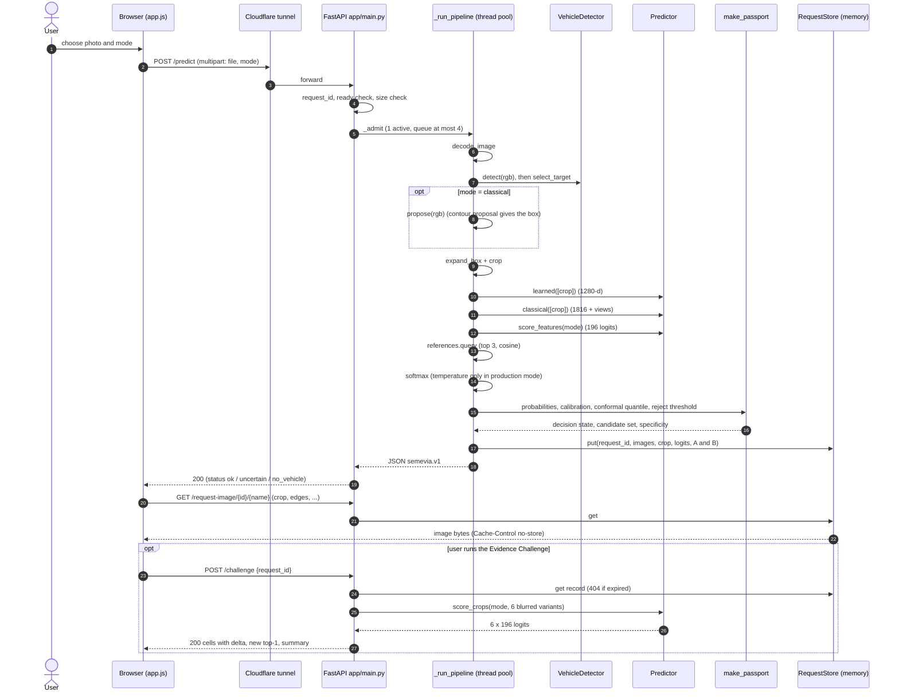
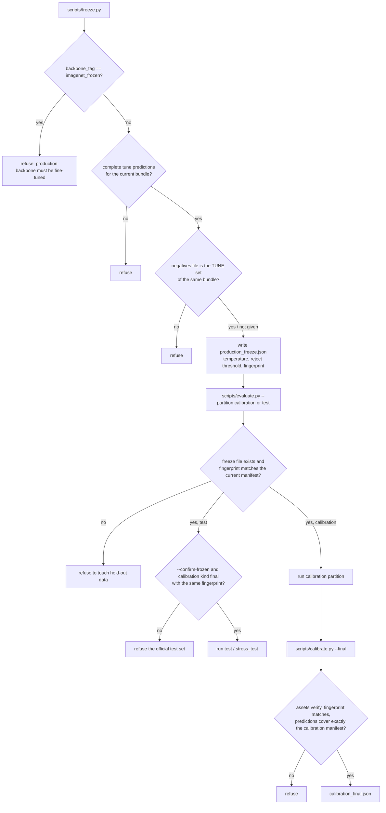
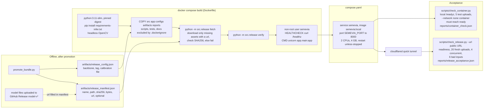

# SEMEVIA architecture

This document describes how SEMEVIA is built, using the code on branch `semevia/implementation`. Every box in
the diagrams below is a real file or function. When a diagram names a function, it is written as
`file.py: function`. No metric values appear here: results are in [eval_P5_T35.md](../eval_P5_T35.md), which
`scripts/report.py` generates from the JSON files in [reports/](../reports/).

**Release iterations.**

* **r2** is the current release. It is run `effb0_r2` (`configs/train_v2.yaml`: full-network fine-tuning with a
  cosine learning rate and label smoothing 0.1), backbone tag `ckpt_4f3584f597d5`, release bundle
  `ft_ckpt_4f3584f597d5_9662c2e703` (the bundle at the freeze was `ft_ckpt_4f3584f597d5_c13883508a`), with its
  model files on GitHub Release `model-v2`. Every step from `cache_features.py` onwards in
  [section 4](#4-offline-training-and-evaluation-pipeline) was run again for r2: heads, development calibration,
  a freeze whose reject threshold uses the 40 tune negatives (`negatives_used: true` in
  `artifacts/production_freeze.json`), final calibration, a single test run, stress, analysis and the 40
  held-out negatives. The production mode is hybrid. r2 is what the live container serves.
* **r1** (`configs/train.yaml`, run `effb0_r1`, last-stage fine-tuning, tag `ckpt_2339418979e1`, bundle
  `ft_ckpt_2339418979e1_0920511710`, GitHub Release `model-v1`) was frozen, evaluated once on test and deployed
  first. It is superseded. Its freeze, calibration files, release config and release manifest are archived in
  [artifacts/history/r1/](../artifacts/history/r1/), and its test reports stay in
  `reports/*_ft_ckpt_2339418979e1_0920511710.json`.
* r2 was designed after r1's test result was known. The decision that r2 replaces r1 whatever its result was
  committed in [NEXT.md](../NEXT.md) ("Iteration r2 decision record") before r2's test run. The test split was
  therefore evaluated once per iteration, twice in total. Both iterations are listed under "Model iterations"
  in [eval_P5_T35.md](../eval_P5_T35.md). The architecture is the same for both; only the trained files and
  reports differ.

The release in service at any moment is the one named in
[artifacts/release_manifest.json](../artifacts/release_manifest.json) (`bundle_id`) and
[artifacts/release_config.json](../artifacts/release_config.json).

Contents:

1. [System context](#1-system-context)
2. [Runtime request flow](#2-runtime-request-flow)
3. [Sequence of one upload](#3-sequence-of-one-upload)
4. [Offline training and evaluation pipeline](#4-offline-training-and-evaluation-pipeline)
5. [Data partitions and the freeze guard](#5-data-partitions-and-the-freeze-guard)
6. [Deployment and release](#6-deployment-and-release)
7. [Module map](#7-module-map)
8. [Known architectural limitations](#8-known-architectural-limitations)

---

## 1. System context

* The browser talks only to the container, through the tunnel. The container never downloads anything at run
  time: `src/release.py` fetches release files during `docker build`, and readiness fails if a file is missing
  or has the wrong SHA256.
* The trained files are not stored in Git. Their URLs and SHA256 hashes are listed in
  `artifacts/release_manifest.json`. For the current release (r2) they are on GitHub Release `model-v2`; the
  superseded r1 files stay on `model-v1`. `calibration_final.json`
  has no URL because it is stored in Git (`"in_git": true`).
* Hosting details and the reason for this choice (Hugging Face Docker Spaces returned `402 Payment Required`)
  are in [docs/hosting_lock.md](hosting_lock.md). The public URL works only while the laptop, Docker Desktop and
  `cloudflared` are all running.

## 2. Runtime request flow

All of this lives in `app/main.py`. `_run_pipeline` handles `POST /predict` and `_run_challenge` handles
`POST /challenge`. Both run in a thread pool behind `_admit`, which lets one job run at a time
(`server.max_active_jobs: 1`) and allows at most 4 waiting jobs (`server.max_queue: 4`, `configs/runtime.yaml`).
When the queue is full the service answers `503 busy`.

Notes on the flow, each checked against the code:

* **Detection always runs.** YOLO11n output is reported in every mode. In classical mode the crop comes from
  the contour proposal, not from YOLO11n, so that path uses no learned model at all.
* **One embedding per upload.** `_run_pipeline` calls `Predictor.learned` once whenever an encoder is loaded, also
  in classical mode. The same vector feeds the head (deep and hybrid) and the reference search.
* **Heads.** Each head is a scikit-learn pipeline stored as joblib. Deep and hybrid receive the row
  `[1280 learned | 1816 handcrafted]`. `FusionFeatures` (`src/models/heads.py`) picks the branches. The hybrid
  handcrafted branch is standardised, reduced by PCA to 64 components and standardised again.
  `canonical_logits` puts the logit columns in class-id order 0..195.
* **Temperature and the Passport apply only to the production mode** named in the calibration file. The other
  two modes are shown with plain softmax, and their Passport state is `comparison_only`.
* **Passport precedence** (`src/passport/decision.py`): `detection_failed` -> `comparison_only` -> `rejected` ->
  `inadequate` (empty set, or no shared make) -> `exact_candidate` (one candidate) / `ambiguous`. Rejection does
  not remove labels from the conformal set. These are separate objects. When the state is `rejected` or
  `inadequate`, the top-level `status` becomes `uncertain`.
* **References** come from up to 3 training images per class (`build_index`). They are used only when
  `embedding_version` equals the running encoder's version string. Each item shows the sample key, the class
  name and the cosine similarity. **No thumbnails are shown.** Stanford Cars images are licensed for
  non-commercial research only, so the team decided that references show identifiers, labels and similarity
  only (`reference_thumbnails: false` in `configs/runtime.yaml`, `thumbnail=None` in `app/main.py`).
* **Evidence Challenge** (`src/passport/challenge.py`). The crop is split into 2 x 3 cells. Each variant blurs one
  cell, and all six go through `Predictor.score_crops` for the same mode, which recomputes both branches. The
  result for cell r is `delta_r`, the drop in the logit margin between the top class A and the runner-up B.
  This measures how sensitive the prediction is to hiding that cell. It does not show which car part matters.
  The result is cached on the request record, so repeating the request returns the same answer.
* **Other endpoints.** `GET /healthz` (process alive), `GET /readyz` (assets verified, warm-up done, which modes
  work), `GET /benchmarks` (saved test reports for the bundle being served; not per-upload accuracy), `GET /`
  (the page).
* `cnn_diagnostic` in the response is always `unavailable` ("optional; not implemented").

### Start-up and readiness

`src/release.py: recognition_config` reads `configs/runtime.yaml` and then applies the overrides in
`artifacts/release_config.json`, which `scripts/promote_bundle.py` writes. These overrides set the backbone
file, its tag and status text, the calibration file and the precision. The encoder runs in PyTorch unless
`encoder_runtime` (or the `SEMEVIA_ENCODER_RUNTIME` environment variable) is `onnx_fp32` and the ONNX file is
in the build. The current release uses `torch`.

## 3. Sequence of one upload

## 4. Offline training and evaluation pipeline

The scripts run in this order. Each one reads and writes versioned files: manifests carry a SHA256, caches
carry a sidecar that `src/models/cache_io.py: load_cache` checks, and reports carry the bundle id. Colours show
which data a step may read.

```mermaid
flowchart TD
    classDef dev fill:#e3f2fd,stroke:#1565c0,color:#000
    classDef freeze fill:#fff3e0,stroke:#ef6c00,color:#000
    classDef held fill:#fce4ec,stroke:#ad1457,color:#000
    classDef rep fill:#eeeeee,stroke:#616161,color:#000

    S1["1 prepare_data.py<br/>audit + frozen split manifests"]:::dev
    S2["2 declare_subsets.py<br/>stress and viewpoint keys only"]:::dev
    S3["3 train.py<br/>EfficientNet-B0 fine-tuning, GPU PC"]:::dev
    S4["4 cache_features.py<br/>classical + learned caches, annotation crops"]:::dev
    S5["5 fit_heads.py<br/>classical, deep, hybrid, ablations"]:::dev
    S6["6 calibrate.py --development<br/>dev temperature / threshold / quantile"]:::dev
    S7["7 build_references.py<br/>curated training index"]:::dev
    S8["8 promote_bundle.py<br/>release folder + manifest + release_config"]:::dev
    S9["9 optimize.py / optimize_head.py<br/>ONNX FP32 and INT8 trials"]:::dev
    S10["10 evaluate.py --partition tune<br/>end-to-end on tune"]:::dev
    S11["11 evaluate_negatives.py --partition tune<br/>40 tune negatives"]:::dev
    S12["12 freeze.py --negatives ...<br/>production_freeze.json + model fingerprint"]:::freeze
    S13["13 evaluate.py --partition calibration"]:::held
    S14["14 calibrate.py --final<br/>calibration_final.json"]:::held
    S15["15 promote_bundle.py --calibration<br/>artifacts/calibration_final.json"]:::freeze
    S16["16 evaluate.py --partition test --confirm-frozen<br/>+ --subset stress_test --condition x 7"]:::held
    S17["17 report_robustness.py --subset stress_test"]:::rep
    S18["18 analyze_results.py --partition test<br/>viewpoints + rule-based failures"]:::held
    S19["19 evaluate_negatives.py --partition test<br/>40 held-out negatives"]:::held
    S20["20 report.py --team-id T35<br/>writes eval_P5_T35.md"]:::rep

    S1 --> S2 --> S3 --> S4 --> S5 --> S6 --> S7 --> S8 --> S9 --> S10 --> S11 --> S12
    S12 --> S13 --> S14 --> S15 --> S16 --> S17 --> S18 --> S19 --> S20
```

Blue: train and tune only. Orange: freeze / promotion (writes no new predictions). Pink: held-out data,
locked until the freeze. Grey: reads reports only.

| # | Script | What it does | Data it may read | Main outputs |
|---|---|---|---|---|
| 1 | `scripts/prepare_data.py` | Checks published checksums, decodes every image, audits boxes and duplicates, assigns partitions (`src/data/manifest.py: assign_partitions`), fails if partitions overlap | all raw Stanford Cars files (audit only) | `artifacts/manifests/*_m1.csv`, `manifest_index.json`, `artifacts/class_metadata.json`, `reports/data_audit.json` |
| 2 | `scripts/declare_subsets.py` | Fixes stress and viewpoint subsets by seed. No model output is read | manifest keys and labels of test and tune | `stress_test_m1.csv` (392 = 2 per class), `stress_tune_m1.csv`, `viewpoint_test_m1.csv` (60), `subsets_index.json` |
| 3 | `scripts/train.py` -> `src/models/training.py: run` | Head stage, then a fine-tuning stage. r1 unfreezes `features.7`/`features.8`. r2 unfreezes all of `features` with a cosine LR and label smoothing | train (fitting), tune (model selection, early stopping) | `runs/<run>/best_finetuned.pt` in the artifact store, `reports/training/*` |
| 4 | `scripts/cache_features.py` | 1816-d classical and 1280-d learned features on annotation crops, tagged `ckpt_<sha12>` | train, tune | feature caches in the artifact store |
| 5 | `scripts/fit_heads.py` | Logistic-regression heads. C is chosen from a fixed grid by tune top-1. Scalers and PCA are fit on train rows only | train, tune | head joblibs, `reports/classical_tune.json`, `reports/heads_tune_<tag>.json` |
| 6 | `scripts/calibrate.py --development` | Development temperature, threshold and quantile from tune predictions | tune | `artifacts/development_calibration.json` (`kind: development`) |
| 7 | `scripts/build_references.py` | 3 training images per class nearest the class centroid. `validate_index` refuses any tune, calibration or test key | train (index), tune (retrieval diagnostic) | `artifacts/store/release/reference_index.npz/.json`, `reports/references_tune_<tag>.json` |
| 8 | `scripts/promote_bundle.py` | Copies backbone and heads into the release folder (head hashes checked against the reports), writes the manifest and `release_config.json` | none (model files only) | `artifacts/release_manifest.json`, `artifacts/release_config.json` |
| 9 | `scripts/optimize.py`, `scripts/optimize_head.py` | ONNX FP32 parity; static and dynamic INT8 encoder; INT8 linear head. A variant is kept only if the tune top-1 drop is at most 1.0 point | train (128 INT8 calibration crops), tune | `reports/optimization_<tag>.json`, `reports/optimization_head_hybrid_<tag>.json` |
| 10 | `scripts/evaluate.py --partition tune` | Whole deployed pipeline on tune: detection, crop, all three heads | tune | `reports/e2e_tune_<bundle>.json`, predictions JSONL |
| 11 | `scripts/evaluate_negatives.py --partition tune` | Unsupported images through the deployed pipeline | `artifacts/negative_manifests/negatives_tune.csv` (40) | `reports/negatives_tune_<bundle>.json` |
| 12 | `scripts/freeze.py --mode <mode> --negatives ...` | Fits the temperature on matched-primary tune rows and picks the reject threshold (`src/passport/calibration.py: choose_reject_threshold`). Records the model fingerprint | tune predictions, tune negatives | `artifacts/production_freeze.json` |
| 13 | `scripts/evaluate.py --partition calibration` | Frozen pipeline on the untouched calibration partition | calibration (locked until step 12) | calibration predictions JSONL |
| 14 | `scripts/calibrate.py --final` | Conformal quantile from every calibration input. A detection failure gets the uniform fallback score 1 - 1/196 | calibration predictions | `artifacts/calibration_final.json` (`kind: final`) |
| 15 | `scripts/promote_bundle.py --calibration artifacts/calibration_final.json` | Re-promotes with the final calibration. The model fingerprint stays the same because calibration files are not part of it | none | new `bundle_id` in the manifest |
| 16 | `scripts/evaluate.py --partition test --resume --confirm-frozen`, then `--subset stress_test --condition <c>` for the 7 conditions in `configs/evaluation.yaml` | Single official test run and stress runs | test (8,041), stress_test (392) | `reports/e2e_test_<bundle>.json`, `reports/e2e_stress_test_<c>_<bundle>.json` |
| 17 | `scripts/report_robustness.py --subset stress_test` | Compares each condition with clean on the same images | reports only | `reports/robustness_stress_test_<bundle>.json/.md` |
| 18 | `scripts/analyze_results.py --partition test` | Viewpoint subgroups (60 labelled photos) and rule-based failure cases with an annotation-crop check | test predictions, `reports/viewpoint_labels.csv`, failure images | `reports/analysis_test_<bundle>.json` |
| 19 | `scripts/evaluate_negatives.py --partition test` | Held-out unsupported images | `negatives_test.csv` (40; locked until a freeze file exists) | `reports/negatives_test_<bundle>.json` |
| 20 | `scripts/report.py --team-id T35 --usns ... [--readme]` | Builds the evaluation file. Reports are chosen by bundle id and backbone tag, never by "latest file". It lists earlier releases archived under `artifacts/history/*/` (r1 is in `artifacts/history/r1/`) | reports and artifacts only | `eval_P5_T35.md` (and the README results block) |

Side steps:

* `scripts/evaluate_detector.py --partition tune` measures the frozen YOLO11n detector alone and writes
  `reports/detector_tune.json`.
* `python -m src.models.export_onnx` makes a parity-checked FP32 ONNX encoder (optional; unused by the current
  release).
* `scripts/evaluate.py --subset stress_tune` checks the stress tooling on tune data.

The viewpoint labels were made by an agent before any test result existed. A blind second pass by six
separate agents is recorded in [reports/viewpoint_label_check.json](../reports/viewpoint_label_check.json).
Neither pass is a human review.

## 5. Data partitions and the freeze guard

The official Stanford Cars train split (8,144 images) is divided into three partitions by
`src/data/manifest.py: assign_partitions`, seed `20261106`. The official test split (8,041 images) stays
whole.

| Partition | Images | Source | May be read by | Never used for |
|---|---|---|---|---|
| train | 6,514 | official train | network training, scalers, PCA, heads, reference index, INT8 calibration crops | any selection or reported score |
| tune | 815 (all 196 classes, stratified) | official train | checkpoint selection, head C, production mode, temperature, reject threshold, development calibration | final claims |
| calibration | 815 (seeded random) | official train | the final conformal quantile only, after the freeze | fitting or selection |
| test | 8,041 | official test | one final evaluation after the freeze, plus the predeclared stress (392) and viewpoint (60) subsets | anything before the freeze |
| negatives tune | 40 (10 per bucket) | Wikimedia Commons, licence per row | reject-threshold choice in `freeze.py` | final claims |
| negatives test | 40 (10 per bucket) | Wikimedia Commons, licence per row | held-out unsupported-input rate | selection |

The negative suite (80 = 40 + 40) has four buckets (`non_vehicle`, `two_wheeler`, `unsupported_vehicle_type`,
`unlisted_car_model`; `scripts/evaluate_negatives.py: BUCKETS`). Each row lists its source URL, licence and
author: [artifacts/negative_manifests/](../artifacts/negative_manifests/), see also
[docs/negative_suite.md](negative_suite.md).

### Freeze guard

The freeze is a file, `artifacts/production_freeze.json`. Its key field is `model_fingerprint`, computed by
`src/passport/calibration.py: model_fingerprint`: a hash over the names and SHA256 of every `.pt`, `.pth` and
`.joblib` asset (plus the ONNX encoder when it is used), the production mode and the encoder runtime. Any change
to the detector, backbone or heads changes the fingerprint, and the held-out steps then refuse to run.

Other guards in the code:

* `scripts/prepare_data.py` stops if any two partitions share an image key, or if train or tune is missing a
  class.
* `scripts/fit_heads.py` stops if train and tune keys overlap.
* `src/passport/references.py: validate_index` stops if the reference index holds a non-training key.
* `scripts/promote_bundle.py` refuses a checkpoint with no completed fine-tuning epoch and a calibration file
  made for a different backbone. It also checks each head's SHA256 against its report.
* `app/main.py: _load_recognition` turns recognition off if the calibration's `head_sha256` is not the
  production head's hash. It turns references off if the index's `embedding_version` differs from the encoder's.
* `scripts/evaluate_negatives.py --partition test` only checks that a freeze file exists. It does not compare
  fingerprints.

These rules are tested with fixtures in `tests/test_calibration_freeze.py`, `tests/test_reference_index.py` and
`tests/test_bundle_parity.py`.

## 6. Deployment and release

* `src/release.py: fetch` skips files already present with the right hash. If an optional file has no URL it
  skips it, and the service then runs detection-only and says so. A required file with no URL stops the build.
  `verify` is also called by the app at start-up (see section 2).
* `.dockerignore` keeps `artifacts/store/release` in the build context and excludes the rest of the artifact
  store, datasets, `scripts/`, `tests/` and `docs/`. The image holds no training data.
* `scripts/check_container.py` proves the image works with no network. `scripts/check_release.py` measures the
  public URL from outside. Their results are in
  [reports/container_check.json](../reports/container_check.json) and
  [reports/release_acceptance.json](../reports/release_acceptance.json); deployed latency is reported in
  [eval_P5_T35.md](../eval_P5_T35.md).
* `scripts/prepare_hf_space.py` packages the same Dockerfile for a Hugging Face Docker Space. That host was not
  used (see `docs/hosting_lock.md`).

## 7. Module map

| Path | Responsibility |
|---|---|
| `app/main.py` | FastAPI service: start-up and readiness, `/predict` pipeline, `/challenge`, `/request-image`, `/benchmarks`, `/healthz`, `/readyz`; in-memory `RequestStore`; admission control |
| `app/static/index.html`, `app.js`, `style.css` | Single-page UI: upload, mode choice, Passport, references, processing views, challenge, raw JSON view, Passport snapshot download (hashes and coordinates, no pixels) |
| `src/vision/decode.py` | `decode_image`: bounded, typed-error upload decoding to canonical RGB (EXIF applied, resized to long edge 1600) |
| `src/vision/coordinates.py` | Canonical box convention (0-based, half-open), `iou`, `expand_box`, `crop_bounds`, Stanford conversion |
| `src/vision/proposals.py` | `propose`: classical contour ROI proposal used by classical mode |
| `src/vision/features.py` | `extract_classical`: HOG 1764, LBP 10, HSV 32, geometry 8, flags 2 = 1816; processing views |
| `src/models/detector.py` | `VehicleDetector` (YOLO11n on CPU, car/bus/truck to vehicle), `select_target` (largest box with score at least 0.25) |
| `src/models/backbone.py` | EfficientNet-B0 build, `crop_to_tensor` (224 squash, ImageNet normalisation), `embed_and_logits` (1280-d), freezing helpers |
| `src/models/training.py` | Resumable staged training, augmentation, cosine schedule, label smoothing, `best_finetuned.pt` |
| `src/models/heads.py` | `FusionFeatures` (branch scaling, PCA 64), `canonical_logits`, `softmax`, `topk_accuracy` |
| `src/models/inference.py` | `Predictor`, `CropInput`: one scoring path shared by the app, evaluation, negatives and the challenge |
| `src/models/cache_io.py` | Versioned feature caches with sidecar checks; `store_dir` (`SEMEVIA_ARTIFACT_STORE`) |
| `src/models/export_onnx.py` | Optional parity-gated ONNX FP32 encoder export |
| `src/passport/decision.py` | `make_passport`: decision state and reason codes |
| `src/passport/conformal.py` | Split-conformal quantile (`calibrate`), `candidate_set`, failure set |
| `src/passport/hierarchy.py` | Make -> family -> category hierarchy and set specificity |
| `src/passport/calibration.py` | `fit_temperature`, `choose_reject_threshold`, `final_conformal_scores`, `model_fingerprint` |
| `src/passport/references.py` | Curated training-reference index: build, validate, save, load, `query` |
| `src/passport/challenge.py` | Six-cell blur Evidence Challenge and its summary |
| `src/release.py` | Release manifest: `fetch` (build time), `verify` / `asset_status` (readiness), `recognition_config` |
| `src/data/manifest.py`, `metadata.py`, `crops.py` | Annotation loading, audit, partitions, manifests; class metadata and families; dataset crops |
| `src/evaluation/metrics.py` | Metrics with explicit numerators and denominators (top-k, localisation, COCO AP, ECE, NLL, set metrics) |
| `src/evaluation/stress.py` | Stress conditions (brightness, downsample, occlusion) and stratified subsets |
| `src/evaluation/analysis.py` | Viewpoint subgroup tables and rule-based failure selection |
| `src/evaluation/hardware.py` | CPU label for timing reports |
| `scripts/*.py` | Offline pipeline steps (section 4) and deployment checks (section 6) |
| `configs/data.yaml`, `train.yaml`, `train_v2.yaml`, `features.yaml`, `heads.yaml`, `calibration.yaml`, `evaluation.yaml`, `runtime.yaml` | Fixed settings: data and splits, the r1 and r2 training recipes, feature contract, head grids, calibration targets, stress and viewpoint subsets, runtime limits |
| `artifacts/manifests/`, `artifacts/negative_manifests/` | Frozen split and subset manifests; negative suite sources |
| `artifacts/release_manifest.json`, `release_config.json`, `production_freeze.json`, `calibration_final.json`, `class_metadata.json` | Release definition, freeze record, final calibration, class hierarchy |
| `Dockerfile`, `compose.yaml`, `.dockerignore`, `requirements-infer.txt` | Inference image and how it runs |
| `tests/` | Fixture and contract tests for data, coordinates, features, detector policy, Passport, calibration and freeze, references, challenge, upload, prediction contract, bundle parity |

## 8. Known architectural limitations

* **Dataset scope.** Stanford Cars covers 196 categories up to model year 2012. Newer cars and unlisted models
  can only be "closest known category" or be rejected. The data audit
  ([reports/data_audit.json](../reports/data_audit.json)) found exact duplicate images with conflicting labels.
  They are recorded, not removed, so the official populations stay unchanged.
* **Hosting depends on one laptop.** The quick-tunnel URL changes whenever `cloudflared` restarts, and it works
  only while the laptop is on and online. Cloudflare gives no uptime guarantee for quick tunnels.
* **No reference thumbnails.** Licence decision explained in section 2; the app states the same reason.
* **Agent-made labels.** Both the viewpoint labels and the blind second pass were made by agents, not humans.
* **INT8 encoder not used.** All INT8 encoder variants failed the project's accuracy policy
  (`int8_passes_policy` in `reports/optimization_<tag>.json`), so the release runs the FP32 PyTorch encoder.
* **Single worker.** One job runs at a time with a short queue, so heavy concurrent use gets `503 busy` rather
  than slow answers.
* **Negatives are a small stress set.** 80 images in four buckets. They do not measure open-world behaviour.
  The held-out negative step checks that a freeze exists but not its fingerprint.
* **Challenge cells are geometric**, not car parts. A positive `delta` means the prediction is sensitive to that
  region under blur. It does not prove the region identifies the car.
