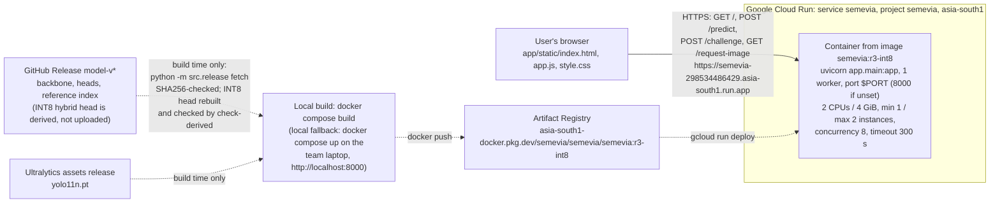
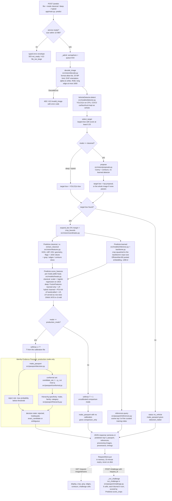
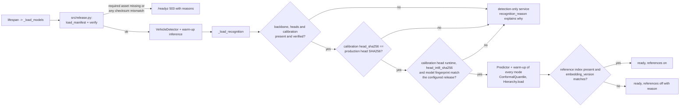
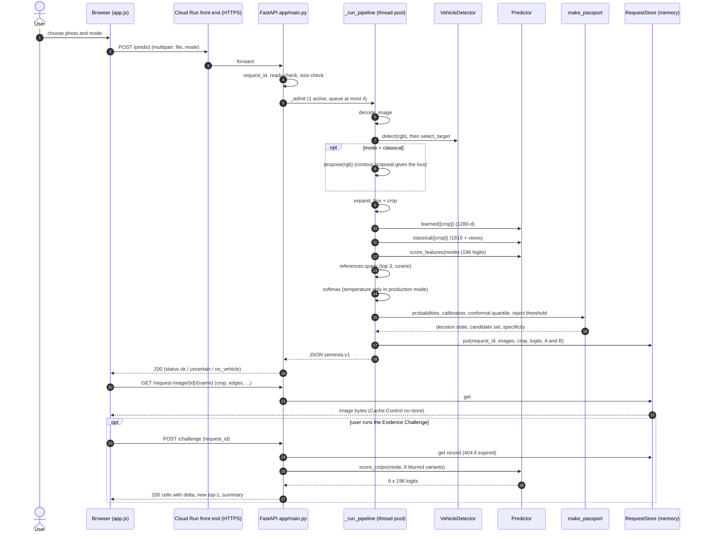
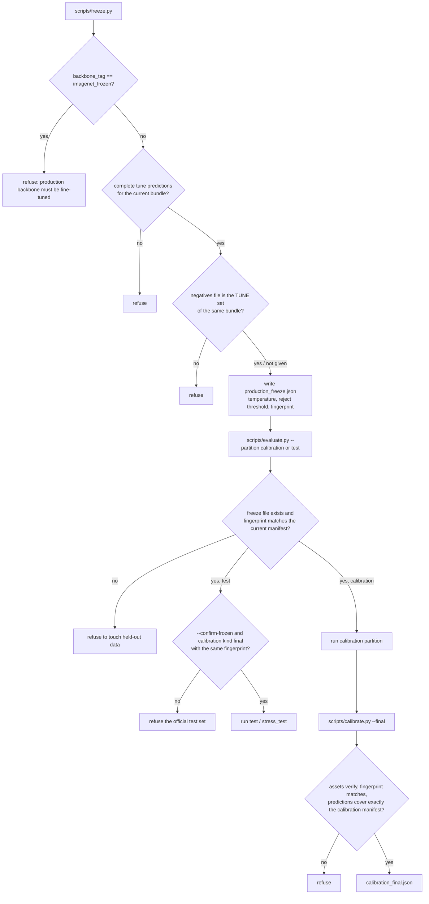
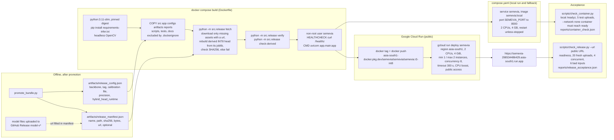

# SEMEVIA architecture

This document describes how SEMEVIA is built, using the code on branch `semevia/implementation`. Every box in
the diagrams below is a real file or function. When a diagram names a function, it is written as
`file.py: function`. No metric values appear here: results are in [eval_P5_T35.md](../eval_P5_T35.md), which
`scripts/report.py` generates from the JSON files in [reports/](../reports/).

**Release iterations.**

* **r3-int8** is the current release. It is r3 (backbone tag `ckpt_98b1fb55cc6e`, run `effb0_r3`, 320 px) with
  one change: the final logistic layer of the hybrid (production) head is served as a row-wise ONNX INT8 graph
  (onnxruntime `quantize_dynamic`, QInt8 weights). Release bundle `ft_ckpt_98b1fb55cc6e_f3734d4f40`; the bundle
  at the freeze was `ft_ckpt_98b1fb55cc6e_0d835360cc`. The INT8 file `head_hybrid_int8.onnx` is not uploaded
  anywhere. `src/models/head_onnx.py` derives it deterministically from the published `head_hybrid.joblib`, the
  manifest pins its sha256 (`6acf0061...`), and the Docker build rebuilds and checks it (section 6). The encoder
  stays PyTorch FP32 (`precision: fp32`); the deep and classical heads and the fusion transform (scalers, PCA)
  stay scikit-learn FP32. For r3-int8 the tune evaluation, tune negatives, freeze (temperature and reject
  threshold from INT8 logits), calibration run and final calibration were redone, followed by a single test
  run, stress, analysis and the 40 held-out negatives. The ground-truth-crop protocol was not re-run, as
  pre-registered; the result shown in [eval_P5_T35.md](../eval_P5_T35.md) is r3 FP32's
  ([reports/oracle_test_ft_ckpt_98b1fb55cc6e_5d755416fd.json](../reports/oracle_test_ft_ckpt_98b1fb55cc6e_5d755416fd.json)).
  The production mode is hybrid. r3-int8 is what the live container serves.
* **r3** (FP32) is run `effb0_r3` (`configs/train_v3.yaml`: r2's full-network recipe with the encoder input
  raised from 224 px to 320 px, same seed and data), backbone tag `ckpt_98b1fb55cc6e`, bundle
  `ft_ckpt_98b1fb55cc6e_5d755416fd` (the bundle at its freeze was `ft_ckpt_98b1fb55cc6e_f99e386191`). Its model
  files are on GitHub Release `model-v3` (URLs in `artifacts/release_manifest.json`); r3-int8 reuses them.
  Every step from `cache_features.py` onwards in [section 4](#4-offline-training-and-evaluation-pipeline) was
  run for r3: heads, development calibration, a freeze whose reject threshold uses the 40 tune negatives
  (`negatives_used: true` in `artifacts/history/r3/production_freeze.json`), final calibration, a single test
  run, stress, analysis, the 40 held-out negatives and the standard ground-truth-crop protocol
  (`scripts/evaluate_oracle.py`).
  It is superseded. Its freeze, calibration files, release config and manifest are archived in
  [artifacts/history/r3/](../artifacts/history/r3/), and its test reports stay in
  `reports/*_ft_ckpt_98b1fb55cc6e_5d755416fd.*`; they remain valid for r3.
* **r2** (`configs/train_v2.yaml`, run `effb0_r2`, full-network fine-tuning at 224 px, tag `ckpt_4f3584f597d5`,
  bundle `ft_ckpt_4f3584f597d5_9662c2e703`, GitHub Release `model-v2`) was frozen with the tune negatives,
  evaluated once on test and deployed. It is superseded; its freeze, calibration files, release config and
  manifest are archived in [artifacts/history/r2/](../artifacts/history/r2/), and its test reports stay in
  `reports/*_ft_ckpt_4f3584f597d5_9662c2e703.*`.
* **r1** (`configs/train.yaml`, run `effb0_r1`, last-stage fine-tuning at 224 px, tag `ckpt_2339418979e1`, bundle
  `ft_ckpt_2339418979e1_0920511710`, GitHub Release `model-v1`) was frozen, evaluated once on test and deployed
  first. It is superseded. Its files are archived in [artifacts/history/r1/](../artifacts/history/r1/), and its
  test reports stay in `reports/*_ft_ckpt_2339418979e1_0920511710.json`.
* Each later iteration was designed after the earlier test result was known, so each was pre-registered in
  [NEXT.md](../NEXT.md) before its own test run: "Iteration r2 decision record" (r2 replaces r1 whatever its
  result), "Iteration r3 decision record" (r3 replaces r2 only if a tune-split rule is met; otherwise r3 never
  touches test) and "Iteration r3-int8 decision record" (committed before any per-image, end-to-end,
  calibration or test INT8 number existed; r3-int8 replaces r3 FP32 whatever its test result once five pipeline
  checks pass, and all five passed). The test split was therefore evaluated end to end once per iteration, four
  times in total (r1, r2, r3, r3-int8; files `reports/e2e_test_*.json`). The standard-protocol (ground-truth
  crop) test run was made twice, for r2 (after its result was known) and for r3 (files
  `reports/oracle_test_*.json`). The 392-image stress subset was run for four bundles and the 40 held-out
  negatives for three (`reports/robustness_stress_test_*.json`, `reports/negatives_test_*.json`). All of this is
  disclosed in the status line of [eval_P5_T35.md](../eval_P5_T35.md), and all four iterations are listed under
  "Model iterations" there. The architecture is the same for all of them. r3 differs from r1 and r2 in its
  trained files, reports and the encoder input size, which travels with the backbone file (section 2, "Encoder
  input size"). r3-int8 differs from r3 only in the hybrid head runtime (section 2, "Hybrid head runtime").

The release in service at any moment is the one named in
[artifacts/release_manifest.json](../artifacts/release_manifest.json) (`bundle_id`) and
[artifacts/release_config.json](../artifacts/release_config.json).

Contents:

1. [System context](#1-system-context)
2. [Runtime request flow](#2-runtime-request-flow)
3. [Sequence of one upload](#3-sequence-of-one-upload)
4. [Offline training and evaluation pipeline](#4-offline-training-and-evaluation-pipeline)
5. [Data partitions and the freeze guard](#5-data-partitions-and-the-freeze-guard)
6. [Deployment and release](#6-deployment-and-release)
7. [Module map](#7-module-map)
8. [Known architectural limitations](#8-known-architectural-limitations)

---

## 1. System context

* The browser talks only to the container, through the Cloud Run HTTPS URL. The container never downloads
  anything at run time: `src/release.py` fetches release files during `docker build`, and readiness fails if a
  file is missing or has the wrong SHA256.
* The trained files are not stored in Git. Their URLs and SHA256 hashes are listed in
  `artifacts/release_manifest.json`. The current release (r3-int8) uses the r3 files on GitHub Release
  `model-v3`; the superseded r2 and r1 files stay on `model-v2` and `model-v1`. `calibration_final.json` has no
  URL because it is stored in Git (`"in_git": true`). `head_hybrid_int8.onnx` has no URL either: its manifest
  entry names `derived_from: head_hybrid.joblib` with that file's sha256 and the build recipe, and
  `src/release.py: fetch` rebuilds it from the verified joblib.
* The public app runs on Google Cloud Run at <https://semevia-298534486429.asia-south1.run.app>. It no longer
  depends on the team laptop, and the URL stays the same across redeploys. One minimum instance keeps the models
  loaded. Hosting details, the redeploy steps and the options considered are in
  [docs/hosting_lock.md](hosting_lock.md). Until 2026-11-07 the app was served from the team laptop through a
  Cloudflare quick tunnel; Hugging Face Docker Spaces returned `402 Payment Required`. The local fallback is
  `docker compose up` on the laptop at <http://localhost:8000>.

## 2. Runtime request flow

All of this lives in `app/main.py`. `_run_pipeline` handles `POST /predict` and `_run_challenge` handles
`POST /challenge`. Both run in a thread pool behind `_admit`, which lets one job run at a time
(`server.max_active_jobs: 1`) and allows at most 4 waiting jobs (`server.max_queue: 4`, `configs/runtime.yaml`).
When the queue is full the service answers `503 busy`.

Notes on the flow, each checked against the code:

* **Detection always runs.** YOLO11n output is reported in every mode. In classical mode the crop comes from
  the contour proposal, not from YOLO11n, so that path uses no learned model at all. If no contour box passes
  the proposal filters, the app classifies the whole image instead of stopping and says so
  (`classical_proposal.fallback: "whole_image"`). The evaluated classical baseline is unchanged: there a missing
  proposal counts as a failure.
* **One embedding per upload.** `_run_pipeline` calls `Predictor.learned` once whenever an encoder is loaded, also
  in classical mode. The same vector feeds the head (deep and hybrid) and the reference search.
* **Heads.** Each head is a scikit-learn pipeline stored as joblib. Deep and hybrid receive the row
  `[1280 learned | 1816 handcrafted]`. `FusionFeatures` (`src/models/heads.py`) picks the branches. The hybrid
  handcrafted branch is standardised, reduced by PCA to 64 components and standardised again.
  `canonical_logits` puts the logit columns in class-id order 0..195. In the current release the hybrid head's
  final logistic layer runs as an ONNX INT8 graph instead (see "Hybrid head runtime" below).
* **Temperature and the Passport apply only to the production mode** named in the calibration file. The other
  two modes are shown with plain softmax, and their Passport state is `comparison_only`.
* **Passport precedence** (`src/passport/decision.py`): `detection_failed` -> `comparison_only` -> `rejected` ->
  `inadequate` (empty set, or no shared make) -> `exact_candidate` (one candidate) / `ambiguous`. Rejection does
  not remove labels from the conformal set. These are separate objects. When the state is `rejected` or
  `inadequate`, the top-level `status` becomes `uncertain`.
* **References** come from up to 3 training images per class (`build_index`). They are used only when
  `embedding_version` equals the running encoder's version string. Each item shows the sample key, the class
  name and the cosine similarity. **No thumbnails are shown.** Stanford Cars images are licensed for
  non-commercial research only, so the team decided that references show identifiers, labels and similarity
  only (`reference_thumbnails: false` in `configs/runtime.yaml`, `thumbnail=None` in `app/main.py`).
* **Evidence Challenge** (`src/passport/challenge.py`). The crop is split into 2 x 3 cells. Each variant blurs one
  cell, and all six go through `Predictor.score_crops` for the same mode, which recomputes both branches. The
  result for cell r is `delta_r`, the drop in the logit margin between the top class A and the runner-up B.
  This measures how sensitive the prediction is to hiding that cell. It does not show which car part matters.
  The result is cached on the request record, so repeating the request returns the same answer.
* **Other endpoints.** `GET /healthz` (process alive), `GET /readyz` (assets verified, warm-up done, which modes
  work, plus `encoder_runtime`, `encoder_precision`, `head_runtime`, `head_int8_sha256` and the first 12
  characters of `model_fingerprint`), `GET /benchmarks` (saved test reports for the bundle being served; not
  per-upload accuracy), `GET /` (the page). Every `/predict` response also carries `provenance.head_runtime`.
* **Page features.** Besides upload and mode choice, the page has a Reset button, a thumbnail of the chosen
  photo, and a "Model comparison" panel. The panel sends the same photo through `POST /predict` once per mode
  (classical, deep, hybrid) and shows each mode's official test results, read from
  `reports/e2e_test_<bundle>.json` through `/benchmarks`.
* `cnn_diagnostic` in the response is always `unavailable` ("optional; not implemented").
* **Example row.** The page offers four one-tap examples (Audi R8, Lamborghini Aventador, 2021 Kia EV6,
  motorcycle), Wikimedia Commons photos served as static files from `app/static/examples/`, with source,
  author and licence in [app/static/examples/credits.json](../app/static/examples/credits.json). They go
  through the same `POST /predict` path as any upload.

### Encoder input size

r1 and r2 run the encoder at 224 px; r3 and r3-int8 run it at 320 px. The size is not a runtime setting: it
travels with the backbone file. `scripts/promote_bundle.py` writes `input_size` into a released backbone whose training
config is not 224 (224 bundles stay byte-identical to the earlier releases), and
`src/models/backbone.py: backbone_input_size` reads it back (released file, else the training checkpoint's
config, else 224). `Predictor` (`src/models/inference.py`), `scripts/cache_features.py`, `scripts/optimize.py`
and `src/models/export_onnx.py` all take the size from there, and `crop_to_tensor` squashes the crop to it.
`preprocess_version(size)` puts the size into the version string (`crop_squash<size>_bilinear_imagenetnorm_v1`),
which is part of the feature-cache sidecars (`src/models/cache_io.py`) and of the app's `encoder_version`, so a
cache or reference index made at another size is refused. This is tested in `tests/test_input_size.py`.

### Hybrid head runtime

The hybrid head runtime is `sklearn` or `onnx_int8` (`src/models/head_onnx.py: RUNTIMES`). `configs/runtime.yaml`
defaults to `sklearn`; `artifacts/release_config.json` sets `hybrid_head_runtime: onnx_int8` for r3-int8.

* **What is INT8.** Only the final logistic layer of the hybrid head. `head_onnx.py` copies its coefficients into
  an ONNX MatMul+Add graph (columns in class-id order 0..195) and quantises it with onnxruntime
  `quantize_dynamic` (QInt8 weights, MatMulInteger). The fusion transform before it (scalers and PCA) stays the
  scikit-learn FP32 one from `head_hybrid.joblib`. The encoder, the detector and the deep and classical heads are
  unchanged.
* **Row-wise scoring.** Dynamic quantisation picks one activation scale per input tensor, so the graph is always
  run one image row at a time. Each image's logits then depend only on that image's features, not on the batch.
* **Deterministic build.** The same joblib gives a byte-identical file, so the manifest pins it by sha256 without
  a separate upload. `python -m src.release fetch` rebuilds it, and `python -m src.release check-derived`
  regenerates it into a temporary file and fails if the bytes differ from the manifest.
* **Wiring.** `Predictor` (`src/models/inference.py`) opens the INT8 graph when `hybrid_head_runtime` is
  `onnx_int8`, and refuses to start without the hybrid joblib and the INT8 file. Prediction rows of
  `scripts/evaluate.py` record the head runtime; `scripts/freeze.py` and `scripts/calibrate.py --final` refuse
  rows made with another runtime (`src/passport/calibration.py: check_rows_runtime`; see section 5).
* **Parity checks.** `tests/test_head_int8.py` compares the INT8 head with the scikit-learn head on real tune
  crops. `scripts/int8_parity_host.py` and `scripts/int8_parity_container.py` compare the host and the container
  on the same fused features of tune crops, computed once on the host
  ([reports/int8_container_parity.json](../reports/int8_container_parity.json)), because INT8 results depend on
  the CPU instruction set.

### Start-up and readiness

`src/release.py: recognition_config` reads `configs/runtime.yaml` and then applies the overrides in
`artifacts/release_config.json`, which `scripts/promote_bundle.py` writes. These overrides set the backbone
file, its tag and status text, the calibration file, the precision (`precision` is the encoder's precision) and
the hybrid head runtime. The encoder runs in PyTorch unless `encoder_runtime` (or the `SEMEVIA_ENCODER_RUNTIME`
environment variable) is `onnx_fp32` and the ONNX file is in the build. The current release uses `torch` with
`precision: fp32` for the encoder and `hybrid_head_runtime: onnx_int8` for the hybrid head. When the head
runtime is `onnx_int8`, `head_hybrid_int8.onnx` is a required file for recognition. The encoder input size is
not among the overrides; it is read from the backbone file (see "Encoder input size" above).

## 3. Sequence of one upload

## 4. Offline training and evaluation pipeline

The scripts run in this order. Each one reads and writes versioned files: manifests carry a SHA256, caches
carry a sidecar that `src/models/cache_io.py: load_cache` checks, and reports carry the bundle id. Colours show
which data a step may read.

```mermaid
flowchart TD
    classDef dev fill:#e3f2fd,stroke:#1565c0,color:#000
    classDef freeze fill:#fff3e0,stroke:#ef6c00,color:#000
    classDef held fill:#fce4ec,stroke:#ad1457,color:#000
    classDef rep fill:#eeeeee,stroke:#616161,color:#000

    S1["1 prepare_data.py<br/>audit + frozen split manifests"]:::dev
    S2["2 declare_subsets.py<br/>stress and viewpoint keys only"]:::dev
    S3["3 train.py<br/>EfficientNet-B0 fine-tuning, GPU PC"]:::dev
    S4["4 cache_features.py<br/>classical + learned caches, annotation crops"]:::dev
    S5["5 fit_heads.py<br/>classical, deep, hybrid, ablations"]:::dev
    S6["6 calibrate.py --development<br/>dev temperature / threshold / quantile"]:::dev
    S7["7 build_references.py<br/>curated training index"]:::dev
    S9["9 optimize.py / optimize_head.py<br/>ONNX FP32 and INT8 trials;<br/>INT8 head sidecar"]:::dev
    S8["8 promote_bundle.py --hybrid-head ...<br/>release folder + manifest + release_config"]:::dev
    S10["10 evaluate.py --partition tune<br/>end-to-end on tune"]:::dev
    S11["11 evaluate_negatives.py --partition tune<br/>40 tune negatives"]:::dev
    S12["12 freeze.py --negatives ...<br/>production_freeze.json + model fingerprint"]:::freeze
    S13["13 evaluate.py --partition calibration"]:::held
    S14["14 calibrate.py --final<br/>calibration_final.json"]:::held
    S15["15 promote_bundle.py --hybrid-head ...<br/>--calibration artifacts/calibration_final.json"]:::freeze
    S16["16 evaluate.py --partition test --confirm-frozen<br/>+ --subset stress_test --condition x 7"]:::held
    S17["17 report_robustness.py --subset stress_test"]:::rep
    S18["18 analyze_results.py --partition test<br/>viewpoints + rule-based failures"]:::held
    S19["19 evaluate_negatives.py --partition test<br/>40 held-out negatives"]:::held
    S19b["19b evaluate_oracle.py --partition test --confirm-frozen<br/>standard protocol: ground-truth crop<br/>(r2 and r3 only)"]:::held
    S20["20 report.py --team-id T35<br/>writes eval_P5_T35.md"]:::rep

    S1 --> S2 --> S3 --> S4 --> S5 --> S6 --> S7 --> S9 --> S8 --> S10 --> S11 --> S12
    S12 --> S13 --> S14 --> S15 --> S16 --> S17 --> S18 --> S19 --> S19b --> S20
```

Blue: train and tune only. Orange: freeze / promotion (writes no new predictions). Pink: held-out data,
locked until the freeze. Grey: reads reports only. Step 9 runs before step 8 because `promote_bundle.py
--hybrid-head onnx_int8` checks the sidecar that `optimize_head.py` writes.

The r3-int8 promotions were `scripts/promote_bundle.py --backbone <ckpt> --hybrid-head onnx_int8 --calibration
artifacts\development_calibration.json` (step 8), then, after the freeze and the final calibration,
`scripts/promote_bundle.py --backbone <ckpt> --hybrid-head onnx_int8 --calibration artifacts\calibration_final.json`
(step 15). `--hybrid-head {sklearn,onnx_int8}` is required on every promotion.

| # | Script | What it does | Data it may read | Main outputs |
|---|---|---|---|---|
| 1 | `scripts/prepare_data.py` | Checks published checksums, decodes every image, audits boxes and duplicates, assigns partitions (`src/data/manifest.py: assign_partitions`), fails if partitions overlap | all raw Stanford Cars files (audit only) | `artifacts/manifests/*_m1.csv`, `manifest_index.json`, `artifacts/class_metadata.json`, `reports/data_audit.json` |
| 2 | `scripts/declare_subsets.py` | Fixes stress and viewpoint subsets by seed. No model output is read | manifest keys and labels of test and tune | `stress_test_m1.csv` (392 = 2 per class), `stress_tune_m1.csv`, `viewpoint_test_m1.csv` (60), `subsets_index.json` |
| 3 | `scripts/train.py` -> `src/models/training.py: run` | Head stage, then a fine-tuning stage. r1 unfreezes `features.7`/`features.8`. r2 unfreezes all of `features` with a cosine LR and label smoothing. r3 is r2's recipe at `input_size: 320` | train (fitting), tune (model selection, early stopping) | `runs/<run>/best_finetuned.pt` in the artifact store, `reports/training/*` |
| 4 | `scripts/cache_features.py` | 1816-d classical and 1280-d learned features on annotation crops, tagged `ckpt_<sha12>`; the encoder input size comes from the backbone file | train, tune | feature caches in the artifact store |
| 5 | `scripts/fit_heads.py` | Logistic-regression heads. C is chosen from a fixed grid by tune top-1. Scalers and PCA are fit on train rows only | train, tune | head joblibs, `reports/classical_tune.json`, `reports/heads_tune_<tag>.json` |
| 6 | `scripts/calibrate.py --development` | Development temperature, threshold and quantile from tune predictions | tune | `artifacts/development_calibration.json` (`kind: development`) |
| 7 | `scripts/build_references.py` | 3 training images per class nearest the class centroid. `validate_index` refuses any tune, calibration or test key | train (index), tune (retrieval diagnostic) | `artifacts/store/release/reference_index.npz/.json`, `reports/references_tune_<tag>.json` |
| 8 | `scripts/promote_bundle.py --hybrid-head {sklearn,onnx_int8}` | Copies backbone and heads into the release folder (head hashes checked against the reports), writes the manifest and `release_config.json`. With `onnx_int8` it builds `head_hybrid_int8.onnx` from the hybrid joblib, checks it against the `optimize_head.py` sidecar and records it in the manifest as a derived asset | none (model files only) | `artifacts/release_manifest.json`, `artifacts/release_config.json` |
| 9 | `scripts/optimize.py`, `scripts/optimize_head.py` | ONNX FP32 parity; static and dynamic INT8 encoder; INT8 linear head, scored row by row. A variant is kept only if the tune top-1 drop is at most 1.0 point. Runs before step 8 | train (128 INT8 calibration crops), tune | `reports/optimization_<tag>.json`, `reports/optimization_head_hybrid_<tag>.json` (row-wise; the earlier batch-wise values are kept under `superseded_batchwise`), sidecar `<store>/optimized/head_hybrid_<tag>_int8.json` |
| 10 | `scripts/evaluate.py --partition tune` | Whole deployed pipeline on tune: detection, crop, all three heads | tune | `reports/e2e_tune_<bundle>.json`, predictions JSONL |
| 11 | `scripts/evaluate_negatives.py --partition tune` | Unsupported images through the deployed pipeline | `artifacts/negative_manifests/negatives_tune.csv` (40) | `reports/negatives_tune_<bundle>.json` |
| 12 | `scripts/freeze.py --mode <mode> --negatives ...` | Fits the temperature on matched-primary tune rows and picks the reject threshold (`src/passport/calibration.py: choose_reject_threshold`). Records the model fingerprint | tune predictions, tune negatives | `artifacts/production_freeze.json` |
| 13 | `scripts/evaluate.py --partition calibration` | Frozen pipeline on the untouched calibration partition | calibration (locked until step 12) | calibration predictions JSONL |
| 14 | `scripts/calibrate.py --final` | Conformal quantile from every calibration input. A detection failure gets the uniform fallback score 1 - 1/196 | calibration predictions | `artifacts/calibration_final.json` (`kind: final`) |
| 15 | `scripts/promote_bundle.py --hybrid-head <runtime> --calibration artifacts/calibration_final.json` | Re-promotes with the final calibration (same head runtime as step 8). The model fingerprint stays the same because calibration files are not part of it | none | new `bundle_id` in the manifest |
| 16 | `scripts/evaluate.py --partition test --resume --confirm-frozen`, then `--subset stress_test --condition <c>` for the 7 conditions in `configs/evaluation.yaml` | Single official test run and stress runs | test (8,041), stress_test (392) | `reports/e2e_test_<bundle>.json`, `reports/e2e_stress_test_<c>_<bundle>.json` |
| 17 | `scripts/report_robustness.py --subset stress_test` | Compares each condition with clean on the same images | reports only | `reports/robustness_stress_test_<bundle>.json/.md` |
| 18 | `scripts/analyze_results.py --partition test` | Viewpoint subgroups (60 labelled photos) and rule-based failure cases with an annotation-crop check | test predictions, `reports/viewpoint_labels.csv`, failure images | `reports/analysis_test_<bundle>.json` |
| 19 | `scripts/evaluate_negatives.py --partition test` | Held-out unsupported images | `negatives_test.csv` (40; locked until a freeze file exists) | `reports/negatives_test_<bundle>.json` |
| 19b | `scripts/evaluate_oracle.py --partition test --confirm-frozen` | Standard Stanford Cars protocol: the frozen encoder and heads classify the ground-truth box crop (same 5% margin, no detector), so the result is comparable with published numbers. Refuses to run unless the release matches the freeze; nothing is selected from it. Run for r2 and r3; not re-run for r3-int8, as pre-registered | test (after the freeze) | `reports/oracle_test_<bundle>.json` |
| 19c | `scripts/compare_runs.py --a <r3 bundle> --b <r3-int8 bundle>`, `scripts/analyze_resolution.py` | Per-image comparison of two saved test prediction files (INT8 vs FP32 hybrid head; the unchanged deep head gives the run-to-run floor), and accuracy by native car-box width and by natural occlusion. No model run, no new test run | saved test predictions, `reports/viewpoint_labels.csv` | `reports/int8_vs_fp32_test_<bundle>.json`, `reports/resolution_test_<bundle>.json` |
| 20 | `scripts/report.py --team-id T35 --usns ... [--readme]` | Builds the evaluation file. Reports are chosen by bundle id and backbone tag, never by "latest file". It lists earlier releases archived under `artifacts/history/*/` (r1, r2 and r3) | reports and artifacts only | `eval_P5_T35.md` (and the README results block) |

Side steps:

* `scripts/evaluate_detector.py --partition tune` measures the frozen YOLO11n detector alone and writes
  `reports/detector_tune.json`.
* `python -m src.models.export_onnx` makes a parity-checked FP32 ONNX encoder (optional; unused by the current
  release).
* `scripts/evaluate.py --subset stress_tune` checks the stress tooling on tune data.
* `scripts/make_figures.py` draws the report figures in `reports/figures/` from saved report files (no number
  typed in); iterations come from `artifacts/history/*/` plus the current release.
* `scripts/record_demo.py` records a silent, captioned demo video of the live URL with Playwright (separate
  environment, not in `requirements.lock`), following `docs/demo.md`. It only uploads photos to the public
  page; nothing is selected from it.

The viewpoint labels were made by an agent before any test result existed. A blind second pass by six
separate agents is recorded in [reports/viewpoint_label_check.json](../reports/viewpoint_label_check.json).
Neither pass is a human review.

## 5. Data partitions and the freeze guard

The official Stanford Cars train split (8,144 images) is divided into three partitions by
`src/data/manifest.py: assign_partitions`, seed `20261106`. The official test split (8,041 images) stays
whole.

| Partition | Images | Source | May be read by | Never used for |
|---|---|---|---|---|
| train | 6,514 | official train | network training, scalers, PCA, heads, reference index, INT8 calibration crops | any selection or reported score |
| tune | 815 (all 196 classes, stratified) | official train | checkpoint selection, head C, production mode, temperature, reject threshold, development calibration | final claims |
| calibration | 815 (seeded random) | official train | the final conformal quantile only, after the freeze | fitting or selection |
| test | 8,041 | official test | one final evaluation after the freeze, plus the predeclared stress (392) and viewpoint (60) subsets | anything before the freeze |
| negatives tune | 40 (10 per bucket) | Wikimedia Commons, licence per row | reject-threshold choice in `freeze.py` | final claims |
| negatives test | 40 (10 per bucket) | Wikimedia Commons, licence per row | held-out unsupported-input rate | selection |

The negative suite (80 = 40 + 40) has four buckets (`non_vehicle`, `two_wheeler`, `unsupported_vehicle_type`,
`unlisted_car_model`; `scripts/evaluate_negatives.py: BUCKETS`). Each row lists its source URL, licence and
author: [artifacts/negative_manifests/](../artifacts/negative_manifests/), see also
[docs/negative_suite.md](negative_suite.md).

### Freeze guard

The freeze is a file, `artifacts/production_freeze.json`. Its key field is `model_fingerprint`, computed by
`src/passport/calibration.py: model_fingerprint`: a hash over the names and SHA256 of every `.pt`, `.pth` and
`.joblib` asset (plus the ONNX encoder when it is used), the production mode and the encoder runtime. When the
hybrid head runtime is not `sklearn`, the hash also covers `head_hybrid_int8.onnx` and the head runtime; with
the default `sklearn` head the payload is the earlier one, so older freezes still verify. Any change to the
detector, backbone, heads or head runtime changes the fingerprint, and the held-out steps then refuse to run.
The r3-int8 freeze has fingerprint `2ef1643c...`, and the freeze and final calibration also record
`hybrid_head_runtime` and `head_int8_sha256`.

Other guards in the code:

* `scripts/prepare_data.py` stops if any two partitions share an image key, or if train or tune is missing a
  class.
* `scripts/fit_heads.py` stops if train and tune keys overlap.
* `src/passport/references.py: validate_index` stops if the reference index holds a non-training key.
* `scripts/promote_bundle.py` refuses a checkpoint with no completed fine-tuning epoch and a calibration file
  made for a different backbone. It also checks each head's SHA256 against its report. With
  `--hybrid-head onnx_int8` it refuses to promote unless the `optimize_head.py` sidecar exists, passed the
  policy and FP32 parity, was made from the same hybrid joblib, and matches the rebuilt INT8 file.
* Head runtimes are not mixed. `scripts/evaluate.py` on calibration or test and `scripts/calibrate.py --final`
  refuse to run if the configured encoder or hybrid head runtime is not the frozen one
  (`check_runtime_matches`). `scripts/freeze.py`, `scripts/calibrate.py --final` and a resumed
  `scripts/evaluate.py` refuse prediction rows made with another hybrid head runtime (`check_rows_runtime`), and
  `scripts/freeze.py` also refuses tune negatives scored with another one.
* `app/main.py: _load_recognition` turns recognition off if the calibration's `head_sha256` is not the
  production head's hash, if a final calibration was made for another hybrid head runtime or another INT8 file
  (`head_int8_sha256`), or if the model fingerprint does not match. It turns references off if the index's
  `embedding_version` differs from the encoder's.
* `scripts/evaluate_negatives.py --partition test` only checks that a freeze file exists. It does not compare
  fingerprints.

These rules are tested with fixtures in `tests/test_calibration_freeze.py`, `tests/test_reference_index.py`,
`tests/test_bundle_parity.py` and `tests/test_head_int8.py`.

### Continuous integration

[.github/workflows/ci.yml](../.github/workflows/ci.yml) runs on pushes to `semevia/implementation` and `main`
and on pull requests. Job `tests` installs `requirements.lock` (CPU PyTorch), runs
`python -m src.release fetch` and `verify`, then the whole `tests/` suite (tests that need Stanford Cars images
skip themselves, because the dataset is not redistributed). Job `container` builds the Dockerfile from a clean
checkout, starts it with `--network none` and requires `/readyz` to report `ready` and `recognition` true.
The build fetches model files from their manifest URLs (the r3 files on `model-v3`) and rebuilds the INT8 hybrid
head. The image build also runs `python -m src.release check-derived`.

## 6. Deployment and release

* `src/release.py: fetch` skips files already present with the right hash. If an optional file has no URL it
  skips it, and the service then runs detection-only and says so. A required file with no URL stops the build.
  A derived file (`head_hybrid_int8.onnx`) is rebuilt from its verified source joblib; a sha256 different from
  the manifest stops the build. `check-derived` then regenerates it into a temporary file and fails unless the
  Linux build is byte-identical to the pinned sha256. `verify` is also called by the app at start-up (see
  section 2).
* `.dockerignore` keeps `artifacts/store/release` in the build context and excludes the rest of the artifact
  store, datasets, `scripts/`, `tests/` and `docs/`. The image holds no training data.
* `scripts/check_container.py` proves the image works with no network. `scripts/check_release.py` measures the
  public URL from outside. Their results are in
  [reports/container_check.json](../reports/container_check.json) and
  [reports/release_acceptance.json](../reports/release_acceptance.json); deployed latency is reported in
  [eval_P5_T35.md](../eval_P5_T35.md).
* The public service is Google Cloud Run. The image is built locally with `docker compose build`, tagged and
  pushed to Artifact Registry, then deployed with `gcloud run deploy`. `scripts/check_release.py --url
  https://semevia-298534486429.asia-south1.run.app` then checks it from outside. The exact commands are in
  [docs/hosting_lock.md](hosting_lock.md).
* `scripts/prepare_hf_space.py` packages the same Dockerfile for a Hugging Face Docker Space. That host was not
  used (see `docs/hosting_lock.md`).
* **Changing the release behind the live URL.** Each iteration (r2, r3, then r3-int8) was deployed the same
  way: promote the bundle, rebuild the image, restart the container, then re-run `scripts/check_container.py`
  and `scripts/check_release.py`. Until 2026-11-07 the container ran on the team laptop behind a Cloudflare
  quick tunnel; for r2 and r3 the tunnel was not restarted, so the public URL stayed the same. Since 2026-11-07
  r3-int8 runs on Google Cloud Run. A new release is now a new image tag pushed to Artifact Registry and a
  `gcloud run deploy`; the Cloud Run URL does not change on redeploy. Readiness and every response carry the
  bundle id, and `/readyz` also shows `head_runtime`, `encoder_precision`, `head_int8_sha256` and
  `model_fingerprint`, so the served release can be checked from outside.

## 7. Module map

| Path | Responsibility |
|---|---|
| `app/main.py` | FastAPI service: start-up and readiness, `/predict` pipeline, `/challenge`, `/request-image`, `/benchmarks`, `/healthz`, `/readyz`; in-memory `RequestStore`; admission control |
| `app/static/index.html`, `app.js`, `style.css` | Single-page UI: upload with thumbnail, mode choice, Reset, Passport, references, processing views, challenge, "Model comparison" panel (all three modes on the photo, with each mode's official test results from `/benchmarks`), raw JSON view, Passport snapshot download (hashes and coordinates, no pixels) |
| `src/vision/decode.py` | `decode_image`: bounded, typed-error upload decoding to canonical RGB (EXIF applied, resized to long edge 1600) |
| `src/vision/coordinates.py` | Canonical box convention (0-based, half-open), `iou`, `expand_box`, `crop_bounds`, Stanford conversion |
| `src/vision/proposals.py` | `propose`: classical contour ROI proposal used by classical mode |
| `src/vision/features.py` | `extract_classical`: HOG 1764, LBP 10, HSV 32, geometry 8, flags 2 = 1816; processing views |
| `src/models/detector.py` | `VehicleDetector` (YOLO11n on CPU, car/bus/truck to vehicle), `select_target` (largest box with score at least 0.25) |
| `src/models/backbone.py` | EfficientNet-B0 build, `backbone_input_size` and `preprocess_version` (input size read from the backbone file: 224 for r1/r2, 320 for r3 and r3-int8), `crop_to_tensor` (square squash to that size, ImageNet normalisation), `embed_and_logits` (1280-d), freezing helpers |
| `src/models/training.py` | Resumable staged training, augmentation, cosine schedule, label smoothing, `best_finetuned.pt` |
| `src/models/heads.py` | `FusionFeatures` (branch scaling, PCA 64), `canonical_logits`, `softmax`, `topk_accuracy` |
| `src/models/head_onnx.py` | INT8 hybrid head: deterministic ONNX build from the hybrid joblib (`build_int8`), quantisation recipe, row-wise scoring, runtimes `sklearn` / `onnx_int8` |
| `src/models/inference.py` | `Predictor`, `CropInput`: one scoring path shared by the app, evaluation, negatives and the challenge; runs the hybrid head as scikit-learn or ONNX INT8 |
| `src/models/cache_io.py` | Versioned feature caches with sidecar checks; `store_dir` (`SEMEVIA_ARTIFACT_STORE`) |
| `src/models/export_onnx.py` | Optional parity-gated ONNX FP32 encoder export |
| `src/passport/decision.py` | `make_passport`: decision state and reason codes |
| `src/passport/conformal.py` | Split-conformal quantile (`calibrate`), `candidate_set`, failure set |
| `src/passport/hierarchy.py` | Make -> family -> category hierarchy and set specificity |
| `src/passport/calibration.py` | `fit_temperature`, `choose_reject_threshold`, `final_conformal_scores`, `model_fingerprint` |
| `src/passport/references.py` | Curated training-reference index: build, validate, save, load, `query` |
| `src/passport/challenge.py` | Six-cell blur Evidence Challenge and its summary |
| `src/release.py` | Release manifest: `fetch` (build time; also rebuilds derived assets), `verify` / `asset_status` (readiness), `check-derived` (byte-identical rebuild of the INT8 head), `recognition_config` |
| `src/data/manifest.py`, `metadata.py`, `crops.py` | Annotation loading, audit, partitions, manifests; class metadata and families; dataset crops |
| `src/evaluation/metrics.py` | Metrics with explicit numerators and denominators (top-k, localisation, COCO AP, ECE, NLL, set metrics) |
| `src/evaluation/stress.py` | Stress conditions (brightness, downsample, occlusion) and stratified subsets |
| `src/evaluation/analysis.py` | Viewpoint subgroup tables and rule-based failure selection |
| `src/evaluation/hardware.py` | CPU label for timing reports |
| `scripts/*.py` | Offline pipeline steps (section 4) and deployment checks (section 6) |
| `configs/data.yaml`, `train.yaml`, `train_v2.yaml`, `train_v3.yaml`, `features.yaml`, `heads.yaml`, `calibration.yaml`, `evaluation.yaml`, `runtime.yaml` | Fixed settings: data and splits, the r1, r2 and r3 training recipes, feature contract, head grids, calibration targets, stress and viewpoint subsets, runtime limits |
| `artifacts/manifests/`, `artifacts/negative_manifests/` | Frozen split and subset manifests; negative suite sources |
| `artifacts/release_manifest.json`, `release_config.json`, `production_freeze.json`, `calibration_final.json` | Release definition, freeze record, final calibration (all describe r3-int8) |
| `artifacts/class_metadata.json` | Fixed 196-class hierarchy; the same for every iteration (does not depend on r1, r2, r3 or r3-int8) |
| `artifacts/history/r1/`, `artifacts/history/r2/`, `artifacts/history/r3/` | Archived freeze, calibrations, release config and manifest of the superseded iterations |
| `app/static/examples/` | One-tap example photos (Wikimedia Commons) and `credits.json` |
| `Dockerfile`, `compose.yaml`, `.dockerignore`, `requirements-infer.txt` | Inference image and how it runs |
| `.github/workflows/ci.yml` | CI: test suite with fetched and verified release assets; clean-build container that must reach ready offline |
| `tests/` | Fixture and contract tests for data, coordinates, features, detector policy, Passport, calibration and freeze, references, challenge, upload, prediction contract, bundle parity, encoder input size, INT8 hybrid head, training contract |

## 8. Known architectural limitations

* **Dataset scope.** Stanford Cars covers 196 categories up to model year 2012. Newer cars and unlisted models
  can only be "closest known category" or be rejected. The data audit
  ([reports/data_audit.json](../reports/data_audit.json)) found exact duplicate images with conflicting labels.
  They are recorded, not removed, so the official populations stay unchanged.
* **Hosting on one small Cloud Run service.** At most 2 instances of 2 CPUs each serve the public URL, in one
  region (`asia-south1`). The minimum instance is billed while it runs (covered by the free-trial credit). If it
  is set to 0 after judging, the first request after an idle period waits for the models to load (`warmup_ms`
  in `/readyz`). Cloud Run's CPU differs from the team laptop, so deployed latency in
  [reports/release_acceptance.json](../reports/release_acceptance.json) is Cloud Run's, not the laptop's.
* **No reference thumbnails.** Licence decision explained in section 2; the app states the same reason.
* **Agent-made labels.** Both the viewpoint labels and the blind second pass were made by agents, not humans.
* **INT8 encoder not used; only the INT8 head is deployed.** All INT8 encoder variants failed the project's
  accuracy policy (`int8_passes_policy` in `reports/optimization_<tag>.json`), so the release runs the FP32
  PyTorch encoder. The deployed optimisation (PS5 item 4.6) is the hybrid head's final layer as ONNX INT8
  ([reports/optimization_head_hybrid_ckpt_98b1fb55cc6e.json](../reports/optimization_head_hybrid_ckpt_98b1fb55cc6e.json),
  evaluated end to end on test in
  [reports/e2e_test_ft_ckpt_98b1fb55cc6e_f3734d4f40.json](../reports/e2e_test_ft_ckpt_98b1fb55cc6e_f3734d4f40.json)
  and compared per image with r3 FP32 in
  [reports/int8_vs_fp32_test_ft_ckpt_98b1fb55cc6e_f3734d4f40.json](../reports/int8_vs_fp32_test_ft_ckpt_98b1fb55cc6e_f3734d4f40.json)).
  The head is a small part of the request time, so no end-to-end speed gain is claimed from it. INT8 results
  depend on the CPU instruction set; host and container were compared on the same laptop
  ([reports/int8_container_parity.json](../reports/int8_container_parity.json)). That per-image comparison was
  not repeated on Cloud Run's CPU; the acceptance check through the Cloud Run URL passed and shows the INT8
  head (`head_runtime`, `head_int8_sha256` in
  [reports/release_acceptance.json](../reports/release_acceptance.json)).
* **Single worker per instance.** Each instance runs one job at a time with a short queue, so heavy concurrent
  use gets `503 busy` rather than slow answers. Cloud Run sends up to 8 requests to one instance and starts at
  most 2 instances.
* **Negatives are a small stress set.** 80 images in four buckets. They do not measure open-world behaviour.
  The held-out negative step checks that a freeze exists but not its fingerprint.
* **Challenge cells are geometric**, not car parts. A positive `delta` means the prediction is sensitive to that
  region under blur. It does not prove the region identifies the car.
* **Test split used four times end to end.** One end-to-end run per iteration (r1, r2, r3, r3-int8; files
  `reports/e2e_test_*.json`), plus two standard-protocol (ground-truth crop) runs, of r2 after its result was
  known (`8ca670c`) and of r3 (files `reports/oracle_test_*.json`). The stress subset was run for four bundles
  and the held-out negatives for three. All of this is disclosed in the status line of
  [eval_P5_T35.md](../eval_P5_T35.md). r2, r3 and r3-int8 were each pre-registered in [NEXT.md](../NEXT.md)
  before their own test run, and all four results are published.
* **Oracle result is r3 FP32's.** The ground-truth-crop study was not re-run for r3-int8, as pre-registered.
  [eval_P5_T35.md](../eval_P5_T35.md) shows r3 FP32's result, labelled as such
  ([reports/oracle_test_ft_ckpt_98b1fb55cc6e_5d755416fd.json](../reports/oracle_test_ft_ckpt_98b1fb55cc6e_5d755416fd.json)).
* Open limitations are also tracked as GitHub issues #1-#5 on the repository.
