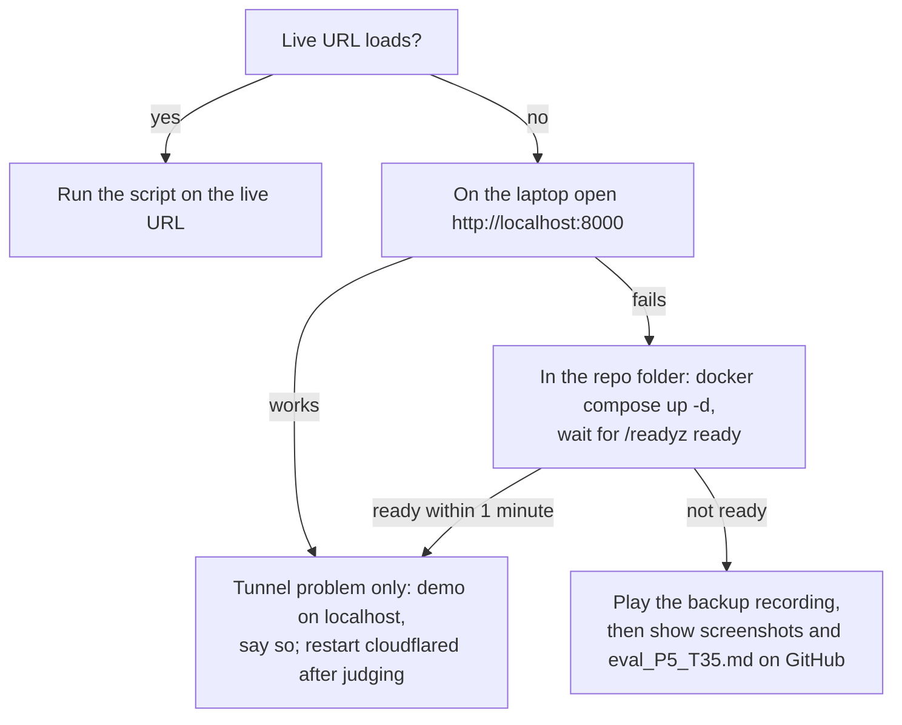

# Three-minute demo script

Live URL: <https://readings-agency-respond-bacteria.trycloudflare.com>
(Cloudflare quick tunnel to the release container on the team laptop; see [hosting_lock.md](hosting_lock.md).)

Rules for the demo:

* The judges' own, unseen photo is the main event. Prepared images are **illustrative only**; say so.
* Never say a metric from memory. When a number is needed, point at [eval_P5_T35.md](../eval_P5_T35.md)
  (generated by `scripts/report.py`) and read it from the screen.
* The release is about to change from iteration r1 (`configs/train.yaml`, run `effb0_r1`) to r2
  (`configs/train_v2.yaml`, run `effb0_r2`). Demo whatever bundle `/readyz` reports, and make sure
  `eval_P5_T35.md` names the same bundle id (check 3 below).

## Before judging (10 minutes earlier)

| # | Check | How |
|---|---|---|
| 1 | Laptop on mains power, lid open, sleep off, online | Windows power settings |
| 2 | Container and tunnel running | Docker Desktop shows the `semevia-semevia-1` container; the `cloudflared` terminal tab is still open |
| 3 | Service ready, right bundle | Open `<URL>/readyz`: `"ready": true`, `"recognition": true`, `"calibration_kind": "final"`. The `bundle_id` must equal the bundle in the first lines of `eval_P5_T35.md` |
| 4 | Local fallback works | Open <http://localhost:8000> on the laptop; the footer says "Service ready" |
| 5 | Tabs open in this order | (1) live URL, (2) `eval_P5_T35.md` on GitHub, (3) `docs/architecture.md` on GitHub, (4) <http://localhost:8000> |
| 6 | Sample photos copied to one folder on the laptop and on the presenter's phone | Table below |
| 7 | Backup recording and screenshots on the laptop desktop and on a phone | See "Fallback plan" |
| 8 | One warm-up upload done | The first request after a restart can be slower |

If `cloudflared` was restarted, the URL has changed: use the new one, and after judging update the README and the
submission form and rerun `scripts/check_release.py --url <new url>` (see [hosting_lock.md](hosting_lock.md)).

## Photos to keep ready

| Purpose | File on the team laptop | Why this one |
|---|---|---|
| Main event | The judges' own photo (their phone, or ours if they prefer) | Unseen data; the honest test |
| Illustrative car (only if judges have no photo) | One Stanford Cars **test** image, chosen during rehearsal, from `C:\semevia\StanfordCars\stanford_cars\cars_test\` | Shows a normal case. Pick one that gives "One category in the candidate set" and one that gives "Several categories remain"; write their file names here after rehearsal |
| Known failure | The image named in the "Failure analysis" section of `eval_P5_T35.md` (for r1: `test/05757.jpg`, Aston Martin V8 Vantage confused with Virage) | A rule-selected failure, not a hand-picked one |
| Negative: two-wheeler | `C:\semevia\negatives\tune\tw_tune_03.jpg` (Ducati motorcycle, Wikimedia Commons, CC BY-SA 4.0) | YOLO11n's motorcycle class is not mapped to "vehicle" (`configs/runtime.yaml`: only car, bus, truck), so the expected answer is "No supported vehicle target found" |
| Negative: bus | `C:\semevia\negatives\tune\uv_tune_01.jpg` (city bus, Wikimedia Commons, CC BY 4.0) | A bus **is** detected as a vehicle, so only the reject rule can stop it. It may be rejected or it may be accepted with a wrong car label; both are honest outcomes. Check which during rehearsal and say it plainly |

Negatives come from the 80-image suite (`artifacts/negative_manifests/*.csv`, 40 tune + 40 test). We use
**tune** negatives in the demo so no held-out test image is used for showing off. Stanford Cars images are for
non-commercial research use; we show them only live, we do not hand them out.

## Script (3:00)

| Time | Do (click) | Say |
|---|---|---|
| 0:00-0:15 | Live URL is on screen | "SEMEVIA detects a car, names its make, model and year among the 196 Stanford Cars categories, and tells you how much of that answer the evidence supports." |
| 0:15-0:50 | Ask the judges for their photo. **Choose or take a photo**, keep **Hybrid (classical + deep)**, press **Analyze** | Section 1: "The thick box is the YOLO11n detection we chose: the largest car, bus or truck with detector score at least 0.25. The detector score and the classification score are separate numbers." Section 2: "This is the ordinary best guess and Top-5." |
| 0:50-1:20 | Scroll to **3. Identity Evidence Passport**; press **Show all** if the set has more than five members | "The Passport lists every category that passes the conformal threshold, never cut to five. If they all share a family or a make, that is the most specific answer we stand behind. The 90% target holds over a population of supported cars, not for this one photo." If the photo is a car newer than 2012: "Our data stops at model year 2012, so 'could not verify' or a make-level answer is the honest result here." |
| 1:20-1:50 | **4. Evidence Challenge**: press **Run six-region challenge**, click one region button, then **Restore original** | "We blur one of six regions at a time and re-score with the same deployed model. The number is how much the lead of A over B shrinks, in logits. It tells us what the model is sensitive to, not which car part identifies the make." |
| 1:50-2:15 | Press **Reset**, upload the motorcycle negative, **Analyze**; if time allows, the bus negative | Motorcycle: "Not a supported vehicle, so no category is claimed." Bus: say what happens, for example "rejected: could not verify a supported category", or "accepted with a wrong car label: softmax rejection is not an open-set detector; false acceptance on the negative suite is in the evaluation file." |
| 2:15-2:25 | Back on a car result: **References from the training library**, then **5. Intermediate image processing** | "The three nearest of 588 training references, shown as identifiers, labels and similarity only; we show no thumbnails because Stanford Cars images are licensed for non-commercial research. Below: grayscale, Canny edges and contours, the classical features that feed the hybrid." |
| 2:25-2:50 | Switch to the `eval_P5_T35.md` tab | "Every number here is printed by a script from report files. Classical, deep and hybrid compared end to end on all 8,041 test images; a prediction counts only if our box has IoU at least 0.5 and the class is right. Then 196-class AP, ablations, robustness under six fixed conditions, ONNX and INT8 results, and the r1 versus r2 fine-tuning." Read one line from the table, do not recite. |
| 2:50-3:00 | Scroll to "Failure analysis" | "Failures are chosen by fixed rules. Limits: data ends at 2012, some duplicate images carry conflicting labels, and the reject rule can be fooled. Thank you." |

If the judges' photo gives an error message (not an image, over 10 MB, over 25 megapixels), read the message
aloud: it is part of the design. If the page says the server is busy (one job at a time, queue of four), wait two
seconds and press **Analyze** again.

## Fallback plan

* **Tunnel down, laptop fine**: demo on <http://localhost:8000> on the same laptop. It is the same container and
  bundle, so the demo is unchanged. Say that the public URL depends on the laptop and the quick tunnel.
* **Container stopped**: `docker compose up -d` in `C:\Users\Luikz\Downloads\SEMEVIA` (the image is already built;
  readiness waits for a real warm-up of every mode). Check `http://localhost:8000/readyz`.
* **Laptop unusable**: play the backup screen recording (make it during rehearsal on the release bundle: one
  upload, Passport, challenge, one negative), then the screenshots, then `eval_P5_T35.md` and
  `docs/architecture.md` on GitHub from any device.
* Never claim the recording is live.

## After the demo

Keep everything running until judging ends. Do not restart `cloudflared` unless the URL is already dead.
