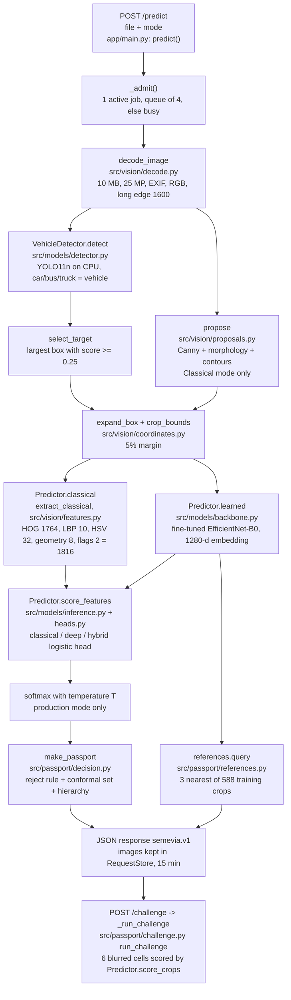

# SEMEVIA design document

Team T35 (Aniket Kumar, USN 1RUA24CSE0051; C Lakshanaa, USN 1RUA24CSE0097). Computer Vision
Hackathon 2026, problem statement PS5.

Status (last update 2026-11-07): the first model iteration, **r1**, is frozen, evaluated once on the
official test split and deployed. The second iteration, **r2**, is training; when it finishes, the whole
pipeline after training is redone for it and r2 replaces r1 as the release (section 5). The file
`artifacts/release_config.json` always names the bundle that is currently released.

**Rule for this document:** no metric is typed here by hand. Every result lives in a generated file:
[eval_P5_T35.md](../eval_P5_T35.md) (written by `scripts/report.py`) or the `reports/*.json` file linked
next to the claim. Counts that are fixed by the data or the design (for example 196 classes) are stated.

## 1. Problem and goals

PS5 asks for a system that finds a vehicle in a real-world photo and identifies its make, model and
year among the 196 Stanford Cars categories. It must combine classical computer vision with deep
learning, and it must cope with very similar categories, lighting, occlusion and viewpoint.

Goals:

1. Required output: a box, make/model/year, separate detector and classifier scores, and a Top-5 list.
2. All required classical and deep components, a real hybrid of the two, and comparisons and ablations.
3. Our own contribution: the **Identity Evidence Passport**, which says how specific an answer the
   evidence supports (exact category, model family, make, or not enough evidence), and the
   **Evidence Challenge**, which lets a user see how the model's lead between its top two answers
   changes when one part of the crop is blurred.
4. A public demo that answers a fresh upload within about ten seconds (target). Status: live at
   <https://readings-agency-respond-bacteria.trycloudflare.com> (section 8); measured latency through the
   public URL is in [reports/release_acceptance.json](../reports/release_acceptance.json).

Non-goals: number-plate reading, tracking, VIN or build-date checks, and vehicles outside the 196 classes
(these should be refused, not named; section 6).

## 2. Data

### 2.1 Stanford Cars

* Source: the original Stanford Cars layout from a GitHub mirror, because the Stanford URLs were
  unreachable (mirror and reasoning in [docs/resource_lock.md](resource_lock.md); settings in
  `configs/data.yaml`).
* Audit (`scripts/prepare_data.py` → [reports/data_audit.json](../reports/data_audit.json)): 8,144 train
  and 8,041 test records, every image decodes, every annotation is checked against its image, and the
  labelled test annotation file matches the SHA256 published by TensorFlow Datasets.
* Partitions (seed 20261106, frozen manifests in `artifacts/manifests/`): train 6,514, tune 815 and
  calibration 815 (both taken from the original train pool), and the official test split 8,041. Keys are
  `split/filename` because file names repeat between the two folders.

| Partition | Count | Used for |
|---|---|---|
| train | 6,514 | network training, scalers, PCA, heads, reference index |
| tune | 815 | every selection: epochs, heads, C, production mode, temperature, reject threshold |
| calibration | 815 | only the final conformal quantile, after the freeze |
| test | 8,041 | one evaluation per frozen iteration; nothing is chosen from it |

* Known dataset problems: 39 groups of byte-identical images, 37 of them with conflicting labels (mostly
  neighbouring model years), and 19 test images with an exact copy in the train pool (listed in the
  audit). The official test split is kept unchanged. A duplicate-excluded diagnostic was planned but has
  not been produced, so the headline test numbers include those 19 images.
* The calibration partition contains 194 of the 196 classes (random draw, no model outcomes used). This is
  acceptable for the marginal (population-level) guarantee in section 6.
* Boxes are 1-based inclusive in the source and are converted once, in `src/vision/coordinates.py`, to
  zero-based half-open floats. Dataset images are used in their stored pixel orientation (EXIF ignored,
  checked in the audit); uploads have EXIF orientation applied in `src/vision/decode.py`.
* Class hierarchy (`src/data/metadata.py`, `artifacts/class_metadata.json`): make → family (name without
  the year; only categories that differ by year alone share a family) → category. All 196 rows were
  reviewed.
* The newest model year in the dataset is 2012.

### 2.2 Predeclared evaluation subsets

`scripts/declare_subsets.py` writes these from `configs/evaluation.yaml` using image keys only, before any
test result exists:

* **Stress subset:** 2 test images per class, 392 images, seeded and stratified
  (`artifacts/manifests/stress_test_m1.csv`). Seven conditions are applied to the image *before*
  detection, so nothing reuses clean boxes: clean, brightness ×0.5 and ×1.5, downsampling to 0.50 and
  0.25, and a grey occluding rectangle covering 15% or 30% of the annotated box (`src/evaluation/stress.py`).
* **Viewpoint subset:** 60 seeded random test photos, disjoint from the stress subset
  (`artifacts/manifests/viewpoint_test_m1.csv`), each labelled front, rear, side, three-quarter front,
  three-quarter rear or indeterminate, plus natural occlusion and multiple-vehicle flags
  ([reports/viewpoint_labels.csv](../reports/viewpoint_labels.csv)).

### 2.3 Blind viewpoint label check

The first-pass viewpoint labels were made by an AI agent before any test result existed (the
`labelled_before_results` column). They were **not** made or reviewed by a human. To give judges a measure
of how reliable they are, a blind second pass was made by six separate agents that were not shown the
first labels. [reports/viewpoint_label_check.json](../reports/viewpoint_label_check.json) records the
agreement, a confusion list and every disagreement with the second labeller's note. Policy: the first-pass
labels used in the analysis are never changed after results exist; the disagreements are published
instead, so readers can judge the viewpoint table in [eval_P5_T35.md](../eval_P5_T35.md). This is a
consistency check between agents, not a human review.

### 2.4 Negative (unsupported-input) suite

Purpose: choose the reject threshold and measure false acceptance on inputs that are **not** one of the
196 categories. Details and the recording procedure: [docs/negative_suite.md](negative_suite.md).

* **Size and buckets:** 80 photos, 40 tune + 40 test, 10 per bucket per partition:

  | Bucket | What it contains |
  |---|---|
  | `non_vehicle` | scenes, animals, food, buildings with no vehicle |
  | `two_wheeler` | bicycles, motorcycles, scooters |
  | `unsupported_vehicle_type` | buses, lorries, tractors, trains, trams, boats, aircraft, auto-rickshaws |
  | `unlisted_car_model` | cars whose make/model/year is not in the 196 classes (all from model year 2017 or later) |

* **Collection and licences:** every photo is a Wikimedia Commons file under CC0, public domain, CC BY or
  CC BY-SA. Each row of `artifacts/negative_manifests/negatives_tune.csv` and `negatives_test.csv`
  records the source page, licence, author and a description; for `unlisted_car_model` the description
  names the model and generation to show why it is outside the class list. `scripts/evaluate_negatives.py`
  refuses any row without a valid bucket, source URL and licence. The images themselves stay outside Git
  (`SEMEVIA_NEG_ROOT`) and are never served by the app.
* **Tune and test are kept apart:** different photos, and different unsupported car models in the two
  partitions.
* **How it is used:** `scripts/evaluate_negatives.py --partition tune` runs the 40 tune negatives through
  the deployed pipeline (same decoder, detector, target rule, crop and production head) and stores raw
  logits. `scripts/freeze.py --negatives reports/negatives_tune_<bundle>.json` then picks the reject
  threshold from the fixed grid in `configs/calibration.yaml`: the lowest negative false acceptance among
  thresholds that keep at least 90% of known tune images (`choose_reject_threshold` in
  `src/passport/calibration.py`). After the freeze, `--partition test` measures **held-out** false
  acceptance on the other 40 photos, per bucket. A photo where no vehicle is detected counts as correctly
  refused (whole-system refusal); the report also gives how many reached the classifier.
* **Timing:** the suite arrived after r1 was frozen, so r1's reject threshold came from known tune images
  only (`"negatives_used": false` in r1's freeze record, archived as
  [artifacts/history/r1/production_freeze.json](../artifacts/history/r1/production_freeze.json)). r2 is the first iteration frozen
  with it.

## 3. Architecture

[docs/architecture.md](architecture.md) holds more diagrams. The two diagrams below were checked
against `app/main.py`, `src/` and `scripts/`.

### 3.1 One request at runtime

At startup, `lifespan` → `_load_models` checks every asset against `artifacts/release_manifest.json`
(`src/release.py` `verify` / `asset_status`), runs a real warm-up inference, and only then reports ready
on `GET /readyz`. `recognition_config()` merges `configs/runtime.yaml` with `artifacts/release_config.json`
(written by `scripts/promote_bundle.py`), so the app always loads the promoted backbone and calibration.
If an optional recognition asset is missing, the app serves detection only and says so in every response.

### 3.2 Offline pipeline (one model iteration)

```mermaid
flowchart LR
    A["Stanford Cars<br/>original layout"] --> M["prepare_data.py<br/>audit + frozen manifests"]
    M --> SUB["declare_subsets.py<br/>stress 392 + viewpoint 60"]
    M --> TR["train.py<br/>configs/train.yaml r1<br/>configs/train_v2.yaml r2"]
    TR -->|best_finetuned.pt| CF["cache_features.py<br/>classical + learned caches"]
    CF --> FH["fit_heads.py<br/>classical, deep, hybrid, ablations<br/>C chosen on tune"]
    FH --> DC["calibrate.py --development"]
    CF --> BR["build_references.py"]
    DC --> PB["promote_bundle.py<br/>release_manifest + release_config"]
    BR --> PB
    PB --> ET["evaluate.py --partition tune"]
    PB --> NT["evaluate_negatives.py --partition tune"]
    ET --> FZ["freeze.py<br/>T + reject threshold<br/>production_freeze.json"]
    NT --> FZ
    FZ --> EC["evaluate.py --partition calibration"]
    EC --> FC["calibrate.py --final<br/>calibration_final.json"]
    FC --> PB2["promote_bundle.py --calibration"]
    PB2 --> TEST["evaluate.py --partition test --confirm-frozen<br/>+ 7 stress conditions"]
    TEST --> AN["report_robustness.py, analyze_results.py,<br/>evaluate_negatives.py --partition test"]
    AN --> REP["report.py -> eval_P5_T35.md"]
    M --> DE["evaluate_detector.py"]
    PB --> OPT["optimize.py, optimize_head.py"]
    DE --> REP
    OPT --> REP
```

### 3.3 Components

| Part | Choice | Code |
|---|---|---|
| Detector | YOLO11n with COCO weights, car/bus/truck mapped to "vehicle", not retrained, run on CPU | `src/models/detector.py` |
| Target rule | Largest vehicle box with score >= 0.25; never uses ground truth | `select_target` |
| Classical ROI | Canny + morphology + contour proposals (Classical mode's own localisation) | `src/vision/proposals.py` |
| Handcrafted features | HOG 1764, uniform LBP 10, HSV 32, geometry 8, flags 2 = 1816 (`hc_v1`) | `src/vision/features.py`, `configs/features.yaml` |
| CNN | EfficientNet-B0, ImageNet weights, fine-tuned (r1 last stage, r2 whole network) | `src/models/backbone.py`, `src/models/training.py` |
| Heads | Multinomial logistic regression on cached features, one shared C grid | `scripts/fit_heads.py`, `configs/heads.yaml` |
| Hybrid | Learned 1280 + handcrafted reduced by PCA to 64, every feature standardised | `FusionFeatures` in `src/models/heads.py` |
| Passport | Temperature scaling, split conformal set, reject rule, make/family hierarchy | `src/passport/` |
| Challenge | 2×3 grid, Gaussian blur per cell, same predictor as the answer | `src/passport/challenge.py` |
| References | 3 training crops per class nearest the class centroid (max 588), cosine similarity | `src/passport/references.py` |
| Serving | FastAPI + static HTML/JS, one container, 2 CPUs and 4 GB | `app/`, `Dockerfile`, `compose.yaml` |

## 4. Interfaces

* Contract: [docs/api_schema.json](api_schema.json) (`semevia.v1`). Identity fields use explicit nulls;
  boxes are `[left, top, right, bottom]`, zero-based half-open, in the decoded upload's frame.
* Implemented endpoints (`app/main.py`): `GET /healthz`, `GET /readyz`, `POST /predict` (multipart:
  `file`, optional `mode` = classical | deep | hybrid, default hybrid), `POST /challenge`
  (`{"request_id": ...}`), `GET /request-image/{rid}/{name}` (in-memory images for that request) and
  `GET /benchmarks` (saved report files for the served bundle, not per-upload accuracy). The schema also
  lists `GET /reference/{ref_id}` for thumbnails; it is intentionally **not** implemented (section 6.5).
* Response statuses: ok, uncertain, no_vehicle, invalid_image, busy, error.
* Passport decision states, in order of precedence (`src/passport/decision.py`): detection_failed →
  comparison_only (mode without calibration) → rejected → inadequate → exact_candidate / ambiguous.
  All reason codes that apply are kept.
* Every response carries provenance: bundle id, app version, detector version, asset hashes, calibration
  kind (development or final) and backbone status text, so a saved Passport can be matched to the model
  that produced it.

## 5. Model development log

### 5.1 Protocol (applies to every iteration)

1. Everything is chosen on **tune** only: epochs (best tune checkpoint), head C, production mode,
   temperature, reject threshold.
2. The pipeline is then **frozen**: `scripts/freeze.py` writes `artifacts/production_freeze.json` with a
   fingerprint of every prediction-changing asset (`model_fingerprint` in `src/passport/calibration.py`).
3. The final conformal quantile is computed on the untouched **calibration** partition through the frozen
   pipeline (`scripts/calibrate.py --final`).
4. The **test** split is run **once**. `scripts/evaluate.py` refuses the test split unless
   `--confirm-frozen` is given, the calibration is final, and its fingerprint matches the freeze.
5. If anything must change after a freeze, the whole chain from step 1 is redone as a new iteration.
   Earlier test results are never hidden: `scripts/report.py` reads superseded iterations from
   `artifacts/history/<iteration>/` and prints them next to the current one. r1's release config, manifest,
   freeze record and calibrations are archived in [artifacts/history/r1/](../artifacts/history/r1/); the
   top-level `artifacts/production_freeze.json` and `artifacts/calibration_final.json` are rewritten by the
   r2 freeze and final calibration.

### 5.2 Development backbone (before fine-tuning)

The laptop used for development has no CUDA GPU (section 10), so the classical head, the Passport logic and
the app were first built on a **frozen ImageNet** EfficientNet-B0. Those results are tune-split
diagnostics only: [reports/heads_tune_imagenet_frozen.json](../reports/heads_tune_imagenet_frozen.json),
[reports/classical_tune.json](../reports/classical_tune.json), and the checkpoint notes in
[docs/checkpoints/P3_P4_dev.md](checkpoints/P3_P4_dev.md). The detector was evaluated on tune in
[reports/detector_tune.json](../reports/detector_tune.json).

One head change was made on that backbone and recorded in `configs/heads.yaml` (where it is labelled
r1/r2; this is unrelated to the training iterations below):

* First version: the hybrid gave the handcrafted branch the same *total* variance as the learned branch.
  With 64 handcrafted and 1280 learned dimensions, each handcrafted dimension then carried 1280/64 = 20
  times the weight of a learned one, and the hybrid scored clearly below the matched deep-only head.
* Second version (one deliberate change): every feature is standardised on its own (`per_feature`). The
  first version is kept as the ablation `hybrid_equal_variance`.

### 5.3 Iteration r1: last-stage fine-tuning (`configs/train.yaml`, run `effb0_r1`)

* Recipe: classifier only for 3 epochs, then the classifier plus the final pretrained stage
  (`features.7`, `features.8`) for up to 6 epochs, AdamW, early-stopping patience 3, seed 20261106.
* Why: it is the cheapest recipe that meets the PS requirement of real fine-tuning, it was sized for
  limited compute before the GPU laptop was available, and it lowers overfitting risk with only about 33
  training images per class.
* Evidence: [reports/training/effb0_r1_summary.json](../reports/training/effb0_r1_summary.json) and
  `effb0_r1_train_log.jsonl` (per-epoch tune scores; `pretrained_changed` confirms that the final stage's
  weights actually changed).
* Then: caches and heads rebuilt on the checkpoint
  ([reports/heads_tune_ckpt_2339418979e1.json](../reports/heads_tune_ckpt_2339418979e1.json)); hybrid kept
  as production mode (deep was not clearly better on tune); freeze with a reject threshold from known tune
  images only (no negative suite yet); final calibration; one test run; released as bundle
  `ft_ckpt_2339418979e1_0920511710`.

### 5.4 Iteration r2: full-network fine-tuning (`configs/train_v2.yaml`, run `effb0_r2`)

* Why: r1 had **not converged**. Its tune score rose in every fine-tuning epoch, the best epoch was the
  last one, and its training loss was still falling when the 6-epoch budget ended, which points to the
  frozen early stages and the short budget limiting it
  (the reasoning is written at the top of `configs/train_v2.yaml`; the epoch curve is in the r1 training
  log). The decision used training and tune behaviour only.
* Recipe: classifier only for 2 epochs, then **all** pretrained blocks unfrozen for up to 24 epochs with a
  per-epoch **cosine** learning-rate decay, **label smoothing 0.1** (training loss only; evaluation uses
  plain cross-entropy), early-stopping patience 6, seed 20261107. Same data, crop, input size and
  normalisation as r1, so the inference pipeline is unchanged.
* Code changes for r2 (in `src/models/training.py`): the cosine schedule is computed from the epoch
  counter, so a resumed run gets the same learning rate, and `label_smoothing` is read from the config.
* After training, every later step is redone on tune/calibration data: caches, heads, production mode,
  development calibration, references, promotion, freeze **with the 80-image negative suite**, final
  calibration, then one test run, the stress and viewpoint analyses and the held-out negatives.
* Reporting: both test results (r1 and r2) appear in [eval_P5_T35.md](../eval_P5_T35.md), which is
  regenerated for r2 by `scripts/report.py` (r1's row comes from the archive in section 5.1). r1's report
  files keep their bundle-named file names, for example
  [reports/e2e_test_ft_ckpt_2339418979e1_0920511710.json](../reports/e2e_test_ft_ckpt_2339418979e1_0920511710.json).
* Honest note: r2 was started after r1's test result existed, so the test split has been looked at twice.
  We limit the effect by choosing r2's recipe from tune behaviour, by deciding in advance that r2 replaces
  r1 as the release, and by publishing both test results.

### 5.5 Optimisation experiment

`scripts/optimize.py` and `scripts/optimize_head.py` measured an ONNX FP32 encoder, three INT8 encoder
variants and an INT8 linear head (results in [eval_P5_T35.md](../eval_P5_T35.md), section 4, and
`reports/optimization_*.json`). Every INT8 **encoder** failed the project's accuracy policy (at most a
1-point tune top-1 drop). The release keeps the PyTorch FP32 encoder (`encoder_runtime: torch`), because
switching runtime would require refitting the temperature and rebuilding the reference index, and the
measured in-app gain was small (`docs/checkpoints/P5_dev.md`).

## 6. Passport and challenge semantics

### 6.1 Probabilities

Softmax of the raw production-head logits divided by one temperature T, fitted by minimising negative
log-likelihood on tune images whose runtime box has IoU >= 0.5 with the annotation (`fit_temperature`).
Comparison modes (the two that are not the production mode) show uncalibrated softmax and give a
`comparison_only` Passport.

### 6.2 Candidate set (split conformal)

* Score s = 1 − p(true class). With alpha = 0.10 and n calibration inputs, q is the k-th smallest score,
  k = ceil((n+1)(1−alpha)), with no interpolation (`src/passport/conformal.py`).
* The set holds every class with 1 − p ≤ q, ties included, never truncated. An empty set stays empty and
  is reported as insufficient evidence.
* q comes from **every** input of the untouched calibration partition run through the frozen pipeline; an
  input with no usable detection gets the fixed fallback score 1 − 1/196 (`final_conformal_scores`). A
  missed detection at runtime returns the full 196-label set with a flag.
* The 90% target is a population-level property for supported categories when calibration and new images
  are exchangeable. It is **not** the probability that one upload is right, and it does not hold for
  unsupported vehicles, edited photos or the challenge's blurred variants.

### 6.3 Specificity

`Hierarchy.specificity` (`src/passport/hierarchy.py`) reports the most specific level the whole set
shares: category, family or make. If the set spans makes, the Passport says "inadequate".

### 6.4 Reject rule

A separate operational rule: if the highest calibrated probability is below the frozen threshold, the
decision is `rejected`. It never removes labels from the candidate set. The threshold is chosen on tune
data at the freeze (section 2.4); r1 used known images only, r2 also uses the tune negatives. Held-out
false acceptance on the test negatives is in [eval_P5_T35.md](../eval_P5_T35.md) once evaluated for the
current bundle.

### 6.5 References and the thumbnail decision

The references panel lists the three training crops whose embeddings are closest (cosine) to the upload,
from a curated index of at most 588 entries (3 per class), built only from training keys and checked by
`validate_index`. Similarity is not a probability and a neighbour is not proof of identity.

**Decision: no thumbnails.** Stanford Cars images are licensed for non-commercial research use only, and
the demo is a public web page. References therefore show the sample identifier (for example
`train/01234.jpg`), the class label and the similarity only. The response sets `thumbnail` to null with a
reason, and `GET /reference/{ref_id}` from the v1 schema is not implemented.

### 6.6 Evidence Challenge

The leading class A and runner-up B are fixed from the original result. The crop is split into 2 rows × 3
columns; each of six variants blurs only its own cell (Gaussian, sigma = max(3, 0.08 × short side)) and is
scored by `Predictor.score_crops`, which recomputes every branch, including handcrafted features. Delta =
original (zA − zB) minus the variant's (zA − zB), in raw logits. Positive means hiding that cell reduced
A's lead. This measures sensitivity to a perturbation; cells are not car parts and the result is not
proof that a region identifies a maker. The variants are outside the clean calibration; every challenge
response carries a label that says so (`DIAGNOSTIC_LABEL`).

## 7. Evaluation plan

Metric code: `src/evaluation/metrics.py` (fixture-tested). Report assembly: `scripts/report.py` →
[eval_P5_T35.md](../eval_P5_T35.md), which prints every value with its population and source file.

| PS5 metric | Population | Source |
|---|---|---|
| Top-1 / Top-5, end to end (a hit needs runtime box IoU >= 0.5 **and** the right class; a miss is a failure) | all 8,041 test images, three modes | `reports/e2e_test_<bundle>.json` |
| Localisation IoU, with named denominators | same | same |
| Detection AP (COCO, pycocotools): 196-category AP50 and AP50:95 with at most one classified prediction per image (score = box score × top-1 probability) | same; the generic "vehicle" AP of YOLO11n alone is measured on tune only | `reports/e2e_test_<bundle>.json`; `reports/detector_tune.json` (tune) |
| Model size and latency | encoder/head variants on tune; deployed latency through the public URL | `reports/optimization_*.json`, `reports/release_acceptance.json` |
| Robustness | 392-image stress subset × 7 conditions; 60 viewpoint photos | `reports/robustness_stress_test_<bundle>.json`, `reports/analysis_test_<bundle>.json` |
| Confidence and thresholds | count-weighted ECE, NLL, reject contingency, conformal coverage and set size; held-out negatives | `reports/e2e_test_<bundle>.json`, `reports/negatives_test_<bundle>.json` |
| Ablations | hybrid without HOG, without colour/texture, without geometry, equal-variance fusion | `reports/heads_tune_<tag>.json` (tune) |
| Failure analysis | rule-selected test failures with an annotation-crop check to separate localisation from classifier errors | `reports/analysis_test_<bundle>.json` |

Tune-split numbers are selection-set numbers and are optimistic; only the single test run per frozen
iteration is an unbiased estimate.

## 8. Deployment

* **What runs:** the release Docker image (`Dockerfile`, `compose.yaml`: 2 CPUs, 4 GB, restart
  `unless-stopped`). At build time `python -m src.release fetch` downloads each model file from its
  public URL in `artifacts/release_manifest.json` and checks its SHA256 (r1's files are in GitHub Release
  `model-v1`). The runtime never downloads; the container also reaches ready with `--network none`
  ([reports/container_check.json](../reports/container_check.json)).
* **Where:** Docker Desktop on the team laptop, exposed by a **Cloudflare quick tunnel**
  (`cloudflared tunnel --url http://localhost:8000`) at
  <https://readings-agency-respond-bacteria.trycloudflare.com>. Details: [docs/hosting_lock.md](hosting_lock.md).
* **Why:** the first choice was a Hugging Face Docker Space (`scripts/prepare_hf_space.py` builds the
  folder). On 2026-11-07 Hugging Face answered `402 Payment Required`, because Docker Spaces on free CPU
  need a paid subscription. Render, Cloud Run with a minimum instance, or a VPS all need billing. A quick
  tunnel needs no account and no payment and serves the exact image we tested.
* **Checks:** `scripts/check_release.py --url <public url>` tests the page, readiness, 20 fresh uploads,
  4 simultaneous clients and six bad inputs through the public URL
  ([reports/release_acceptance.json](../reports/release_acceptance.json)). Phone width (375 px) was checked
  in a browser.
* **Risks:** the URL works only while the laptop is on, awake, online, and both Docker Desktop and
  `cloudflared` are running; the address changes whenever `cloudflared` restarts (then the README and
  submission must be updated and the check rerun); Cloudflare documents quick tunnels as a testing feature
  with no uptime guarantee; one laptop is a single point of failure; requests are handled one at a time
  with a queue of 4, so a burst of users gets "busy" replies. For r2, the bundle is promoted and the
  container rebuilt; the public URL stays the same as long as the tunnel is not restarted.

## 9. Design decisions and alternatives

| Decision | Chosen | Alternatives considered | Why |
|---|---|---|---|
| Detector | YOLO11n with COCO weights, frozen | Train a detector on Stanford boxes; larger YOLO | Small and fast on CPU; one annotated car per image makes detector training data thin |
| Target vehicle | Largest box with score >= 0.25 | Highest score; centre-most box | Simple, deterministic, and matches catalogue-style photos |
| Backbone | EfficientNet-B0 (ImageNet) | ResNet-50, ViT | Compact for CPU serving, strong transfer results |
| Fine-tuning (r1 → r2) | r1 last stage, then r2 whole network with cosine LR and label smoothing | Keep r1; more r1 epochs | r1 was still improving on tune when its epoch budget ended; full fine-tuning is the standard next step |
| Heads | Logistic regression on cached features | End-to-end MLP heads | Fast, inspectable, and gives matched comparisons and ablations on identical features |
| Hybrid fusion | 1280 learned + PCA-64 handcrafted, per-feature standardised | Equal-variance branches (kept as ablation); late fusion of probabilities | Real feature-level fusion without a second network; equal variance overweighted handcrafted features |
| Uncertainty | Split conformal set + make/family hierarchy | Top-k only; Bayesian ensembles | Finite-sample guarantee with no extra model; hierarchy turns a set into a plain-English answer |
| Out-of-scope inputs | Max-probability threshold tuned on licensed negatives | Dedicated open-set detector; energy scores | Simple and auditable in 24 hours; its weakness is stated in section 10 |
| Explanation | Evidence Challenge (blur one cell, re-score) | Grad-CAM heatmaps | Tests the deployed model directly, including handcrafted branches, and is easy to read |
| References | Identifiers, labels, similarity; no thumbnails | Show training images | Dataset licence is non-commercial research only |
| Encoder runtime | PyTorch FP32 | ONNX FP32; INT8 | INT8 failed the accuracy policy; ONNX needs recalibration and an index rebuild for a small in-app gain |
| Hosting | Cloudflare quick tunnel from the team laptop | Hugging Face Space (402), Render, Cloud Run, VPS | Only free option that serves the tested image; risks listed in section 8 |
| Evaluation honesty | Freeze before one test run per iteration; both iterations reported | Report only the better iteration | Avoids choosing results from the test split |

## 10. Limitations and risks

* **Dataset scope:** 196 categories, newest model year 2012, mostly clean catalogue-style photos. Newer
  cars and street photos are out of distribution; a newer car may be named as its nearest 2012-or-older
  look-alike unless the Passport rejects it.
* **Label noise:** 37 duplicate groups carry conflicting labels (often neighbouring years), which caps
  achievable year accuracy for those pairs; 19 test images have exact copies in the train pool, and the
  planned duplicate-excluded diagnostic was not produced.
* **Detection AP** uses one annotated car per image, so real background cars count as false positives.
* **Open-set refusal is weak:** a softmax-threshold reject rule is a simple open-set detector. The negative
  suite is small (10 photos per bucket per partition), so its false-acceptance rates are coarse. A few test
  negatives contain a small car in the background, which the largest-box rule may select.
* **Agent-made labels:** the viewpoint labels and the blind second pass were both made by AI agents, not
  humans; the viewpoint subgroups are small and imbalanced, so that table is descriptive only.
* **Calibration:** the temperature is fitted in-sample on tune; the conformal guarantee is marginal and
  only for supported categories; the calibration partition lacks 2 of the 196 classes.
* **INT8:** every INT8 encoder variant failed the accuracy policy, so the release does not use INT8.
* **Hybrid gain:** whether handcrafted features add anything over the learned embedding is measured, not
  assumed; see the ablations in [eval_P5_T35.md](../eval_P5_T35.md).
* **Test reuse:** r1 and r2 are each evaluated once on test, so the test split is used twice (section 5.4).
* **Hosting:** the public URL depends on one laptop and a quick tunnel (section 8).
* **No GPU on the development laptop:** training ran on a second laptop with an NVIDIA GPU
  ([docs/resource_lock.md](resource_lock.md), `NEXT.md`); serving and all reported latency use CPU.

## 11. Ethics and privacy

* Uploads are processed in memory (`RequestStore` in `app/main.py`), expire after 15 minutes, and are never
  written to disk or logged. The JSON export contains hashes and coordinates, not pixels.
* The app identifies vehicle models, not people or plates. It makes no ownership, insurance or legal
  claims, and the Passport states that it is a reproducibility record, not a certificate.
* Stanford Cars images are not redistributed by the repository, the container or the web page; references
  show identifiers only (section 6.5).
* Negative-suite photos are openly licensed Wikimedia Commons files with author and licence recorded; the
  images are not redistributed, only their source pages are listed.
* Possible misuse: a confident wrong answer could be taken as fact. The Passport's candidate set, the
  "insufficient evidence" and "rejected" states, and the stated limits of the 90% target are there to
  prevent over-trust.
* Third-party licences: YOLO11n weights and the Ultralytics library are AGPL-3.0; torchvision code is
  BSD-3 ([docs/resource_lock.md](resource_lock.md)).

## 12. Recovery and reproducibility

* Handoff and history: `NEXT.md` (current state), [docs/runbook_other_pc.md](runbook_other_pc.md) (every
  step in order), [docs/training_handoff.md](training_handoff.md) (training detail),
  [docs/timeline.md](timeline.md) (what happened when).
* Frozen inputs: data manifests (`configs/data.yaml`, `artifacts/manifests/`, checked to be byte-identical
  on the GPU laptop), the feature contract `hc_v1`, the head grid, the training recipes and the evaluation
  populations are all in Git.
* Caches and heads are keyed by manifest hash, crop policy, feature version and backbone tag and refuse
  mismatches (`src/models/cache_io.py`). Training resumes from `last.pt` and refuses changed splits.
* Release integrity: `artifacts/release_manifest.json` lists every model file with SHA256 and URL;
  `python -m src.release verify` and the app's readiness check enforce it. The freeze fingerprint stops a
  changed model from being evaluated on test as if it were frozen.
* To reproduce the results, follow the runbook steps for one iteration with `configs/train.yaml` (r1) or
  `configs/train_v2.yaml` (r2), then run `python scripts/report.py --team-id T35 --usns ...` to regenerate
  [eval_P5_T35.md](../eval_P5_T35.md).
