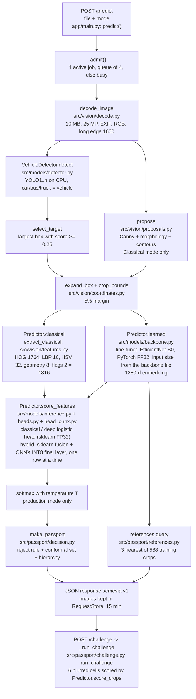

# SEMEVIA design document

Team T35 (Aniket Kumar, USN 1RUA24CSE0051; C Lakshanaa, USN 1RUA24CSE0097). Computer Vision
Hackathon 2026, problem statement PS5.

Status (last update 2026-11-07): the released model is iteration **r3-int8** (bundle
`ft_ckpt_98b1fb55cc6e_f3734d4f40`). It is r3 (run `effb0_r3`, r2's full-network fine-tuning recipe at 320 px
input, backbone tag `ckpt_98b1fb55cc6e`, model files in GitHub Release `model-v3`) with one change: the hybrid
(production) head's final logistic layer is served as a row-wise ONNX INT8 graph, derived at build time from the
published `head_hybrid.joblib` (section 5.6). No new public file was uploaded. It was pre-registered, frozen and
calibrated again on INT8 logits, deployed (now on Google Cloud Run) and evaluated once on the official test
split (sections 5.6 and 8). The earlier iterations, **r1**, **r2** and **r3** (FP32 head, bundle
`ft_ckpt_98b1fb55cc6e_5d755416fd`), were each frozen and evaluated once on test; they are superseded and kept as
history (sections 5.3 to 5.5). The file `artifacts/release_config.json` always names the bundle that is
currently released.

**Rule for this document:** no metric is typed here by hand. Every result lives in a generated file:
[eval_P5_T35.md](../eval_P5_T35.md) (written by `scripts/report.py`) or the `reports/*.json` file linked
next to the claim. Counts that are fixed by the data or the design (for example 196 classes) are stated.

## 1. Problem and goals

PS5 asks for a system that finds a vehicle in a real-world photo and identifies its make, model and
year among the 196 Stanford Cars categories. It must combine classical computer vision with deep
learning, and it must cope with very similar categories, lighting, occlusion and viewpoint.

Goals:

1. Required output: a box, make/model/year, separate detector and classifier scores, and a Top-5 list.
2. All required classical and deep components, a real hybrid of the two, and comparisons and ablations.
3. Our own contribution: the **Identity Evidence Passport**, which says how specific an answer the
   evidence supports (exact category, model family, make, or not enough evidence), and the
   **Evidence Challenge**, which lets a user see how the model's lead between its top two answers
   changes when one part of the crop is blurred.
4. A public demo that answers a fresh upload within about ten seconds (target). Status: live at
   <https://semevia.web.app> (section 8); measured latency through the
   public URL is in [reports/release_acceptance.json](../reports/release_acceptance.json).

Non-goals: number-plate reading, tracking, VIN or build-date checks, and vehicles outside the 196 classes
(these should be refused, not named; section 6).

## 2. Data

### 2.1 Stanford Cars

* Source: the original Stanford Cars layout from a GitHub mirror, because the Stanford URLs were
  unreachable (mirror and reasoning in [docs/resource_lock.md](resource_lock.md); settings in
  `configs/data.yaml`).
* Audit (`scripts/prepare_data.py` → [reports/data_audit.json](../reports/data_audit.json)): 8,144 train
  and 8,041 test records, every image decodes, every annotation is checked against its image, and the
  labelled test annotation file matches the SHA256 published by TensorFlow Datasets.
* Partitions (seed 20261106, frozen manifests in `artifacts/manifests/`): train 6,514, tune 815 and
  calibration 815 (both taken from the original train pool), and the official test split 8,041. Keys are
  `split/filename` because file names repeat between the two folders.

| Partition | Count | Used for |
|---|---|---|
| train | 6,514 | network training, scalers, PCA, heads, reference index |
| tune | 815 | every selection: epochs, heads, C, production mode, temperature, reject threshold |
| calibration | 815 | only the final conformal quantile, after the freeze |
| test | 8,041 | one evaluation per frozen iteration; nothing is chosen from it |

* Known dataset problems: 39 groups of byte-identical images, 37 of them with conflicting labels (mostly
  neighbouring model years), and 19 test images with an exact copy in the train pool (listed in the
  audit). The official test split is kept unchanged. A duplicate-excluded diagnostic was planned but has
  not been produced, so the headline test numbers include those 19 images.
* The calibration partition contains 194 of the 196 classes (random draw, no model outcomes used). This is
  acceptable for the marginal (population-level) guarantee in section 6.
* Boxes are 1-based inclusive in the source and are converted once, in `src/vision/coordinates.py`, to
  zero-based half-open floats. Dataset images are used in their stored pixel orientation (EXIF ignored,
  checked in the audit); uploads have EXIF orientation applied in `src/vision/decode.py`.
* Class hierarchy (`src/data/metadata.py`, `artifacts/class_metadata.json`): make → family (name without
  the year; only categories that differ by year alone share a family) → category. All 196 rows were
  reviewed.
* The newest model year in the dataset is 2012.

### 2.2 Predeclared evaluation subsets

`scripts/declare_subsets.py` writes these from `configs/evaluation.yaml` using image keys only, before any
test result exists:

* **Stress subset:** 2 test images per class, 392 images, seeded and stratified
  (`artifacts/manifests/stress_test_m1.csv`). Seven conditions are applied to the image *before*
  detection, so nothing reuses clean boxes: clean, brightness ×0.5 and ×1.5, downsampling to 0.50 and
  0.25, and a grey occluding rectangle covering 15% or 30% of the annotated box (`src/evaluation/stress.py`).
* **Viewpoint subset:** 60 seeded random test photos, disjoint from the stress subset
  (`artifacts/manifests/viewpoint_test_m1.csv`), each labelled front, rear, side, three-quarter front,
  three-quarter rear or indeterminate, plus natural occlusion and multiple-vehicle flags
  ([reports/viewpoint_labels.csv](../reports/viewpoint_labels.csv)).

### 2.3 Blind viewpoint label check

The first-pass viewpoint labels were made by an AI agent before any test result existed (the
`labelled_before_results` column). They were **not** made or reviewed by a human. To give judges a measure
of how reliable they are, a blind second pass was made by six separate agents that were not shown the
first labels. [reports/viewpoint_label_check.json](../reports/viewpoint_label_check.json) records the
agreement, a confusion list and every disagreement with the second labeller's note. Policy: the first-pass
labels used in the analysis are never changed after results exist; the disagreements are published
instead, so readers can judge the viewpoint table in [eval_P5_T35.md](../eval_P5_T35.md). This is a
consistency check between agents, not a human review.

### 2.4 Negative (unsupported-input) suite

Purpose: choose the reject threshold and measure false acceptance on inputs that are **not** one of the
196 categories. Details and the recording procedure: [docs/negative_suite.md](negative_suite.md).

* **Size and buckets:** 80 photos, 40 tune + 40 test, 10 per bucket per partition:

  | Bucket | What it contains |
  |---|---|
  | `non_vehicle` | scenes, animals, food, buildings with no vehicle |
  | `two_wheeler` | bicycles, motorcycles, scooters |
  | `unsupported_vehicle_type` | buses, lorries, tractors, trains, trams, boats, aircraft, auto-rickshaws |
  | `unlisted_car_model` | cars whose make/model/year is not in the 196 classes (all from model year 2017 or later) |

* **Collection and licences:** every photo is a Wikimedia Commons file under CC0, public domain, CC BY or
  CC BY-SA. Each row of `artifacts/negative_manifests/negatives_tune.csv` and `negatives_test.csv`
  records the source page, licence, author and a description; for `unlisted_car_model` the description
  names the model and generation to show why it is outside the class list. `scripts/evaluate_negatives.py`
  refuses any row without a valid bucket, source URL and licence. The images themselves stay outside Git
  (`SEMEVIA_NEG_ROOT`) and are never served by the app.
* **Tune and test are kept apart:** different photos, and different unsupported car models in the two
  partitions.
* **How it is used:** `scripts/evaluate_negatives.py --partition tune` runs the 40 tune negatives through
  the deployed pipeline (same decoder, detector, target rule, crop and production head) and stores raw
  logits. `scripts/freeze.py --negatives reports/negatives_tune_<bundle>.json` then picks the reject
  threshold from the fixed grid in `configs/calibration.yaml`: the lowest negative false acceptance among
  thresholds that keep at least 90% of known tune images (`choose_reject_threshold` in
  `src/passport/calibration.py`). After the freeze, `--partition test` measures **held-out** false
  acceptance on the other 40 photos, per bucket. A photo where no vehicle is detected counts as correctly
  refused (whole-system refusal); the report also gives how many reached the classifier.
* **Timing:** the suite arrived after r1 was frozen, so r1's reject threshold came from known tune images
  only (`"negatives_used": false` in r1's freeze record, archived as
  [artifacts/history/r1/production_freeze.json](../artifacts/history/r1/production_freeze.json)). r2 was the
  first iteration frozen with it (archived freeze
  [artifacts/history/r2/production_freeze.json](../artifacts/history/r2/production_freeze.json); tune run
  [reports/negatives_tune_ft_ckpt_4f3584f597d5_c13883508a.json](../reports/negatives_tune_ft_ckpt_4f3584f597d5_c13883508a.json),
  held-out run
  [reports/negatives_test_ft_ckpt_4f3584f597d5_9662c2e703.json](../reports/negatives_test_ft_ckpt_4f3584f597d5_9662c2e703.json)).
  r3 was frozen the same way (archived freeze
  [artifacts/history/r3/production_freeze.json](../artifacts/history/r3/production_freeze.json); tune run
  [reports/negatives_tune_ft_ckpt_98b1fb55cc6e_f99e386191.json](../reports/negatives_tune_ft_ckpt_98b1fb55cc6e_f99e386191.json),
  held-out run
  [reports/negatives_test_ft_ckpt_98b1fb55cc6e_5d755416fd.json](../reports/negatives_test_ft_ckpt_98b1fb55cc6e_5d755416fd.json)).
  r3-int8, the release, was frozen again on INT8 logits with the same 40 tune negatives (`"negatives_used": true`
  in [artifacts/production_freeze.json](../artifacts/production_freeze.json); tune run
  [reports/negatives_tune_ft_ckpt_98b1fb55cc6e_0d835360cc.json](../reports/negatives_tune_ft_ckpt_98b1fb55cc6e_0d835360cc.json),
  held-out run
  [reports/negatives_test_ft_ckpt_98b1fb55cc6e_f3734d4f40.json](../reports/negatives_test_ft_ckpt_98b1fb55cc6e_f3734d4f40.json)).

## 3. Architecture

[docs/architecture.md](architecture.md) holds more diagrams. The two diagrams below were checked
against `app/main.py`, `src/` and `scripts/`.

### 3.1 One request at runtime

At startup, `lifespan` → `_load_models` checks every asset against `artifacts/release_manifest.json`
(`src/release.py` `verify` / `asset_status`), runs a real warm-up inference, and only then reports ready
on `GET /readyz`. `recognition_config()` merges `configs/runtime.yaml` with `artifacts/release_config.json`
(written by `scripts/promote_bundle.py`), so the app always loads the promoted backbone, calibration and hybrid head
runtime (`hybrid_head_runtime`). If an optional recognition asset is missing, the app serves detection only and
says so in every response. Since r3-int8, `GET /readyz` also reports `head_runtime`, `encoder_precision`,
`head_int8_sha256` and `model_fingerprint`, and the app refuses a final calibration made for another head runtime
or INT8 file.

**Hybrid head runtime (r3-int8).** The hybrid head's fusion transform (scalers + PCA) stays sklearn FP32. Its
final logistic layer is an ONNX INT8 graph (onnxruntime `quantize_dynamic`, QInt8 weights) built from the
published `head_hybrid.joblib` by `src/models/head_onnx.py`. The INT8 file is not uploaded: `python -m
src.release fetch` derives it and checks its sha256 against `artifacts/release_manifest.json`, and the Docker
build runs `python -m src.release check-derived` to prove the Linux build gives the same bytes. The head scores
one image row at a time, so an image's output does not depend on the other images in a batch. The classical and
deep heads stay sklearn FP32 and the encoder stays PyTorch FP32.

**Encoder input size.** r1 and r2 use 224 px and r3 uses 320 px. The size travels with the backbone file:
`scripts/promote_bundle.py` stores `input_size` in a released backbone that is not 224 px, and
`backbone_input_size` in `src/models/backbone.py` reads it (released file, else the training checkpoint's
config, else 224). The app, feature caching, the optimisation trials and the ONNX export all take the size from
there, and `preprocess_version(size)` puts it into the cache sidecars and the app's `encoder_version`, so a
cache or reference index built at another size is refused (`tests/test_input_size.py`). No runtime setting has
to change when a release changes resolution.

**Example row.** The page has four one-tap examples (Audi R8, Lamborghini Aventador, 2021 Kia EV6,
motorcycle): Wikimedia Commons photos in `app/static/examples/`, with source, author and licence in
[app/static/examples/credits.json](../app/static/examples/credits.json). They use the normal `/predict` path.

**Page features added in `cf2b69e`.** The Reset button works (its id had shadowed `form.reset`), the drop zone
shows a thumbnail, file name and size of the chosen photo, and a "Model comparison" panel runs the photo through
classical, deep and hybrid and shows each mode's official test results read from `GET /benchmarks`. In
Classical mode, when no contour box passes the filters, the app analyses the whole image and says so
(`"fallback": "whole_image"`) instead of returning nothing. The evaluated classical baseline is unchanged: the
test reports count such images as having no box.

### 3.2 Offline pipeline (one model iteration)

```mermaid
flowchart LR
    A["Stanford Cars<br/>original layout"] --> M["prepare_data.py<br/>audit + frozen manifests"]
    M --> SUB["declare_subsets.py<br/>stress 392 + viewpoint 60"]
    M --> TR["train.py<br/>configs/train.yaml r1<br/>configs/train_v2.yaml r2<br/>configs/train_v3.yaml r3"]
    TR -->|best_finetuned.pt| CF["cache_features.py<br/>classical + learned caches"]
    CF --> FH["fit_heads.py<br/>classical, deep, hybrid, ablations<br/>C chosen on tune"]
    FH --> DC["calibrate.py --development"]
    FH --> OH["optimize_head.py<br/>INT8 head study + sidecar"]
    CF --> BR["build_references.py"]
    DC --> PB["promote_bundle.py --hybrid-head sklearn|onnx_int8<br/>release_manifest + release_config"]
    BR --> PB
    OH --> PB
    PB --> ET["evaluate.py --partition tune"]
    PB --> NT["evaluate_negatives.py --partition tune"]
    ET --> FZ["freeze.py<br/>T + reject threshold<br/>production_freeze.json"]
    NT --> FZ
    FZ --> EC["evaluate.py --partition calibration"]
    EC --> FC["calibrate.py --final<br/>calibration_final.json"]
    FC --> PB2["promote_bundle.py --hybrid-head ... --calibration"]
    PB2 --> TEST["evaluate.py --partition test --confirm-frozen<br/>+ 7 stress conditions"]
    TEST --> AN["report_robustness.py, analyze_results.py,<br/>evaluate_negatives.py --partition test,<br/>evaluate_oracle.py (ground-truth crop)"]
    AN --> REP["report.py -> eval_P5_T35.md"]
    M --> DE["evaluate_detector.py"]
    PB --> OPT["optimize.py"]
    DE --> REP
    OPT --> REP
    OH --> REP
```

`scripts/promote_bundle.py` requires `--hybrid-head {sklearn,onnx_int8}`. For `onnx_int8` it checks the sidecar
that `scripts/optimize_head.py` writes, so `optimize_head.py` must run before promotion. The r3-int8 commands were
`promote_bundle.py --backbone <ckpt> --hybrid-head onnx_int8 --calibration artifacts\development_calibration.json`
and, after the freeze and final calibration, `promote_bundle.py --backbone <ckpt> --hybrid-head onnx_int8
--calibration artifacts\calibration_final.json`.

### 3.3 Components

| Part | Choice | Code |
|---|---|---|
| Detector | YOLO11n with COCO weights, car/bus/truck mapped to "vehicle", not retrained, run on CPU | `src/models/detector.py` |
| Target rule | Largest vehicle box with score >= 0.25; never uses ground truth | `select_target` |
| Classical ROI | Canny + morphology + contour proposals (Classical mode's own localisation) | `src/vision/proposals.py` |
| Handcrafted features | HOG 1764, uniform LBP 10, HSV 32, geometry 8, flags 2 = 1816 (`hc_v1`) | `src/vision/features.py`, `configs/features.yaml` |
| CNN | EfficientNet-B0, ImageNet weights, fine-tuned (r1 last stage at 224 px, r2 whole network at 224 px, r3 whole network at 320 px) | `src/models/backbone.py`, `src/models/training.py` |
| Heads | Multinomial logistic regression on cached features, one shared C grid; classical and deep served as sklearn FP32 | `scripts/fit_heads.py`, `configs/heads.yaml` |
| Hybrid head runtime | Final logistic layer as a row-wise ONNX INT8 graph derived from the released joblib (r3-int8) | `src/models/head_onnx.py`, `src/release.py` |
| Hybrid | Learned 1280 + handcrafted reduced by PCA to 64, every feature standardised | `FusionFeatures` in `src/models/heads.py` |
| Passport | Temperature scaling, split conformal set, reject rule, make/family hierarchy | `src/passport/` |
| Challenge | 2×3 grid, Gaussian blur per cell, same predictor as the answer | `src/passport/challenge.py` |
| References | 3 training crops per class nearest the class centroid (max 588), cosine similarity | `src/passport/references.py` |
| Serving | FastAPI + static HTML/JS, one container, 2 CPUs and 4 GB | `app/`, `Dockerfile`, `compose.yaml` |

## 4. Interfaces

* Contract: [docs/api_schema.json](api_schema.json) (`semevia.v1`). Identity fields use explicit nulls;
  boxes are `[left, top, right, bottom]`, zero-based half-open, in the decoded upload's frame.
* Implemented endpoints (`app/main.py`): `GET /healthz`, `GET /readyz`, `POST /predict` (multipart:
  `file`, optional `mode` = classical | deep | hybrid, default hybrid), `POST /challenge`
  (`{"request_id": ...}`), `GET /request-image/{rid}/{name}` (in-memory images for that request) and
  `GET /benchmarks` (saved report files for the served bundle, not per-upload accuracy). The schema also
  lists `GET /reference/{ref_id}` for thumbnails; it is intentionally **not** implemented (section 6.5).
* Response statuses: ok, uncertain, no_vehicle, invalid_image, busy, error.
* Passport decision states, in order of precedence (`src/passport/decision.py`): detection_failed →
  comparison_only (mode without calibration) → rejected → inadequate → exact_candidate / ambiguous.
  All reason codes that apply are kept.
* Every response carries provenance: bundle id, app version, detector version, asset hashes, calibration
  kind (development or final), hybrid head runtime and backbone status text, so a saved Passport can be matched to the model
  that produced it.

## 5. Model development log

### 5.1 Protocol (applies to every iteration)

1. Everything is chosen on **tune** only: epochs (best tune checkpoint), head C, production mode,
   temperature, reject threshold.
2. The pipeline is then **frozen**: `scripts/freeze.py` writes `artifacts/production_freeze.json` with a
   fingerprint of every prediction-changing asset (`model_fingerprint` in `src/passport/calibration.py`).
3. The final conformal quantile is computed on the untouched **calibration** partition through the frozen
   pipeline (`scripts/calibrate.py --final`).
4. The **test** split is run **once**. `scripts/evaluate.py` refuses the test split unless
   `--confirm-frozen` is given, the calibration is final, and its fingerprint matches the freeze.
5. If anything must change after a freeze, the whole chain from step 1 is redone as a new iteration.
   Earlier test results are never hidden: `scripts/report.py` reads superseded iterations from
   `artifacts/history/<iteration>/` and prints them next to the current one. The release config, manifest,
   freeze record and calibrations of r1, r2 and r3 (FP32 head) are archived in
   [artifacts/history/r1/](../artifacts/history/r1/), [artifacts/history/r2/](../artifacts/history/r2/) and
   [artifacts/history/r3/](../artifacts/history/r3/); the top-level `artifacts/production_freeze.json` and
   `artifacts/calibration_final.json` were rewritten by the r3-int8 freeze and final calibration and now
   describe r3-int8.
6. A new iteration designed after an earlier test result is known is **pre-registered** in `NEXT.md` (its
   decision record, committed before its own test run), so the release decision cannot depend on the new
   test result.

### 5.2 Development backbone (before fine-tuning)

The laptop used for development has no CUDA GPU (section 10), so the classical head, the Passport logic and
the app were first built on a **frozen ImageNet** EfficientNet-B0. Those results are tune-split
diagnostics only: [reports/heads_tune_imagenet_frozen.json](../reports/heads_tune_imagenet_frozen.json),
[reports/classical_tune.json](../reports/classical_tune.json), and the checkpoint notes in
[docs/checkpoints/P3_P4_dev.md](checkpoints/P3_P4_dev.md). The detector was evaluated on tune in
[reports/detector_tune.json](../reports/detector_tune.json).

One head change was made on that backbone and recorded in `configs/heads.yaml` (where it is labelled
r1/r2; this is unrelated to the training iterations below):

* First version: the hybrid gave the handcrafted branch the same *total* variance as the learned branch.
  With 64 handcrafted and 1280 learned dimensions, each handcrafted dimension then carried 1280/64 = 20
  times the weight of a learned one, and the hybrid scored clearly below the matched deep-only head.
* Second version (one deliberate change): every feature is standardised on its own (`per_feature`). The
  first version is kept as the ablation `hybrid_equal_variance`.

### 5.3 Iteration r1: last-stage fine-tuning (`configs/train.yaml`, run `effb0_r1`)

* Recipe: classifier only for 3 epochs, then the classifier plus the final pretrained stage
  (`features.7`, `features.8`) for up to 6 epochs, AdamW, early-stopping patience 3, seed 20261106.
* Why: it is the cheapest recipe that meets the PS requirement of real fine-tuning, it was sized for
  limited compute before the GPU laptop was available, and it lowers overfitting risk with only about 33
  training images per class.
* Evidence: [reports/training/effb0_r1_summary.json](../reports/training/effb0_r1_summary.json) and
  `effb0_r1_train_log.jsonl` (per-epoch tune scores; `pretrained_changed` confirms that the final stage's
  weights actually changed).
* Then: caches and heads rebuilt on the checkpoint
  ([reports/heads_tune_ckpt_2339418979e1.json](../reports/heads_tune_ckpt_2339418979e1.json)); hybrid kept
  as production mode (deep was not clearly better on tune); freeze with a reject threshold from known tune
  images only (no negative suite yet); final calibration; one test run; released as bundle
  `ft_ckpt_2339418979e1_0920511710` (GitHub Release `model-v1`).
* Status: **superseded by r2**. r1's freeze, calibrations and release config are archived in
  [artifacts/history/r1/](../artifacts/history/r1/); its test reports keep their bundle-named file names
  (`reports/*_ft_ckpt_2339418979e1_0920511710.json`), and its test result is listed under "Model
  iterations" in [eval_P5_T35.md](../eval_P5_T35.md).

### 5.4 Iteration r2: full-network fine-tuning (`configs/train_v2.yaml`, run `effb0_r2`)

* Why: r1 had **not converged**. Its tune score rose in every fine-tuning epoch, the best epoch was the
  last one, and its training loss was still falling when the 6-epoch budget ended, which points to the
  frozen early stages and the short budget limiting it
  (the reasoning is written at the top of `configs/train_v2.yaml`; the epoch curve is in the r1 training
  log). The decision used training and tune behaviour only.
* Recipe: classifier only for 2 epochs, then **all** pretrained blocks unfrozen for up to 24 epochs with a
  per-epoch **cosine** learning-rate decay, **label smoothing 0.1** (training loss only; evaluation uses
  plain cross-entropy), early-stopping patience 6, seed 20261107. Same data, crop, input size and
  normalisation as r1, so the inference pipeline is unchanged.
* Code changes for r2 (in `src/models/training.py`): the cosine schedule is computed from the epoch
  counter, so a resumed run gets the same learning rate, and `label_smoothing` is read from the config.
* Training evidence: [reports/training/effb0_r2_summary.json](../reports/training/effb0_r2_summary.json)
  and `reports/training/effb0_r2_train_log.jsonl`.
* After training, every later step was redone on tune/calibration data: caches, heads
  ([reports/heads_tune_ckpt_4f3584f597d5.json](../reports/heads_tune_ckpt_4f3584f597d5.json)), production
  mode, development calibration, references, promotion, freeze **with the 40 tune negatives** of the
  negative suite, and final calibration. Hybrid stays the production mode: deep and hybrid were level on
  tune, and the project rule keeps hybrid unless deep is clearly better. The bundle at the freeze was
  `ft_ckpt_4f3584f597d5_c13883508a`; the released bundle after the final calibration is
  `ft_ckpt_4f3584f597d5_9662c2e703`, with model files in GitHub Release `model-v2`.
* Then: one test run, the stress and viewpoint analyses and the held-out negatives
  ([reports/e2e_test_ft_ckpt_4f3584f597d5_9662c2e703.json](../reports/e2e_test_ft_ckpt_4f3584f597d5_9662c2e703.json),
  [reports/robustness_stress_test_ft_ckpt_4f3584f597d5_9662c2e703.md](../reports/robustness_stress_test_ft_ckpt_4f3584f597d5_9662c2e703.md),
  [reports/analysis_test_ft_ckpt_4f3584f597d5_9662c2e703.json](../reports/analysis_test_ft_ckpt_4f3584f597d5_9662c2e703.json),
  [reports/negatives_test_ft_ckpt_4f3584f597d5_9662c2e703.json](../reports/negatives_test_ft_ckpt_4f3584f597d5_9662c2e703.json)),
  then redeployment with the release and container checks re-run on r2 (those two check files have since
  been rewritten for r3 and then for r3-int8; sections 5.5 and 5.6).
* Order of events (commits, IST on 2026-11-07): r1 test run `92ffbae` 02:20; r1 live `1c9461d` 02:43;
  negative suite and viewpoint label check `8e0c84b` 03:09; r2 training and the pre-registration
  ("Iteration r2 decision record" in `NEXT.md`) `4043f4e` 03:25; r2 freeze `38b1a62` 03:30; r2's single
  test run, stress, analysis, held-out negatives and `model-v2` `cadcdc3` 03:46; r2 redeployed and checks
  re-run `ae9a00b` 03:47. More detail: [docs/timeline.md](timeline.md).
* Reporting: r1's and r2's report files keep their bundle-named file names, for example
  [reports/e2e_test_ft_ckpt_2339418979e1_0920511710.json](../reports/e2e_test_ft_ckpt_2339418979e1_0920511710.json)
  and [reports/e2e_test_ft_ckpt_4f3584f597d5_9662c2e703.json](../reports/e2e_test_ft_ckpt_4f3584f597d5_9662c2e703.json);
  both are listed under "Model iterations" in [eval_P5_T35.md](../eval_P5_T35.md) (rows read from the archive
  in section 5.1).
* Honest note: r2 was designed after r1's test result was known. We limited the effect by choosing r2's recipe
  from training and tune behaviour only, by committing the decision that r2 replaces r1 as the release
  whatever its test result (`4043f4e`, before r2's test run in `cadcdc3`), and by publishing both results.
* Status: **superseded by r3** (section 5.5). r2's freeze, calibrations, release config and manifest are
  archived in [artifacts/history/r2/](../artifacts/history/r2/); its model files stay in `model-v2`.

### 5.5 Iteration r3: full-network fine-tuning at 320 px (`configs/train_v3.yaml`, run `effb0_r3`) — superseded by r3-int8

* Why higher resolution: the cues that separate Stanford Cars categories (badges, grilles, lamp shapes) are
  small, and r2's failure cases include near-identical sibling classes. A larger input is the standard lever
  for fine-grained recognition. The reasoning is at the top of `configs/train_v3.yaml`.
* Recipe: identical to r2 (same stages, cosine schedule, label smoothing, early stopping, seed and data); only
  `input_size` (320 instead of 224), the run name and the time cap differ.
* Code changes for r3: the encoder input size now travels with the backbone file (section 3.1, "Encoder input
  size"), so the app, caches, references, optimisation trials and export all use 320 px without a runtime
  setting, and 224 px bundles stay byte-identical to the earlier releases.
* **Pre-registered release rule** ("Iteration r3 decision record" in [NEXT.md](../NEXT.md), committed in
  `794b237` **before r3 training**): r3 replaces r2 only if its tune-split end-to-end hybrid top-1
  (`scripts/evaluate.py --partition tune`, same protocol) reaches at least 740/815 (r2's tune result plus 1.0
  percentage point) and every pipeline check passes. If not, r2 stays the release, r3 **never touches the test
  split**, and its tune result is reported as a negative result. Hybrid stays the production mode.
* **Outcome, recorded before any r3 test run:** the rule was met
  ([reports/e2e_tune_ft_ckpt_98b1fb55cc6e_f99e386191.json](../reports/e2e_tune_ft_ckpt_98b1fb55cc6e_f99e386191.json);
  the count is written in the decision record). It was committed in `e8ce629` on branch `r3-experiment`
  (05:18 IST) and pushed to GitHub before the test run.
* Training evidence: [reports/training/effb0_r3_summary.json](../reports/training/effb0_r3_summary.json) and
  `reports/training/effb0_r3_train_log.jsonl`. Heads:
  [reports/heads_tune_ckpt_98b1fb55cc6e.json](../reports/heads_tune_ckpt_98b1fb55cc6e.json). Optimisation trials:
  [reports/optimization_ckpt_98b1fb55cc6e.json](../reports/optimization_ckpt_98b1fb55cc6e.json),
  [reports/optimization_head_hybrid_ckpt_98b1fb55cc6e.json](../reports/optimization_head_hybrid_ckpt_98b1fb55cc6e.json)
  (the head study was later re-run row-wise for r3-int8; its first, batch-wise values are kept in that file under
  `superseded_batchwise`).
* Freeze and calibration: as for r2, every later step was redone on tune/calibration data; the reject
  threshold was chosen at the freeze with the 40 tune negatives. The bundle at the freeze was
  `ft_ckpt_98b1fb55cc6e_f99e386191`; the bundle released after the final calibration was
  `ft_ckpt_98b1fb55cc6e_5d755416fd`. Its model files were later published as GitHub Release `model-v3`; r3-int8
  reuses them unchanged.
* **Single test run** (`357a7cb`): end to end, stress, viewpoint analysis, held-out negatives and the standard
  ground-truth-crop protocol
  ([reports/e2e_test_ft_ckpt_98b1fb55cc6e_5d755416fd.json](../reports/e2e_test_ft_ckpt_98b1fb55cc6e_5d755416fd.json),
  [reports/robustness_stress_test_ft_ckpt_98b1fb55cc6e_5d755416fd.md](../reports/robustness_stress_test_ft_ckpt_98b1fb55cc6e_5d755416fd.md),
  [reports/analysis_test_ft_ckpt_98b1fb55cc6e_5d755416fd.json](../reports/analysis_test_ft_ckpt_98b1fb55cc6e_5d755416fd.json),
  [reports/negatives_test_ft_ckpt_98b1fb55cc6e_5d755416fd.json](../reports/negatives_test_ft_ckpt_98b1fb55cc6e_5d755416fd.json),
  [reports/oracle_test_ft_ckpt_98b1fb55cc6e_5d755416fd.json](../reports/oracle_test_ft_ckpt_98b1fb55cc6e_5d755416fd.json)).
  Then merged into `semevia/implementation` (`403bc9d`), deployed behind the same live URL (then the Cloudflare tunnel, section 8), and the release
  and container checks re-run (`c0edf1a`;
  [reports/release_acceptance.json](../reports/release_acceptance.json),
  [reports/container_check.json](../reports/container_check.json); both files have since been rewritten for
  r3-int8, section 5.6).
* Reporting: r3's test result is listed under "Model iterations" in [eval_P5_T35.md](../eval_P5_T35.md) as
  "r3 (superseded)", next to the other iterations. More detail on the order of events:
  [docs/timeline.md](timeline.md).
* Status: **superseded by r3-int8** (section 5.6). r3's release config, manifest, freeze and both calibrations
  are archived in [artifacts/history/r3/](../artifacts/history/r3/). Its test results stay valid for r3. Its
  ground-truth-crop result
  ([reports/oracle_test_ft_ckpt_98b1fb55cc6e_5d755416fd.json](../reports/oracle_test_ft_ckpt_98b1fb55cc6e_5d755416fd.json))
  was not re-run for r3-int8 and is shown in [eval_P5_T35.md](../eval_P5_T35.md) labelled as r3 FP32.

### 5.6 Optimisation and iteration r3-int8 (INT8 hybrid head) — released

**Measurements.** `scripts/optimize.py` and `scripts/optimize_head.py` measured an ONNX FP32 encoder, three
INT8 encoder variants and an INT8 linear head (results in [eval_P5_T35.md](../eval_P5_T35.md), section 4;
[reports/optimization_ckpt_98b1fb55cc6e.json](../reports/optimization_ckpt_98b1fb55cc6e.json),
[reports/optimization_head_hybrid_ckpt_98b1fb55cc6e.json](../reports/optimization_head_hybrid_ckpt_98b1fb55cc6e.json)).
Every INT8 **encoder** failed the project's accuracy policy (at most a 1-point tune top-1 drop) and is not used.
The release keeps the PyTorch FP32 encoder (`encoder_runtime: torch`, `precision: fp32`): switching the encoder
runtime would require refitting the temperature and rebuilding the reference index, and the measured in-app
gain was small (`docs/checkpoints/P5_dev.md`). The INT8 **head** passed the policy and is deployed.

**What r3-int8 changes.** r3-int8 is r3 with one change: the hybrid (production) head's final logistic layer is
served as a row-wise ONNX INT8 graph (section 3.1, "Hybrid head runtime"), pinned in the manifest by sha256
(`6acf0061...`). Detector, backbone, fusion transform, features, crop, the classical and deep heads (sklearn
FP32) and the production mode (hybrid) are unchanged. The motivation was PS5 item 4.6 ("optimisation applied
and evaluated"), which was only partial while the INT8 head was measured but not deployed.

**Pre-registration.** The "Iteration r3-int8 decision record" in [NEXT.md](../NEXT.md) was committed in
`b85ddae` before any per-image, end-to-end, calibration or test INT8 number existed. It fixed five pipeline
checks and released r3-int8 whatever its test result once they pass: (1) the row-wise head study passes the
accuracy policy and ONNX FP32 matches sklearn; (2) the INT8 file's sha256 is the same across builds, matches
the manifest and is regenerated by the Docker (Linux) build; (3) a parity test on 16 tune crops; (4) the full
pytest suite, `python -m src.release verify` and `scripts/check_container.py` with `/readyz` showing the INT8
head; (5) container vs host parity
([reports/int8_container_parity.json](../reports/int8_container_parity.json), `scripts/int8_parity_host.py`,
`scripts/int8_parity_container.py`). All five passed; the outcome is recorded in the same NEXT.md section
before the test run.

**Freeze and calibration.** Implemented and re-frozen in `5b0961a`. Temperature, reject threshold and
conformal q were re-derived from INT8 logits on tune and calibration data only (`scripts/freeze.py` with the 40
tune negatives, `scripts/calibrate.py --final`), with the unchanged rules and grid. The bundle at the freeze was
`ft_ckpt_98b1fb55cc6e_0d835360cc` (tune run
[reports/e2e_tune_ft_ckpt_98b1fb55cc6e_0d835360cc.json](../reports/e2e_tune_ft_ckpt_98b1fb55cc6e_0d835360cc.json));
the released bundle after the final calibration is `ft_ckpt_98b1fb55cc6e_f3734d4f40`, with model fingerprint
`2ef1643c...` in [artifacts/production_freeze.json](../artifacts/production_freeze.json). Every prediction row
records the hybrid head runtime, and the freeze and calibration refuse rows from a different runtime. No new
public file was uploaded: the INT8 graph is derived from the `model-v3` joblib at build time.

**Single test run** (`2e55498`): end to end, the 7 stress conditions, viewpoint analysis and the held-out
negatives
([reports/e2e_test_ft_ckpt_98b1fb55cc6e_f3734d4f40.json](../reports/e2e_test_ft_ckpt_98b1fb55cc6e_f3734d4f40.json),
[reports/robustness_stress_test_ft_ckpt_98b1fb55cc6e_f3734d4f40.md](../reports/robustness_stress_test_ft_ckpt_98b1fb55cc6e_f3734d4f40.md),
[reports/analysis_test_ft_ckpt_98b1fb55cc6e_f3734d4f40.json](../reports/analysis_test_ft_ckpt_98b1fb55cc6e_f3734d4f40.json),
[reports/negatives_test_ft_ckpt_98b1fb55cc6e_f3734d4f40.json](../reports/negatives_test_ft_ckpt_98b1fb55cc6e_f3734d4f40.json)).
Analyses from the saved predictions, with no further test run:
[reports/extra_test_ft_ckpt_98b1fb55cc6e_f3734d4f40.json](../reports/extra_test_ft_ckpt_98b1fb55cc6e_f3734d4f40.json),
[reports/resolution_test_ft_ckpt_98b1fb55cc6e_f3734d4f40.json](../reports/resolution_test_ft_ckpt_98b1fb55cc6e_f3734d4f40.json)
(`scripts/analyze_resolution.py`) and the per-image INT8-vs-FP32 comparison of the r3 and r3-int8 test
prediction files
([reports/int8_vs_fp32_test_ft_ckpt_98b1fb55cc6e_f3734d4f40.json](../reports/int8_vs_fp32_test_ft_ckpt_98b1fb55cc6e_f3734d4f40.json),
`scripts/compare_runs.py`). The ground-truth-crop study was not re-run, as pre-registered. The release and
container checks had already been re-run on r3-int8 in `5b0961a`, before the test run, with the release check
then going through the tunnel URL. On 2026-11-07 the release check was run again through the Cloud Run URL, and
[reports/release_acceptance.json](../reports/release_acceptance.json) now holds that result (section 8);
[reports/container_check.json](../reports/container_check.json) holds the local container check.

**Reporting.** All four test results are listed under "Model iterations" in [eval_P5_T35.md](../eval_P5_T35.md),
regenerated for r3-int8 by `scripts/report.py`, with a column for the hybrid head runtime. The INT8 head's
size, tune and test effect are in its section 4.

**Order of events** (commits, IST on 2026-11-07): UI fixes and in-app model comparison `cf2b69e` 09:36;
r3-int8 decision record and r3 archive `b85ddae` 09:58; INT8 head implementation, re-freeze and recalibration
`5b0961a` 10:15; r3-int8's single test run and reports `2e55498` 10:49. More detail:
[docs/timeline.md](timeline.md).

## 6. Passport and challenge semantics

### 6.1 Probabilities

Softmax of the raw production-head logits divided by one temperature T, fitted by minimising negative
log-likelihood on tune images whose runtime box has IoU >= 0.5 with the annotation (`fit_temperature`).
Comparison modes (the two that are not the production mode) show uncalibrated softmax and give a
`comparison_only` Passport.

### 6.2 Candidate set (split conformal)

* Score s = 1 − p(true class). With alpha = 0.10 and n calibration inputs, q is the k-th smallest score,
  k = ceil((n+1)(1−alpha)), with no interpolation (`src/passport/conformal.py`).
* The set holds every class with 1 − p ≤ q, ties included, never truncated. An empty set stays empty and
  is reported as insufficient evidence.
* q comes from **every** input of the untouched calibration partition run through the frozen pipeline; an
  input with no usable detection gets the fixed fallback score 1 − 1/196 (`final_conformal_scores`). A
  missed detection at runtime returns the full 196-label set with a flag.
* The 90% target is a population-level property for supported categories when calibration and new images
  are exchangeable. It is **not** the probability that one upload is right, and it does not hold for
  unsupported vehicles, edited photos or the challenge's blurred variants.

### 6.3 Specificity

`Hierarchy.specificity` (`src/passport/hierarchy.py`) reports the most specific level the whole set
shares: category, family or make. If the set spans makes, the Passport says "inadequate".

### 6.4 Reject rule

A separate operational rule: if the highest calibrated probability is below the frozen threshold, the
decision is `rejected`. It never removes labels from the candidate set. The threshold is chosen on tune
data at the freeze (section 2.4); r1 used known images only, r2, r3 and r3-int8 also used the 40 tune
negatives. Held-out false acceptance on the 40 test negatives for the released r3-int8 bundle is in
[eval_P5_T35.md](../eval_P5_T35.md) (section 6) and
[reports/negatives_test_ft_ckpt_98b1fb55cc6e_f3734d4f40.json](../reports/negatives_test_ft_ckpt_98b1fb55cc6e_f3734d4f40.json).

Behaviours seen on the live r3 (FP32 head) container (demo observations, not metrics; not re-checked one by one
for r3-int8):

* The motorcycle example returns status `no_vehicle`, because YOLO's motorcycle class is not mapped to
  "vehicle".
* The 2021 Kia EV6 example (a car newer than the dataset) is rejected: "Could not verify a supported
  category".
* A city bus is detected and **accepted** as "AM General Hummer SUV 2000". This is a known failure of the
  max-probability reject rule and is shown openly in the demo (section 10).
* The Audi R8 test photo `test/00957.jpg` and the CC-licensed Audi R8 example both give a one-category
  candidate set.
* A family-level answer: `test/06207.jpg` (Dodge Caliber Wagon), where 2012 and 2007 remain in the set. The
  F-150 photo `test/05245.jpg`, family-level under r2, is no longer family-level under r3.

### 6.5 References and the thumbnail decision

The references panel lists the three training crops whose embeddings are closest (cosine) to the upload,
from a curated index of at most 588 entries (3 per class), built only from training keys and checked by
`validate_index`. Similarity is not a probability and a neighbour is not proof of identity.

**Decision: no thumbnails.** Stanford Cars images are licensed for non-commercial research use only, and
the demo is a public web page. References therefore show the sample identifier (for example
`train/01234.jpg`), the class label and the similarity only. The response sets `thumbnail` to null with a
reason, and `GET /reference/{ref_id}` from the v1 schema is not implemented.

### 6.6 Evidence Challenge

The leading class A and runner-up B are fixed from the original result. The crop is split into 2 rows × 3
columns; each of six variants blurs only its own cell (Gaussian, sigma = max(3, 0.08 × short side)) and is
scored by `Predictor.score_crops`, which recomputes every branch, including handcrafted features. Delta =
original (zA − zB) minus the variant's (zA − zB), in raw logits. Positive means hiding that cell reduced
A's lead. This measures sensitivity to a perturbation; cells are not car parts and the result is not
proof that a region identifies a maker. The variants are outside the clean calibration; every challenge
response carries a label that says so (`DIAGNOSTIC_LABEL`).

## 7. Evaluation plan

Metric code: `src/evaluation/metrics.py` (fixture-tested). Report assembly: `scripts/report.py` →
[eval_P5_T35.md](../eval_P5_T35.md), which prints every value with its population and source file.

| PS5 metric | Population | Source |
|---|---|---|
| Top-1 / Top-5, end to end (a hit needs runtime box IoU >= 0.5 **and** the right class; a miss is a failure) | all 8,041 test images, three modes | `reports/e2e_test_<bundle>.json` |
| Top-1 / Top-5, standard Stanford Cars protocol (ground-truth box crop, no detector; comparable with published results; added for r3; not re-run for r3-int8, so the r3 FP32 file is shown) | all 8,041 test images, three modes, same frozen bundle | `reports/oracle_test_<bundle>.json` (`scripts/evaluate_oracle.py`) |
| Localisation IoU, with named denominators | same | same |
| Detection AP (COCO, pycocotools): 196-category AP50 and AP50:95 with at most one classified prediction per image (score = box score × top-1 probability) | same; the generic "vehicle" AP of YOLO11n alone is measured on tune only | `reports/e2e_test_<bundle>.json`; `reports/detector_tune.json` (tune) |
| Model size and latency | encoder/head variants on tune; deployed latency through the public URL | `reports/optimization_*.json`, `reports/release_acceptance.json` |
| Effect of the deployed INT8 head | per-image comparison of the r3 FP32 and r3-int8 test prediction files (no extra test run) | `reports/int8_vs_fp32_test_<bundle>.json` (`scripts/compare_runs.py`) |
| Robustness | 392-image stress subset × 7 conditions; 60 viewpoint photos | `reports/robustness_stress_test_<bundle>.json`, `reports/analysis_test_<bundle>.json` |
| Confidence and thresholds | count-weighted ECE, NLL, reject contingency, conformal coverage and set size; held-out negatives | `reports/e2e_test_<bundle>.json`, `reports/negatives_test_<bundle>.json` |
| Ablations | hybrid without HOG, without colour/texture, without geometry, equal-variance fusion | `reports/heads_tune_<tag>.json` (tune) |
| Failure analysis | rule-selected test failures with an annotation-crop check to separate localisation from classifier errors | `reports/analysis_test_<bundle>.json` |

Tune-split numbers are selection-set numbers and are optimistic; only the single test run per frozen
iteration is an unbiased estimate. The ground-truth-crop protocol reuses the frozen bundle and selects
nothing; `scripts/evaluate_oracle.py` refuses to run unless the release matches the freeze.

**Continuous integration** ([.github/workflows/ci.yml](../.github/workflows/ci.yml)): on every push to
`semevia/implementation` or `main` and on pull requests, one job installs the pinned CPU environment, fetches
and verifies the release files and runs `tests/` (tests that need Stanford Cars images skip themselves); a
second job builds the Docker image from a clean checkout and requires it to reach ready, with recognition on,
under `--network none`. The build fetches model files from the manifest URLs (`model-v3` for the released
bundle), derives the INT8 hybrid head from `head_hybrid.joblib` and checks its sha256
(`python -m src.release check-derived`).

Figures for the report are drawn from the saved report files by `scripts/make_figures.py`
(`reports/figures/`); [docs/report_kit.md](report_kit.md) guides the team's own written report.

## 8. Deployment

* **What runs:** the release Docker image (`Dockerfile`, `compose.yaml`: 2 CPUs, 4 GB, restart
  `unless-stopped`). At build time `python -m src.release fetch` downloads each model file from its
  public URL in `artifacts/release_manifest.json` and checks its SHA256 (the released r3-int8 bundle uses r3's
  files in GitHub Release `model-v3`; the superseded r2 and r1 files stay in `model-v2` and `model-v1`). The same
  step derives `head_hybrid_int8.onnx` from `head_hybrid.joblib` (manifest URL `null`, `derived_from`), and
  `python -m src.release check-derived` fails the build if its sha256 differs from the manifest. The runtime
  never downloads; the container also reaches ready with `--network none`
  ([reports/container_check.json](../reports/container_check.json)).
* **Where:** **Google Cloud Run**, service `semevia` in project `semevia`, region `asia-south1`, at
  <https://semevia-298534486429.asia-south1.run.app>, with Firebase Hosting in front for the short public address <https://semevia.web.app>. The image is built locally with `docker compose build`
  (it fetches the `model-v3` files, rebuilds the INT8 head and runs `check-derived`) and pushed to Artifact
  Registry as `asia-south1-docker.pkg.dev/semevia/semevia/semevia:r3-int8`. Settings: 2 CPUs, 4 GiB, minimum 1
  and maximum 2 instances, 8 concurrent requests per instance, 300 s timeout, startup CPU boost, public access.
  The URL does not depend on the laptop and does not change on redeploy. Local fallback: `docker compose up`
  on the laptop at <http://localhost:8000>. Details: [docs/hosting_lock.md](hosting_lock.md).
* **Why:** the first choice was a Hugging Face Docker Space (`scripts/prepare_hf_space.py` builds the
  folder). On 2026-11-07 Hugging Face answered `402 Payment Required`, because Docker Spaces on free CPU
  need a paid subscription. Until 2026-11-07 the app was served from the team laptop through a Cloudflare quick
  tunnel (`readings-agency-respond-bacteria.trycloudflare.com`), which worked only while the laptop, Docker
  Desktop and `cloudflared` were running. Cloud Run serves the same tested image with a fixed URL, and one
  minimum instance keeps the models loaded.
* **Checks:** `scripts/check_release.py --url <public url>` tests the page, readiness, 20 fresh uploads,
  4 simultaneous clients and six bad inputs through the public URL
  ([reports/release_acceptance.json](../reports/release_acceptance.json)). Phone width (375 px) was checked
  in a browser.
* **Risks:** the minimum instance is billed while it runs (covered by the Google Cloud free-trial credit);
  setting `--min-instances 0` after judging stops that cost, but then the first request after an idle period
  waits for the models to load. The Cloud Run CPU differs from the laptop, so latency in
  `reports/release_acceptance.json` is Cloud Run's. Inside each instance the app handles requests one at a time
  with a queue of 4, and there are at most 2 instances, so a large burst of users still gets "busy" replies.
* **Changing the release:** for r2, r3 and again for r3-int8, the bundle was promoted, the container rebuilt
  and the release and container checks re-run (for r3 in `c0edf1a`, for r3-int8 in `5b0961a`); while the app
  was served through the tunnel, the public URL stayed the same because the tunnel was not restarted. The
  r3-int8 image now runs on Cloud Run (`/readyz` and every response name the bundle id; `/readyz` also shows
  `head_runtime`, with `onnx_int8` for the hybrid mode). A new release is redeployed with `docker compose build`,
  `docker push` and `gcloud run deploy`, then `scripts/check_release.py` on the same URL
  ([docs/hosting_lock.md](hosting_lock.md)).
* **Demo video:** `scripts/record_demo.py` records a silent, captioned walkthrough of the live page with
  Playwright, following [docs/demo.md](demo.md); the team adds the voice-over.

## 9. Design decisions and alternatives

| Decision | Chosen | Alternatives considered | Why |
|---|---|---|---|
| Detector | YOLO11n with COCO weights, frozen | Train a detector on Stanford boxes; larger YOLO | Small and fast on CPU; one annotated car per image makes detector training data thin |
| Target vehicle | Largest box with score >= 0.25 | Highest score; centre-most box | Simple, deterministic, and matches catalogue-style photos |
| Backbone | EfficientNet-B0 (ImageNet) | ResNet-50, ViT | Compact for CPU serving, strong transfer results |
| Fine-tuning (r1 → r2) | r1 last stage, then r2 whole network with cosine LR and label smoothing | Keep r1; more r1 epochs | r1 was still improving on tune when its epoch budget ended; full fine-tuning is the standard next step |
| Input resolution (r2 → r3) | 320 px, same recipe, released only under a pre-registered tune rule | Keep 224 px; larger backbone | Fine-grained cues are small; resolution is the standard lever and changes one setting only |
| Where the input size lives | Stored in the backbone file and read by every consumer | A runtime config key | A bundle cannot be served at the wrong size; caches and references are versioned by size |
| Heads | Logistic regression on cached features | End-to-end MLP heads | Fast, inspectable, and gives matched comparisons and ablations on identical features |
| Hybrid fusion | 1280 learned + PCA-64 handcrafted, per-feature standardised | Equal-variance branches (kept as ablation); late fusion of probabilities | Real feature-level fusion without a second network; equal variance overweighted handcrafted features |
| Uncertainty | Split conformal set + make/family hierarchy | Top-k only; Bayesian ensembles | Finite-sample guarantee with no extra model; hierarchy turns a set into a plain-English answer |
| Out-of-scope inputs | Max-probability threshold tuned on licensed negatives | Dedicated open-set detector; energy scores | Simple and auditable in 24 hours; its weakness is stated in section 10 |
| Explanation | Evidence Challenge (blur one cell, re-score) | Grad-CAM heatmaps | Tests the deployed model directly, including handcrafted branches, and is easy to read |
| References | Identifiers, labels, similarity; no thumbnails | Show training images | Dataset licence is non-commercial research only |
| Encoder runtime | PyTorch FP32 | ONNX FP32; INT8 | INT8 failed the accuracy policy; ONNX needs recalibration and an index rebuild for a small in-app gain |
| Hybrid head runtime (r3-int8) | Final logistic layer as row-wise ONNX INT8, derived at build time from the published joblib | Keep sklearn FP32; batch-wise INT8; upload a new INT8 file | Passed the accuracy policy and meets PS5 item 4.6; row-wise scoring keeps each image independent of the batch; deriving it needs no new public file |
| Hosting | Google Cloud Run (`asia-south1`, 1 minimum instance) | Hugging Face Space (402); Cloudflare quick tunnel from the team laptop (used until 2026-11-07); Render; VPS | Serves the tested image at a fixed URL that does not depend on the laptop; risks listed in section 8 |
| Evaluation honesty | Freeze before one test run per iteration; later iterations pre-registered; all four iterations reported | Report only the better iteration | Avoids choosing results from the test split |
| Headline protocol | End to end (detector box must match), plus the standard ground-truth-crop protocol | Ground-truth crop only | End to end is what the app does; the standard number allows comparison with published work |

## 10. Limitations and risks

* **Dataset scope:** 196 categories, newest model year 2012, mostly clean catalogue-style photos. Newer
  cars and street photos are out of distribution; a newer car may be named as its nearest 2012-or-older
  look-alike unless the Passport rejects it.
* **Label noise:** 37 duplicate groups carry conflicting labels (often neighbouring years), which caps
  achievable year accuracy for those pairs; 19 test images have exact copies in the train pool, and the
  planned duplicate-excluded diagnostic was not produced.
* **Detection AP** uses one annotated car per image, so real background cars count as false positives.
* **Open-set refusal is weak:** a softmax-threshold reject rule is a simple open-set detector. The negative
  suite is small (10 photos per bucket per partition), so its false-acceptance rates are coarse. A few test
  negatives contain a small car in the background, which the largest-box rule may select. A city bus was
  accepted by r3 as a car category (section 6.4), and this is shown in the demo.
* **Agent-made labels:** the viewpoint labels and the blind second pass were both made by AI agents, not
  humans; the viewpoint subgroups are small and imbalanced, so that table is descriptive only.
* **Calibration:** the temperature is fitted in-sample on tune; the conformal guarantee is marginal and
  only for supported categories; the calibration partition lacks 2 of the 196 classes.
* **INT8:** every INT8 encoder variant failed the accuracy policy, so the encoder stays PyTorch FP32. Only the
  hybrid head's final layer is INT8 (r3-int8). INT8 results depend on the CPU instruction set; host and
  container were compared on the same laptop only
  ([reports/int8_container_parity.json](../reports/int8_container_parity.json)); the Cloud Run CPU was not part
  of that comparison. The head is a tiny part of
  end-to-end time, so no meaningful end-to-end speed gain is claimed from it
  ([eval_P5_T35.md](../eval_P5_T35.md), section 4).
* **Hybrid gain:** whether handcrafted features add anything over the learned embedding is measured, not
  assumed; see the ablations in [eval_P5_T35.md](../eval_P5_T35.md).
* **Test reuse:** r1, r2, r3 and r3-int8 were each evaluated end to end once on test, so the test split was used
  end to end four times in total (`reports/e2e_test_*.json`). The 392-image stress subset was run for four
  bundles (`reports/robustness_stress_test_*.json`) and the 40 held-out negatives for three (r1 had none;
  `reports/negatives_test_*.json`). The ground-truth-crop protocol was run on test twice
  (`reports/oracle_test_*.json`): once for the frozen r2 bundle (`8ca670c`) after its result was known, and
  once for r3 in its test run; it was not re-run for r3-int8. These uses are disclosed in the status line of
  [eval_P5_T35.md](../eval_P5_T35.md). r2, r3 and r3-int8 were designed after the earlier test results were
  known, and each was pre-registered before its own test run: r2's decision (replace r1 whatever the result) in
  `4043f4e` before `cadcdc3`; r3's tune-split release rule in `794b237` before r3 training, with its outcome
  recorded in `e8ce629` before the test run `357a7cb`; r3-int8's decision record (release whatever the test
  result once five pipeline checks pass) in `b85ddae` before the test run `2e55498`. All four results are
  published (sections 5.3 to 5.6). Selection effects across iterations are reduced, not removed.
* **Hosting:** the public URL runs on Google Cloud Run with one minimum instance, which costs money while it
  runs; with no minimum instance the first request after idle would wait for the models to load. A burst of
  users can still get "busy" replies (section 8).
* Open limitations are also tracked as GitHub issues #1-#5 on the repository.
* **No GPU on the development laptop:** training ran on a second laptop with an NVIDIA GPU
  ([docs/resource_lock.md](resource_lock.md), `NEXT.md`); serving and all reported latency use CPU.

## 11. Ethics and privacy

* Uploads are processed in memory (`RequestStore` in `app/main.py`), expire after 15 minutes, and are never
  written to disk or logged. The JSON export contains hashes and coordinates, not pixels.
* The app identifies vehicle models, not people or plates. It makes no ownership, insurance or legal
  claims, and the Passport states that it is a reproducibility record, not a certificate.
* Stanford Cars images are not redistributed by the repository, the container or the web page; references
  show identifiers only (section 6.5).
* Negative-suite photos are openly licensed Wikimedia Commons files with author and licence recorded; the
  images are not redistributed, only their source pages are listed.
* Possible misuse: a confident wrong answer could be taken as fact. The Passport's candidate set, the
  "insufficient evidence" and "rejected" states, and the stated limits of the 90% target are there to
  prevent over-trust.
* Third-party licences: YOLO11n weights and the Ultralytics library are AGPL-3.0; torchvision code is
  BSD-3 ([docs/resource_lock.md](resource_lock.md)).

## 12. Recovery and reproducibility

* Handoff and history: `NEXT.md` (current state), [docs/runbook_other_pc.md](runbook_other_pc.md) (every
  step in order), [docs/training_handoff.md](training_handoff.md) (training detail),
  [docs/timeline.md](timeline.md) (what happened when).
* Frozen inputs: data manifests (`configs/data.yaml`, `artifacts/manifests/`, checked to be byte-identical
  on the GPU laptop), the feature contract `hc_v1`, the head grid, the training recipes and the evaluation
  populations are all in Git.
* Caches and heads are keyed by manifest hash, crop policy, feature version and backbone tag and refuse
  mismatches (`src/models/cache_io.py`). Training resumes from `last.pt` and refuses changed splits.
* Release integrity: `artifacts/release_manifest.json` lists every model file with SHA256 and URL (for the
  derived INT8 head: the source file and recipe instead of a URL); `python -m src.release verify`,
  `python -m src.release check-derived` and the app's readiness check enforce it. The freeze fingerprint stops a
  changed model from being evaluated on test as if it were frozen.
* To reproduce the results, follow the runbook steps for one iteration with `configs/train.yaml` (r1),
  `configs/train_v2.yaml` (r2) or `configs/train_v3.yaml` (r3; the release r3-int8 uses the same backbone and
  promotes with `--hybrid-head onnx_int8` after `scripts/optimize_head.py`, section 3.2), then run
  `python scripts/report.py --team-id T35 --usns ...` to regenerate [eval_P5_T35.md](../eval_P5_T35.md).
* CI ([.github/workflows/ci.yml](../.github/workflows/ci.yml)) reruns the tests and a clean, offline
  container build on every push (section 7).
