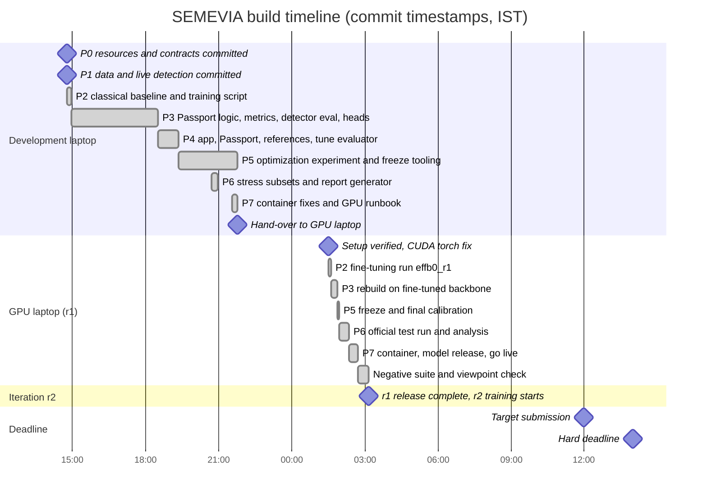

# Hackathon timeline

SEMEVIA, Computer Vision Hackathon 2026, problem statement PS5 (fine-grained vehicle recognition on
Stanford Cars), team T35. Branch `semevia/implementation`.

This page records how the project was built during the 24 hours: the phases P0 to P7, which machine did
what, the two model iterations (r1 and r2), and the problems found and fixed on the way. It is built from
the Git history (`git log --reverse --format='%h %ad %s'`), the checkpoint notes in
[`docs/checkpoints/`](checkpoints/), [`NEXT.md`](../NEXT.md) and [`docs/resource_lock.md`](resource_lock.md).

All times are commit timestamps in IST (UTC+05:30, the offset Git recorded). A commit time shows when work
was **committed**, not when it started; several phases were committed in one batch. No result numbers are
given here. All results are in [`eval_P5_T35.md`](../eval_P5_T35.md), which `scripts/report.py` generates
from `reports/*.json`.

## Phases at a glance

| Phase | Name |
|---|---|
| P0 | Resources and contracts |
| P1 | Verified data and live detection |
| P2 | Classical baseline and fine-tuning |
| P3 | Core recognition heads |
| P4 | Passport, Evidence Challenge and app |
| P5 | Optimization, freeze and final calibration |
| P6 | Official test evaluation and analysis |
| P7 | Release, container and public deployment |

## Gantt chart

Bars run from one recorded commit to the next. The gap between 21:47 and 01:31 is the hand-over to the
GPU laptop and its setup (no commits in that window). Iteration r2 has no commit times yet, so it is
shown only as its starting point.

## Phase table

Short SHAs link each phase to the commits that delivered it. "Dev" means the development laptop and
"GPU" the GPU laptop (see the next section).

| Phase | Goal | What was delivered | Key commits | Exit check |
|---|---|---|---|---|
| P0 | Know the machines, data source and limits; freeze the contracts | [`docs/resource_lock.md`](resource_lock.md) (measured hardware, pilot throughput, data mirror, licences); frozen API schema [`docs/api_schema.json`](api_schema.json), class IDs, box format and split seed in `configs/data.yaml`; [`docs/ownership.md`](ownership.md); `requirements.lock`; FastAPI scaffold, `Dockerfile`, `compose.yaml` | Dev: `6c265d5` | Contracts frozen and the Docker image built once. Two items stayed open at this point: no public host and no CUDA GPU on this laptop. Both were closed later (P7 and P2 on the GPU laptop). |
| P1 | Verified data and a real detector behind the service | `scripts/prepare_data.py` with frozen manifests (train 6,514 / tune 815 / calibration 815 / test 8,041, seed 20261106) and [`reports/data_audit.json`](../reports/data_audit.json) (duplicates with conflicting labels recorded); YOLO11n detection with bounded uploads; box conversion in `src/vision/coordinates.py` | Dev: `83a18f4`, `15d44d3`, `b446a65`, `e101013` | Manifest hashes identical over three runs; overlay sheet inspected; tests pass; upload flow checked in a browser at phone width. Container run and public deploy were still open (see [`checkpoints/P1.md`](checkpoints/P1.md)). |
| P2 | Classical baseline and the mandatory fine-tuning run | `src/vision/features.py` (1816-dim handcrafted vector), `src/vision/proposals.py`, versioned caches (`scripts/cache_features.py`, `src/models/cache_io.py`), classical head (`scripts/fit_heads.py`); resumable two-stage trainer `scripts/train.py` + `src/models/training.py`; on the GPU laptop, run `effb0_r1` with [`reports/training/effb0_r1_summary.json`](../reports/training/effb0_r1_summary.json) | Dev: `00a6e22`, `e275c11`, `1a9e948`, `192b7ea`, `27b4dec`. GPU: `1cdf976`, `42e7cbf` | `fine_tuning_requirement_met: true` in the r1 training summary, with `pretrained_changed` true for `features.7` and `features.8`. |
| P3 | Matched deep, hybrid, classical and ablation heads on cached features | `scripts/fit_heads.py` (one grid from `configs/heads.yaml`, selection on tune only); detector evaluation on tune ([`reports/detector_tune.json`](../reports/detector_tune.json)); metric implementations in `src/evaluation/metrics.py` with fixture tests; on the GPU laptop, everything rebuilt on the fine-tuned backbone ([`reports/heads_tune_ckpt_2339418979e1.json`](../reports/heads_tune_ckpt_2339418979e1.json)) | Dev: `ecd7c2c`, `31aa668`, `e34f645`, `6140788`. GPU: `8ce22e7` | Heads refitted on the fine-tuned backbone; production mode chosen on tune only (hybrid kept, deep not clearly better on tune); `src.release verify` and `pytest` pass. |
| P4 | User-facing recognition with honest uncertainty | `app/main.py` serving three modes (`/predict`), the Passport (conformal set, hierarchy, decision states in `src/passport/`), the Evidence Challenge (`/challenge`), JSON export; training-only reference index (`scripts/build_references.py`) and references panel; resumable end-to-end evaluator `scripts/evaluate.py`; [`docs/architecture.md`](architecture.md) and [`docs/design.md`](design.md) | Dev: `a738562`, `8e612b3`, `789ffd0`, `4abc022`, `8ba7f7f` | Full flow checked in a browser on a test photo; API contract tests for all modes and the challenge; app-vs-offline parity test. References show identifiers, labels and similarity only, no thumbnails (licence decision, see below). |
| P5 | Measure optimized runtimes; freeze the pipeline before any test image; final calibration | `scripts/optimize.py`, `scripts/optimize_head.py` (ONNX FP32, three INT8 encoder variants, INT8 head); parity-gated ONNX FP32 runtime; `scripts/freeze.py`, `scripts/calibrate.py --final`, release config via `scripts/promote_bundle.py`; on the GPU laptop, `artifacts/production_freeze.json` and `artifacts/calibration_final.json` (r1's copies are archived in [`artifacts/history/r1/`](../artifacts/history/r1/)) | Dev: `fa0d5a2`, `5d3139a`, `03354e8`, `684873f`, `5bbc04c`. GPU: `a05ee37` | Freeze file written before the test split was touched; `scripts/evaluate.py` refuses the test split unless it gets `--confirm-frozen` and the final calibration of the frozen pipeline. All INT8 encoder variants failed the accuracy policy, so the release keeps the PyTorch FP32 encoder (`encoder_runtime: torch`); see [`checkpoints/P5_dev.md`](checkpoints/P5_dev.md) and the `reports/optimization_*.json` files. |
| P6 | One official test run, robustness and failure analysis | Predeclared stress and viewpoint subsets (`scripts/declare_subsets.py`); seven stress conditions on the 392-image subset (`scripts/report_robustness.py`); `scripts/analyze_results.py` (viewpoint subgroups, rule-selected failures); `scripts/report.py` writing [`eval_P5_T35.md`](../eval_P5_T35.md) | Dev: `a6418c6`, `f97888b`, `c712e9a`. GPU: `92ffbae` | Test split (8,041 images) evaluated once after the freeze; the eval file is generated from the report files, and every number in it was re-checked against the JSON. |
| P7 | A container that works offline, public model files, a public URL | Docker fixes (`4c8c5ec`); runbook, demo script and negative-suite guide (`f94c5d2`); `scripts/check_container.py` → [`reports/container_check.json`](../reports/container_check.json); GitHub Release `model-v1` with URLs and SHA256 in [`artifacts/release_manifest.json`](../artifacts/release_manifest.json); `scripts/prepare_hf_space.py`; Cloudflare tunnel ([`docs/hosting_lock.md`](hosting_lock.md)); `scripts/check_release.py` → [`reports/release_acceptance.json`](../reports/release_acceptance.json); 80-image negative suite manifests and the blind viewpoint check | Dev: `4c8c5ec`, `6cf86de`, `f94c5d2`. GPU: `b763e75`, `900f483`, `2cebf30`, `1c9461d`, `8e0c84b` | Container ready with all three modes, also with `--network none`; a fresh clone builds an image that downloads and verifies the published model files; public URL passes the release checks and the phone-width check. |

## Milestones

| When (IST) | Milestone | Commit |
|---|---|---|
| 2026-11-06 14:46 | P0 contracts frozen; P1 data manifests frozen; real detection served | `6c265d5`, `83a18f4`, `15d44d3` |
| 2026-11-06 14:55 | Classical features, proposals and head; resumable training script | `00a6e22`, `e275c11` |
| 2026-11-06 18:30 | Matched heads fitted; app serves three modes, Passport and Evidence Challenge | `6140788`, `a738562` |
| 2026-11-06 19:21 | End-to-end evaluator run on tune; reference index and panel | `4abc022`, `8ba7f7f` |
| 2026-11-06 19:31 | Optimization experiment (ONNX FP32, INT8 encoder variants, INT8 head) | `fa0d5a2` |
| 2026-11-06 20:57 | Eval file generator `scripts/report.py` | `f97888b` |
| 2026-11-06 21:47 | Freeze, final calibration and analysis code ready; runbook for the GPU laptop | `5bbc04c`, `f94c5d2` |
| 2026-11-07 01:31 | GPU laptop set up; manifests reproduce there | `1cdf976` |
| 2026-11-07 01:37 | r1 fine-tuning complete (`effb0_r1`) | `42e7cbf` |
| 2026-11-07 01:53 | Fine-tuned backbone `ckpt_2339418979e1` promoted | `8ce22e7` |
| 2026-11-07 01:56 | P5 freeze and final conformal calibration | `a05ee37` |
| 2026-11-07 02:20 | Official test run, robustness, analysis, `eval_P5_T35.md` | `92ffbae` |
| 2026-11-07 02:26 | Model files published as GitHub Release `model-v1` | `900f483` |
| 2026-11-07 02:43 | Live through the Cloudflare tunnel; public checks recorded | `1c9461d` |
| 2026-11-07 03:09 | 80-image negative suite manifests; blind viewpoint label check | `8e0c84b` |
| **r2** | **r2 freeze, test, redeploy** | **_In progress — to be filled by the maintainer._** |

## Two-machine workflow

The work was split across two laptops because the development laptop has no CUDA GPU
([`docs/resource_lock.md`](resource_lock.md)).

| | Development laptop | GPU laptop (host `LEGION`) |
|---|---|---|
| Hardware | Intel Core i5-1135G7, Intel Iris Xe (no CUDA), C: nearly full, data on D: | NVIDIA RTX 4050 Laptop GPU (6 GB), Intel Core i7-14650HX, C: only |
| Used for | P0, P1, P2 classical part, P3 and P4 on a **development backbone** (frozen ImageNet EfficientNet-B0), all P5-P7 code, written and fixture-tested | Fine-tuning, rebuilding every cache, head and calibration on the fine-tuned backbone, the freeze, the single test run, the container, the model release, and the live service |
| Instructions | [`docs/training_handoff.md`](training_handoff.md) | [`docs/runbook_other_pc.md`](runbook_other_pc.md) (steps 1 to 9, ends with a ready prompt) |

Rules from the runbook: only one machine commits at a time (the development laptop stopped pushing once
the GPU laptop started), `git pull` before each step and push after it, frozen manifests and configs are
never edited, weights and data never go into Git, and every number comes from a generated
`reports/*.json`. The runbook's `E:\semevia` folder became `C:\semevia` on the GPU laptop, which has no
E: drive.

```mermaid
flowchart LR
    subgraph DEV["Development laptop (no CUDA)"]
        D1["P0-P1: contracts, manifests, detection"]
        D2["P2-P4 on frozen ImageNet backbone:<br/>features, heads, Passport, app"]
        D3["P5-P7 code, fixture-tested:<br/>freeze.py, calibrate.py --final,<br/>analyze_results.py, report.py, Docker"]
        D1 --> D2 --> D3
    end
    GH[("GitHub branch<br/>semevia/implementation")]
    subgraph GPU["GPU laptop LEGION"]
        G1["Runbook step 1: env + data check"]
        G2["Step 2: train.py (effb0_r1)"]
        G3["Step 3: rebuild caches, heads,<br/>references, promote bundle"]
        G4["Step 5: evaluate tune + calibration,<br/>freeze.py, calibrate.py --final"]
        G5["Step 6: single test run, stress,<br/>analysis, report.py"]
        G6["Steps 7-9: GitHub Release model-v1,<br/>container checks, tunnel"]
        G1 --> G2 --> G3 --> G4 --> G5 --> G6
    end
    D3 -- "push + runbook_other_pc.md" --> GH
    GH -- "pull" --> G1
    G6 -- "push reports, artifacts, docs" --> GH
    G6 --> LIVE(["Public URL<br/>(Cloudflare quick tunnel)"])
```

The live service runs on the GPU laptop: the release container in Docker Desktop plus `cloudflared`
([`docs/hosting_lock.md`](hosting_lock.md)). The URL works only while that laptop is on, awake and online,
and it changes if `cloudflared` restarts.

## Two model iterations

Both iterations use the same data partitions, crop, input size (224) and normalisation, so the inference
pipeline in `app/main.py` does not change between them. Only the backbone weights, and everything built on
them, are replaced.

| | r1 (released first) | r2 (training now) |
|---|---|---|
| Config | [`configs/train.yaml`](../configs/train.yaml) | [`configs/train_v2.yaml`](../configs/train_v2.yaml) |
| Run name | `effb0_r1` | `effb0_r2` |
| Stage 1 | Classifier only, up to 3 epochs | Classifier only, up to 2 epochs |
| Stage 2 | Last stage only: `classifier`, `features.7`, `features.8`, up to 6 epochs | Full network: `classifier` + all of `features`, up to 24 epochs, cosine learning-rate decay |
| Loss | Cross-entropy | Cross-entropy with label smoothing (training only; evaluation uses plain cross-entropy) |
| Early stopping patience | 3 | 6 |
| Seed | 20261106 | 20261107 |
| Why | Meets the mandatory "last-stage fine-tuning" requirement | r1's training loss was still falling when it stopped, which suggests the frozen early stages limited it (reasoning in the `configs/train_v2.yaml` header). Decided from train and tune behaviour only. |
| Status | Frozen, evaluated once on test, deployed (bundle `ft_ckpt_2339418979e1_0920511710`) | Training. Then the whole pipeline is redone: heads, calibration, freeze with the 80-image negative suite, a single test run, redeploy. r2 then replaces r1 as the release. |
| Results | [`eval_P5_T35.md`](../eval_P5_T35.md) (current version) and the r1 `reports/*_ft_ckpt_2339418979e1_*.json` files | `eval_P5_T35.md` will be regenerated by `scripts/report.py` for the r2 bundle |

For r2, `src/models/training.py` gained a per-epoch cosine schedule (computed from the epoch counter, so a
resumed run gets the same learning rate) and the `label_smoothing` option.

Differences in the freeze: r1 was frozen **without** a negative suite, so its reject threshold was set from
known tune images only (recorded in r1's freeze file, archived as
[`artifacts/history/r1/production_freeze.json`](../artifacts/history/r1/production_freeze.json)). The 80-image negative suite
(40 tune + 40 test, Wikimedia Commons images under CC0, public domain, CC BY or CC BY-SA, manifests in
[`artifacts/negative_manifests/`](../artifacts/negative_manifests/)) arrived after the r1 release and is used
in the r2 freeze (`scripts/freeze.py --negatives ...`, see [`docs/negative_suite.md`](negative_suite.md)).

Rule that holds for both: the test split is evaluated once per frozen bundle, and never re-run to pick a
better-looking result. The r1 test reports stay in `reports/` (their file names carry the r1 bundle id).

## Problems found and fixed during the run

| Problem | What we saw | Cause | Fix | Commit |
|---|---|---|---|---|
| CUDA torch vs sympy conflict | After installing the lock, the GPU laptop had a CPU-only torch | The cu124 torch build pins a `sympy` version that conflicts with the one in `requirements.lock`, so pip quietly replaced it with CPU torch from PyPI | Runbook step 1 now installs the lock without torch, then `torch==2.14.1+cu126` / `torchvision==0.29.1+cu126` last, then `pip check` and a CUDA check | `1cdf976` |
| Detector silently on the GPU | Evaluation on the GPU laptop would not have matched the CPU-only deployment | Ultralytics picks a GPU automatically when one exists | `src/models/detector.py` passes `device="cpu"` explicitly | `8ce22e7` |
| Windows calibration path broke recognition in the container | The Linux container served detection only; recognition was silently off | `scripts/promote_bundle.py`, run from PowerShell, stored `artifacts\calibration_final.json` with a backslash | Paths are written with `as_posix()` (bundle id unchanged); `scripts/check_container.py` now checks all modes, online and with `--network none` | `b763e75` |
| `report.py` did not print test values | The eval file showed development files and no final test numbers | `scripts/report.py` had hard-coded development report files | Rewritten to pick reports by bundle id and backbone tag and print the final test values in the PS5 order; the old `eval_P5_TeamID.md` was removed | `92ffbae` |
| Stale development wording in the UI | The live page called the final bundle "development"; `/benchmarks` served old tune-only files; browsers could keep old scripts | Labels and benchmark file list were written for the development backbone | `app/main.py`, `app/static/index.html` and `app/static/app.js` updated; `/benchmarks` serves the current bundle's test reports; static files carry a cache-busting version | `1c9461d` |
| Hugging Face 402 | Creating the Docker Space returned `402 Payment Required` | Docker Spaces on free CPU need a PRO subscription | Team chose a Cloudflare quick tunnel to the release container on the GPU laptop; `scripts/prepare_hf_space.py` is kept in case the team subscribes | `2cebf30`, `1c9461d` |

Earlier fixes on the development laptop, for completeness:

* Ultralytics patched `PIL.Image.open` and tried to `pip install pi-heif` on unreadable uploads; disabled and
  covered by a test (`15d44d3`, see [`checkpoints/P1.md`](checkpoints/P1.md)).
* A Docker layer cached while C: was full held empty `.py` files, and uninstalling `opencv-python` removed the
  shared `cv2` package; the `Dockerfile` now reinstalls `opencv-python-headless` and checks imports at build
  time (`4c8c5ec`).
* `tests/test_bundle_parity.py` used a hard-coded `imagenet_frozen` tag, and latency reports hard-coded the
  old laptop's CPU name (now read by `src/evaluation/hardware.py`) (`8ce22e7`).

## Honest notes on the timeline

* Commit times are not work start times. P0 and P1 were committed together at 14:46 after earlier work that
  Git did not timestamp.
* Everything in P3-P5 on the development laptop used a frozen ImageNet backbone. Those tune-split numbers,
  in [`checkpoints/P3_P4_dev.md`](checkpoints/P3_P4_dev.md) and [`checkpoints/P5_dev.md`](checkpoints/P5_dev.md),
  are development diagnostics, not results. Only the GPU-laptop bundle is evaluated on test.
* The viewpoint labels (`reports/viewpoint_labels.csv`) and the blind second labelling pass
  ([`reports/viewpoint_label_check.json`](../reports/viewpoint_label_check.json)) were both made by agents, not
  by humans.
* Reference thumbnails are not shown because Stanford Cars images are licensed for non-commercial research
  only; the references panel shows identifiers, labels and similarity instead.
* The data ends at model year 2012, and it contains duplicate images with conflicting labels
  ([`reports/data_audit.json`](../reports/data_audit.json)).
* The public URL is a quick tunnel to one laptop. It has no uptime guarantee and changes if `cloudflared`
  restarts ([`docs/hosting_lock.md`](hosting_lock.md)).
