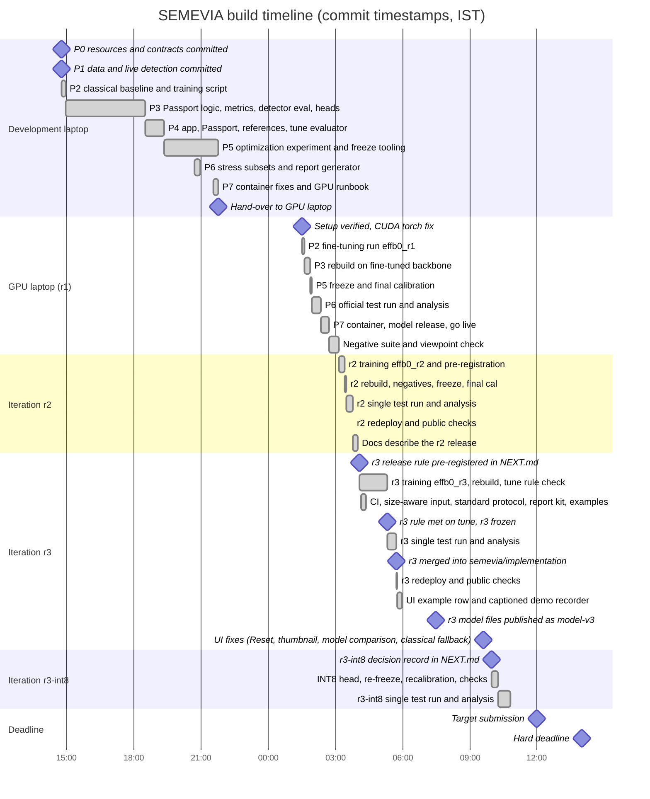

# Hackathon timeline

SEMEVIA, Computer Vision Hackathon 2026, problem statement PS5 (fine-grained vehicle recognition on
Stanford Cars), team T35. Branch `semevia/implementation`.

This page records how the project was built during the 24 hours: the phases P0 to P7, which machine did
what, the four model iterations (r1, r2 and r3, all superseded, and r3-int8, the release: r3 with its hybrid
head served as an ONNX INT8 graph), and the problems found and fixed on the way. It is built from
the Git history (`git log --reverse --format='%h %ad %s'`), the checkpoint notes in
[`docs/checkpoints/`](checkpoints/), [`NEXT.md`](../NEXT.md) and [`docs/resource_lock.md`](resource_lock.md).

All times are commit timestamps in IST (UTC+05:30, the offset Git recorded). A commit time shows when work
was **committed**, not when it started; several phases were committed in one batch. No result numbers are
given here. All results are in [`eval_P5_T35.md`](../eval_P5_T35.md), which `scripts/report.py` generates
from `reports/*.json`.

## Phases at a glance

| Phase | Name |
|---|---|
| P0 | Resources and contracts |
| P1 | Verified data and live detection |
| P2 | Classical baseline and fine-tuning |
| P3 | Core recognition heads |
| P4 | Passport, Evidence Challenge and app |
| P5 | Optimization, freeze and final calibration |
| P6 | Official test evaluation and analysis |
| P7 | Release, container and public deployment |

## Gantt chart

Bars run from one recorded commit to the next. The gap between 21:47 and 01:31 is the hand-over to the
GPU laptop and its setup (no commits in that window). In the r3 section, the r3 training, rebuild and
tune-rule check ran between the pre-registration commit (04:05) and the commit that records the rule outcome
and the freeze (05:18); the tooling bar in between was committed while r3 trained. In the r3-int8 section, the
INT8 head, the re-freeze, the recalibration and the five pipeline checks ran between the decision record (09:58)
and the implementation commit (10:15); the single r3-int8 test run ran between 10:15 and the results commit
(10:49).

## Phase table

Short SHAs link each phase to the commits that delivered it. "Dev" means the development laptop and
"GPU" the GPU laptop (see the next section).

| Phase | Goal | What was delivered | Key commits | Exit check |
|---|---|---|---|---|
| P0 | Know the machines, data source and limits; freeze the contracts | [`docs/resource_lock.md`](resource_lock.md) (measured hardware, pilot throughput, data mirror, licences); frozen API schema [`docs/api_schema.json`](api_schema.json), class IDs, box format and split seed in `configs/data.yaml`; [`docs/ownership.md`](ownership.md); `requirements.lock`; FastAPI scaffold, `Dockerfile`, `compose.yaml` | Dev: `6c265d5` | Contracts frozen and the Docker image built once. Two items stayed open at this point: no public host and no CUDA GPU on this laptop. Both were closed later (P7 and P2 on the GPU laptop). |
| P1 | Verified data and a real detector behind the service | `scripts/prepare_data.py` with frozen manifests (train 6,514 / tune 815 / calibration 815 / test 8,041, seed 20261106) and [`reports/data_audit.json`](../reports/data_audit.json) (duplicates with conflicting labels recorded); YOLO11n detection with bounded uploads; box conversion in `src/vision/coordinates.py` | Dev: `83a18f4`, `15d44d3`, `b446a65`, `e101013` | Manifest hashes identical over three runs; overlay sheet inspected; tests pass; upload flow checked in a browser at phone width. Container run and public deploy were still open (see [`checkpoints/P1.md`](checkpoints/P1.md)). |
| P2 | Classical baseline and the mandatory fine-tuning run | `src/vision/features.py` (1816-dim handcrafted vector), `src/vision/proposals.py`, versioned caches (`scripts/cache_features.py`, `src/models/cache_io.py`), classical head (`scripts/fit_heads.py`); resumable two-stage trainer `scripts/train.py` + `src/models/training.py`; on the GPU laptop, run `effb0_r1` with [`reports/training/effb0_r1_summary.json`](../reports/training/effb0_r1_summary.json), then `effb0_r2` ([summary](../reports/training/effb0_r2_summary.json)) and the released `effb0_r3` ([summary](../reports/training/effb0_r3_summary.json)) | Dev: `00a6e22`, `e275c11`, `1a9e948`, `192b7ea`, `27b4dec`. GPU: `1cdf976`, `42e7cbf` (r1), `4043f4e` (r2), `e8ce629` (r3) | `fine_tuning_requirement_met: true` in the r1 training summary, with `pretrained_changed` true for `features.7` and `features.8`; r2 and r3 fine-tune the full network. |
| P3 | Matched deep, hybrid, classical and ablation heads on cached features | `scripts/fit_heads.py` (one grid from `configs/heads.yaml`, selection on tune only); detector evaluation on tune ([`reports/detector_tune.json`](../reports/detector_tune.json)); metric implementations in `src/evaluation/metrics.py` with fixture tests; on the GPU laptop, everything rebuilt on the fine-tuned backbone (r1: [`reports/heads_tune_ckpt_2339418979e1.json`](../reports/heads_tune_ckpt_2339418979e1.json); r2: [`reports/heads_tune_ckpt_4f3584f597d5.json`](../reports/heads_tune_ckpt_4f3584f597d5.json); r3: [`reports/heads_tune_ckpt_98b1fb55cc6e.json`](../reports/heads_tune_ckpt_98b1fb55cc6e.json)) | Dev: `ecd7c2c`, `31aa668`, `e34f645`, `6140788`. GPU: `8ce22e7` (r1), `38b1a62` (r2), `e8ce629` (r3) | Heads refitted on the fine-tuned backbone; production mode chosen on tune only (hybrid kept, deep not clearly better on tune); `src.release verify` and `pytest` pass. |
| P4 | User-facing recognition with honest uncertainty | `app/main.py` serving three modes (`/predict`), the Passport (conformal set, hierarchy, decision states in `src/passport/`), the Evidence Challenge (`/challenge`), JSON export; training-only reference index (`scripts/build_references.py`) and references panel; resumable end-to-end evaluator `scripts/evaluate.py`; [`docs/architecture.md`](architecture.md) and [`docs/design.md`](design.md) | Dev: `a738562`, `8e612b3`, `789ffd0`, `4abc022`, `8ba7f7f` | Full flow checked in a browser on a test photo; API contract tests for all modes and the challenge; app-vs-offline parity test. References show identifiers, labels and similarity only, no thumbnails (licence decision, see below). |
| P5 | Measure optimized runtimes; freeze the pipeline before any test image; final calibration | `scripts/optimize.py`, `scripts/optimize_head.py` (ONNX FP32, three INT8 encoder variants, INT8 head); parity-gated ONNX FP32 runtime; `scripts/freeze.py`, `scripts/calibrate.py --final`, release config via `scripts/promote_bundle.py`; on the GPU laptop, `artifacts/production_freeze.json` and `artifacts/calibration_final.json` (now r3-int8's; r1's, r2's and r3's copies are archived in [`artifacts/history/r1/`](../artifacts/history/r1/), [`artifacts/history/r2/`](../artifacts/history/r2/) and [`artifacts/history/r3/`](../artifacts/history/r3/)); r3 optimization reports [`optimization_ckpt_98b1fb55cc6e.json`](../reports/optimization_ckpt_98b1fb55cc6e.json) and [`optimization_head_hybrid_ckpt_98b1fb55cc6e.json`](../reports/optimization_head_hybrid_ckpt_98b1fb55cc6e.json) (re-run row-wise for r3-int8; the earlier batch-wise values are kept under `superseded_batchwise`); for r3-int8, `src/models/head_onnx.py` (INT8 head derived from the published `head_hybrid.joblib`), `promote_bundle.py --hybrid-head onnx_int8`, and the container parity check [`reports/int8_container_parity.json`](../reports/int8_container_parity.json) | Dev: `fa0d5a2`, `5d3139a`, `03354e8`, `684873f`, `5bbc04c`. GPU: `a05ee37` (r1), `38b1a62` (r2), `e8ce629` (r3), `b85ddae`, `5b0961a` (r3-int8) | Freeze file written before the test split was touched; `scripts/evaluate.py` refuses the test split unless it gets `--confirm-frozen` and the final calibration of the frozen pipeline. All INT8 encoder variants failed the accuracy policy, so every release keeps the PyTorch FP32 encoder (`encoder_runtime: torch`, `precision: fp32`); see [`checkpoints/P5_dev.md`](checkpoints/P5_dev.md) and the `reports/optimization_*.json` files. The INT8 hybrid head passed the policy and is deployed from r3-int8 on (`hybrid_head_runtime: onnx_int8` in [`artifacts/release_config.json`](../artifacts/release_config.json)); the five pipeline checks of its decision record passed before its test run (listed in [`NEXT.md`](../NEXT.md)). |
| P6 | One official test run, robustness and failure analysis | Predeclared stress and viewpoint subsets (`scripts/declare_subsets.py`); seven stress conditions on the 392-image subset (`scripts/report_robustness.py`); `scripts/analyze_results.py` (viewpoint subgroups, rule-selected failures); `scripts/report.py` writing [`eval_P5_T35.md`](../eval_P5_T35.md); `scripts/evaluate_oracle.py` for the standard Stanford Cars protocol (ground-truth crop) | Dev: `a6418c6`, `f97888b`, `c712e9a`. GPU: `92ffbae` (r1), `cadcdc3`, `800e7b7` (r2), `8ca670c` (frozen r2 bundle, standard-protocol test run), `d028940`, `357a7cb` (r3), `cf2b69e` (accuracy by native car size from the saved test predictions, `scripts/analyze_resolution.py`), `2e55498` (r3-int8) | Test split (8,041 images) evaluated end to end once per iteration after its freeze, four times in total (r1 `92ffbae`, r2 `cadcdc3`, r3 `357a7cb`, r3-int8 `2e55498`; files `reports/e2e_test_*.json`), plus two standard-protocol (ground-truth crop) runs: the frozen r2 bundle (`8ca670c`) after r2's result was known, and r3 (`357a7cb`); it was not re-run for r3-int8 (pre-registered). All of this is disclosed in the status line of `eval_P5_T35.md`. The INT8-vs-FP32 comparison on test (`scripts/compare_runs.py`) uses the two saved prediction files, with no extra test run. The eval file is generated from the report files. |
| P7 | A container that works offline, public model files, a public URL | Docker fixes (`4c8c5ec`); runbook, demo script and negative-suite guide (`f94c5d2`); `scripts/check_container.py` → [`reports/container_check.json`](../reports/container_check.json); GitHub Release `model-v1` (r1), replaced by `model-v2` (r2), then `model-v3` (r3's files, `9e36b4c`; URLs and SHA256 in [`artifacts/release_manifest.json`](../artifacts/release_manifest.json)); r3-int8 uploads no new file: its INT8 head is rebuilt from the published `head_hybrid.joblib` by `python -m src.release fetch`, pinned by sha256 in the manifest and checked by `python -m src.release check-derived` in the Docker build; CI in [`.github/workflows/ci.yml`](../.github/workflows/ci.yml) (tests and a clean-build container job); `scripts/prepare_hf_space.py`; Cloudflare tunnel ([`docs/hosting_lock.md`](hosting_lock.md)); `scripts/check_release.py` → [`reports/release_acceptance.json`](../reports/release_acceptance.json); 80-image negative suite manifests and the blind viewpoint check | Dev: `4c8c5ec`, `6cf86de`, `f94c5d2`. GPU: `b763e75`, `900f483`, `2cebf30`, `1c9461d`, `8e0c84b` (r1), `cadcdc3`, `ae9a00b` (r2), `d028940`, `c0edf1a`, `50f4d6a`, `9e36b4c`, `cf2b69e` (r3), `5b0961a` (r3-int8) | Container ready with all three modes, also with `--network none`; a fresh clone builds an image that downloads and verifies the published model files; public URL passes the release checks and the phone-width check (both checks re-run on r2 and again on r3, `c0edf1a`). For r3-int8 the container check and the public release checks were re-run before its test run (`5b0961a`), and `/readyz` reports `head_runtime`, `encoder_precision`, `head_int8_sha256` and `model_fingerprint`. |

## Milestones

| When (IST) | Milestone | Commit |
|---|---|---|
| 2026-11-06 14:46 | P0 contracts frozen; P1 data manifests frozen; real detection served | `6c265d5`, `83a18f4`, `15d44d3` |
| 2026-11-06 14:55 | Classical features, proposals and head; resumable training script | `00a6e22`, `e275c11` |
| 2026-11-06 18:30 | Matched heads fitted; app serves three modes, Passport and Evidence Challenge | `6140788`, `a738562` |
| 2026-11-06 19:21 | End-to-end evaluator run on tune; reference index and panel | `4abc022`, `8ba7f7f` |
| 2026-11-06 19:31 | Optimization experiment (ONNX FP32, INT8 encoder variants, INT8 head) | `fa0d5a2` |
| 2026-11-06 20:57 | Eval file generator `scripts/report.py` | `f97888b` |
| 2026-11-06 21:47 | Freeze, final calibration and analysis code ready; runbook for the GPU laptop | `5bbc04c`, `f94c5d2` |
| 2026-11-07 01:31 | GPU laptop set up; manifests reproduce there | `1cdf976` |
| 2026-11-07 01:37 | r1 fine-tuning complete (`effb0_r1`) | `42e7cbf` |
| 2026-11-07 01:53 | Fine-tuned backbone `ckpt_2339418979e1` promoted | `8ce22e7` |
| 2026-11-07 01:56 | P5 freeze and final conformal calibration | `a05ee37` |
| 2026-11-07 02:20 | Official test run, robustness, analysis, `eval_P5_T35.md` | `92ffbae` |
| 2026-11-07 02:26 | Model files published as GitHub Release `model-v1` | `900f483` |
| 2026-11-07 02:43 | Live through the Cloudflare tunnel; public checks recorded | `1c9461d` |
| 2026-11-07 03:09 | 80-image negative suite manifests; blind viewpoint label check | `8e0c84b` |
| 2026-11-07 03:25 | r2 training (`effb0_r2`, full fine-tuning) committed with the pre-registration in `NEXT.md`: r2 replaces r1 whatever its test result | `4043f4e` |
| 2026-11-07 03:30 | r2 rebuilt and frozen (hybrid; reject threshold chosen with the 40 tune negatives); final calibration | `38b1a62` |
| 2026-11-07 03:46 | r2 single official test run, stress, analysis, 40 held-out negatives; GitHub Release `model-v2` | `cadcdc3` |
| 2026-11-07 03:47 | r2 container live behind the same URL; container and public-URL checks re-run | `ae9a00b` |
| 2026-11-07 04:05 | r3 release rule pre-registered in `NEXT.md` ("Iteration r3 decision record") before r3 training: r3 replaces r2 only if its tune end-to-end hybrid top-1 reaches a fixed threshold above r2's; otherwise r3 never touches test | `794b237` |
| 2026-11-07 04:09 | CI (tests and clean-build container job); encoder input size carried by the backbone file; standard-protocol evaluator, report kit and figures, one-tap example row and demo recorder | `d028940`, `ab591ff`, `8ca670c`, `eb33dd5` |
| 2026-11-07 05:18 | r3 tune rule met, outcome recorded before any r3 test run (branch `r3-experiment`, pushed before the test run); r3 frozen (hybrid; reject threshold chosen with the 40 tune negatives); r2 archived in `artifacts/history/r2/` | `e8ce629` |
| 2026-11-07 05:44 | r3 single official test run, stress, analysis, 40 held-out negatives, standard protocol | `357a7cb` |
| 2026-11-07 05:44 | r3 merged into `semevia/implementation` as the release | `403bc9d` |
| 2026-11-07 05:46 | r3 container live behind the same URL; container and public-URL checks re-run | `c0edf1a` |
| 2026-11-07 05:58 | Example row shows a rejection openly; demo recorder captions taken from live results | `50f4d6a` |
| 2026-11-07 07:29 | r3 model files published as GitHub Release `model-v3` | `9e36b4c` |
| 2026-11-07 09:36 | UI fixes: Reset button works again, upload thumbnail, in-app "Model comparison" panel (classical, deep and hybrid on the photo, with each mode's official test results from `/benchmarks`), classical-mode whole-image fallback when no contour box passes | `cf2b69e` |
| 2026-11-07 09:58 | r3-int8 decision record committed in `NEXT.md` ("Iteration r3-int8 decision record") before any per-image, end-to-end, calibration or test INT8 number existed: r3-int8 replaces r3 FP32 whatever its test result once five pipeline checks pass; r3 FP32 release files archived in `artifacts/history/r3/` | `b85ddae` |
| 2026-11-07 10:15 | Hybrid head served as a row-wise ONNX INT8 graph; tune, negatives, freeze and calibration redone on INT8 logits (bundle at freeze `ft_ckpt_98b1fb55cc6e_0d835360cc`, release bundle `ft_ckpt_98b1fb55cc6e_f3734d4f40`); all five pipeline checks passed before the test run | `5b0961a` |
| 2026-11-07 10:49 | r3-int8 single official test run, stress, analysis, 40 held-out negatives, INT8-vs-FP32 comparison from the saved predictions; r3 FP32 listed as superseded | `2e55498` |

## Two-machine workflow

The work was split across two laptops because the development laptop has no CUDA GPU
([`docs/resource_lock.md`](resource_lock.md)).

| | Development laptop | GPU laptop (host `LEGION`) |
|---|---|---|
| Hardware | Intel Core i5-1135G7, Intel Iris Xe (no CUDA), C: nearly full, data on D: | NVIDIA RTX 4050 Laptop GPU (6 GB), Intel Core i7-14650HX, C: only |
| Used for | P0, P1, P2 classical part, P3 and P4 on a **development backbone** (frozen ImageNet EfficientNet-B0), all P5-P7 code, written and fixture-tested | Fine-tuning, rebuilding every cache, head and calibration on the fine-tuned backbone, the freeze, the single test run, the container, the model release, and the live service |
| Instructions | [`docs/training_handoff.md`](training_handoff.md) | [`docs/runbook_other_pc.md`](runbook_other_pc.md) (steps 1 to 9, ends with a ready prompt) |

Rules from the runbook: only one machine commits at a time (the development laptop stopped pushing once
the GPU laptop started), `git pull` before each step and push after it, frozen manifests and configs are
never edited, weights and data never go into Git, and every number comes from a generated
`reports/*.json`. The runbook's `E:\semevia` folder became `C:\semevia` on the GPU laptop, which has no
E: drive.

```mermaid
flowchart LR
    subgraph DEV["Development laptop (no CUDA)"]
        D1["P0-P1: contracts, manifests, detection"]
        D2["P2-P4 on frozen ImageNet backbone:<br/>features, heads, Passport, app"]
        D3["P5-P7 code, fixture-tested:<br/>freeze.py, calibrate.py --final,<br/>analyze_results.py, report.py, Docker"]
        D1 --> D2 --> D3
    end
    GH[("GitHub branch<br/>semevia/implementation")]
    subgraph GPU["GPU laptop LEGION"]
        G1["Runbook step 1: env + data check"]
        G2["Step 2: train.py (effb0_r1)"]
        G3["Step 3: rebuild caches, heads,<br/>references, promote bundle"]
        G4["Step 5: evaluate tune + calibration,<br/>freeze.py, calibrate.py --final"]
        G5["Step 6: single test run, stress,<br/>analysis, report.py"]
        G6["Steps 7-9: GitHub Release model-v1<br/>(r2: model-v2; r3 and r3-int8: model-v3),<br/>container checks, tunnel"]
        G1 --> G2 --> G3 --> G4 --> G5 --> G6
    end
    D3 -- "push + runbook_other_pc.md" --> GH
    GH -- "pull" --> G1
    G6 -- "push reports, artifacts, docs" --> GH
    G6 --> LIVE(["Public URL<br/>(Cloudflare quick tunnel)"])
```

The live service runs on the GPU laptop: the release container in Docker Desktop plus `cloudflared`
([`docs/hosting_lock.md`](hosting_lock.md)). The URL works only while that laptop is on, awake and online,
and it changes if `cloudflared` restarts.

## Four model iterations

All four iterations use the same data partitions, crop and normalisation. r1 and r2 use a 224 px input; r3
and r3-int8 use 320 px. The encoder input size now travels with the backbone file (`backbone_input_size` and
`preprocess_version` in [`src/models/backbone.py`](../src/models/backbone.py)), so `app/main.py` and the
evaluators pick up the right size from the released backbone and the inference code does not change between
r1, r2 and r3. From r1 to r3 only the backbone weights, and everything built on them, are replaced. r3-int8 keeps
r3's backbone and heads and changes only how the hybrid head's final logistic layer runs (ONNX INT8 instead of
sklearn FP32); the encoder stays PyTorch FP32 and the deep and classical heads stay sklearn FP32.

| | r1 (first release, superseded) | r2 (second release, superseded) | r3 (third release, superseded) | r3-int8 (released, current) |
|---|---|---|---|---|
| Config | [`configs/train.yaml`](../configs/train.yaml) | [`configs/train_v2.yaml`](../configs/train_v2.yaml) | [`configs/train_v3.yaml`](../configs/train_v3.yaml) | As r3 (no new training) |
| Run name | `effb0_r1` | `effb0_r2` | `effb0_r3` | `effb0_r3` (same backbone `ckpt_98b1fb55cc6e`) |
| Input size | 224 px | 224 px | 320 px | 320 px |
| Stage 1 | Classifier only, up to 3 epochs | Classifier only, up to 2 epochs | As r2 | As r3 |
| Stage 2 | Last stage only: `classifier`, `features.7`, `features.8`, up to 6 epochs | Full network: `classifier` + all of `features`, up to 24 epochs, cosine learning-rate decay | As r2 | As r3 |
| Loss | Cross-entropy | Cross-entropy with label smoothing (training only; evaluation uses plain cross-entropy) | As r2 | As r3 |
| Early stopping patience | 3 | 6 | 6 | As r3 |
| Seed | 20261106 | 20261107 | 20261107 (same as r2) | As r3 |
| Hybrid head runtime | sklearn FP32 | sklearn FP32 | sklearn FP32 | ONNX INT8, row-wise (`onnxruntime` `quantize_dynamic`, QInt8 weights), derived from the published `head_hybrid.joblib` by [`src/models/head_onnx.py`](../src/models/head_onnx.py) and pinned by sha256 (`6acf0061...`) |
| Why | Meets the mandatory "last-stage fine-tuning" requirement | r1's training loss was still falling when it stopped, which suggests the frozen early stages limited it (reasoning in the `configs/train_v2.yaml` header). Decided from train and tune behaviour only, but after r1's test result was known; the decision that r2 replaces r1 whatever its result was committed in [`NEXT.md`](../NEXT.md) ("Iteration r2 decision record", `4043f4e`) before r2's test run. | Fine-grained cues (badges, grilles, lamp shapes) are small and r2's failures include near-identical sibling classes, so r3 keeps r2's recipe and only raises the input resolution (reasoning in the `configs/train_v3.yaml` header). Designed after r2's test result was known, so the release rule was pre-registered in [`NEXT.md`](../NEXT.md) ("Iteration r3 decision record", `794b237`) **before r3 training**: release only if the tune end-to-end hybrid top-1 reaches a fixed threshold above r2's tune result, otherwise r3 never touches test. The outcome (rule met) was recorded in `e8ce629` before the test run. | PS5 item 4.6 ("optimisation applied and evaluated") was only partial: the INT8 head was measured but not deployed, and every INT8 encoder variant failed the accuracy policy. Designed after r3's test result was known, so the decision record ("Iteration r3-int8 decision record", `b85ddae`) was committed in [`NEXT.md`](../NEXT.md) before any per-image, end-to-end, calibration or test INT8 number existed: r3-int8 replaces r3 FP32 whatever its test result, once five pipeline checks pass. The earlier batch-wise tune study was seen before the record and is disclosed there. |
| Status | Superseded. Was frozen, evaluated once on test and deployed (backbone `ckpt_2339418979e1`, bundle `ft_ckpt_2339418979e1_0920511710`, GitHub Release `model-v1`); its freeze, calibration and config are archived in [`artifacts/history/r1/`](../artifacts/history/r1/) | Superseded. Was frozen with the reject threshold chosen on the 40 tune negatives (bundle at freeze `ft_ckpt_4f3584f597d5_c13883508a`), finally calibrated (release bundle `ft_ckpt_4f3584f597d5_9662c2e703`), evaluated once on test and deployed (backbone `ckpt_4f3584f597d5`, GitHub Release `model-v2`); its freeze, calibration, config and manifest are archived in [`artifacts/history/r2/`](../artifacts/history/r2/) | Superseded by r3-int8. Was released and live. Whole pipeline redone on backbone `ckpt_98b1fb55cc6e`: heads (production mode hybrid), calibration, freeze with the reject threshold chosen on the 40 tune negatives (bundle at freeze `ft_ckpt_98b1fb55cc6e_f99e386191`), final calibration (release bundle `ft_ckpt_98b1fb55cc6e_5d755416fd`), a single test run (`357a7cb`), merge (`403bc9d`), redeploy behind the same URL with checks re-run (`c0edf1a`). Model files published as GitHub Release `model-v3` (`9e36b4c`). Its freeze, both calibrations, config and manifest are archived in [`artifacts/history/r3/`](../artifacts/history/r3/) (`b85ddae`); its test results stay valid for r3 | Released and live. Same detector, backbone, heads, features and crop as r3; temperature, reject threshold (40 tune negatives) and conformal q re-derived from INT8 logits on tune and calibration data (`scripts/freeze.py`, `scripts/calibrate.py --final`; [`artifacts/production_freeze.json`](../artifacts/production_freeze.json), bundle at freeze `ft_ckpt_98b1fb55cc6e_0d835360cc`, model fingerprint `2ef1643c...`), final calibration (release bundle `ft_ckpt_98b1fb55cc6e_f3734d4f40`), five pipeline checks passed (`5b0961a`), a single test run (`2e55498`). Uses the `model-v3` files; no new public file |
| Results | Listed under "Model iterations" in [`eval_P5_T35.md`](../eval_P5_T35.md); test reports in `reports/*_ft_ckpt_2339418979e1_0920511710.json`, e.g. [`e2e_test`](../reports/e2e_test_ft_ckpt_2339418979e1_0920511710.json), training summary [`effb0_r1_summary.json`](../reports/training/effb0_r1_summary.json) | Listed under "Model iterations" in [`eval_P5_T35.md`](../eval_P5_T35.md); [`e2e_test`](../reports/e2e_test_ft_ckpt_4f3584f597d5_9662c2e703.json), [`robustness_stress_test`](../reports/robustness_stress_test_ft_ckpt_4f3584f597d5_9662c2e703.md), [`analysis_test`](../reports/analysis_test_ft_ckpt_4f3584f597d5_9662c2e703.json), [`negatives_test`](../reports/negatives_test_ft_ckpt_4f3584f597d5_9662c2e703.json), [`oracle_test`](../reports/oracle_test_ft_ckpt_4f3584f597d5_9662c2e703.json), [`negatives_tune`](../reports/negatives_tune_ft_ckpt_4f3584f597d5_c13883508a.json), [`heads_tune`](../reports/heads_tune_ckpt_4f3584f597d5.json), training summary [`effb0_r2_summary.json`](../reports/training/effb0_r2_summary.json) | Listed under "Model iterations" in [`eval_P5_T35.md`](../eval_P5_T35.md); [`e2e_test`](../reports/e2e_test_ft_ckpt_98b1fb55cc6e_5d755416fd.json), [`robustness_stress_test`](../reports/robustness_stress_test_ft_ckpt_98b1fb55cc6e_5d755416fd.md), [`analysis_test`](../reports/analysis_test_ft_ckpt_98b1fb55cc6e_5d755416fd.json), [`negatives_test`](../reports/negatives_test_ft_ckpt_98b1fb55cc6e_5d755416fd.json), [`oracle_test`](../reports/oracle_test_ft_ckpt_98b1fb55cc6e_5d755416fd.json), [`e2e_tune`](../reports/e2e_tune_ft_ckpt_98b1fb55cc6e_f99e386191.json) (the pre-registered rule), [`negatives_tune`](../reports/negatives_tune_ft_ckpt_98b1fb55cc6e_f99e386191.json), [`heads_tune`](../reports/heads_tune_ckpt_98b1fb55cc6e.json), training summary [`effb0_r3_summary.json`](../reports/training/effb0_r3_summary.json) | [`eval_P5_T35.md`](../eval_P5_T35.md) (generated by `scripts/report.py` for the r3-int8 bundle); [`e2e_test`](../reports/e2e_test_ft_ckpt_98b1fb55cc6e_f3734d4f40.json), [`robustness_stress_test`](../reports/robustness_stress_test_ft_ckpt_98b1fb55cc6e_f3734d4f40.md), [`analysis_test`](../reports/analysis_test_ft_ckpt_98b1fb55cc6e_f3734d4f40.json), [`extra_test`](../reports/extra_test_ft_ckpt_98b1fb55cc6e_f3734d4f40.json), [`resolution_test`](../reports/resolution_test_ft_ckpt_98b1fb55cc6e_f3734d4f40.json), [`negatives_test`](../reports/negatives_test_ft_ckpt_98b1fb55cc6e_f3734d4f40.json), [`int8_vs_fp32_test`](../reports/int8_vs_fp32_test_ft_ckpt_98b1fb55cc6e_f3734d4f40.json), [`e2e_tune`](../reports/e2e_tune_ft_ckpt_98b1fb55cc6e_0d835360cc.json), [`negatives_tune`](../reports/negatives_tune_ft_ckpt_98b1fb55cc6e_0d835360cc.json), [`optimization_head_hybrid`](../reports/optimization_head_hybrid_ckpt_98b1fb55cc6e.json), [`int8_container_parity`](../reports/int8_container_parity.json). The ground-truth-crop study was not re-run for r3-int8 (pre-registered); the eval file shows r3 FP32's [`oracle_test`](../reports/oracle_test_ft_ckpt_98b1fb55cc6e_5d755416fd.json), labelled as r3 FP32 |

For r2, `src/models/training.py` gained a per-epoch cosine schedule (computed from the epoch counter, so a
resumed run gets the same learning rate) and the `label_smoothing` option. For r3, the encoder input size
became part of the backbone file (`d028940`), so a 320 px backbone cannot be run at 224 px by mistake. For
r3-int8 (`5b0961a`), `scripts/promote_bundle.py` requires `--hybrid-head {sklearn,onnx_int8}` and refuses a final
calibration made for another head runtime; every prediction row records the hybrid head runtime, and the freeze
and calibration refuse rows from a different runtime.

Differences in the freeze: r1 was frozen **without** a negative suite, so its reject threshold was set from
known tune images only (recorded in r1's freeze file, archived as
[`artifacts/history/r1/production_freeze.json`](../artifacts/history/r1/production_freeze.json)). The 80-image negative suite
(40 tune + 40 test, Wikimedia Commons images under CC0, public domain, CC BY or CC BY-SA, manifests in
[`artifacts/negative_manifests/`](../artifacts/negative_manifests/)) arrived after the r1 release. In the r2, r3 and
r3-int8 freezes (`scripts/freeze.py --negatives ...`, see [`docs/negative_suite.md`](negative_suite.md)) the 40 tune
negatives were used to choose the reject threshold (`negatives_used: true` in
[`artifacts/production_freeze.json`](../artifacts/production_freeze.json) for r3-int8, in
[`artifacts/history/r3/production_freeze.json`](../artifacts/history/r3/production_freeze.json) for r3 and in
[`artifacts/history/r2/production_freeze.json`](../artifacts/history/r2/production_freeze.json) for r2); the 40
test negatives were held out and evaluated once with each of these iterations' test runs, three times in total
(files `reports/negatives_test_*.json`; r3-int8:
[`reports/negatives_test_ft_ckpt_98b1fb55cc6e_f3734d4f40.json`](../reports/negatives_test_ft_ckpt_98b1fb55cc6e_f3734d4f40.json)).

Rule that holds for all four: the test split is evaluated once per frozen bundle, and never re-run to pick a
better-looking result. It was therefore evaluated end to end four times in total, once for r1 (`92ffbae`), once
for r2 (`cadcdc3`), once for r3 (`357a7cb`) and once for r3-int8 (`2e55498`). The 392-image stress subset was run
for the same four bundles (`reports/robustness_stress_test_*.json`). The r1, r2 and r3 test reports stay in
`reports/` (their file names carry their bundle ids); the r3-int8 reports carry the r3-int8 bundle id. The
standard Stanford Cars protocol (ground-truth crop instead of the detector, `scripts/evaluate_oracle.py`) is
reported separately in the `oracle_test_*.json` files, for the frozen r2 bundle (`8ca670c`) and for r3
(`357a7cb`); it was not re-run for r3-int8 (pre-registered), and it selects nothing.

## Problems found and fixed during the run

| Problem | What we saw | Cause | Fix | Commit |
|---|---|---|---|---|
| CUDA torch vs sympy conflict | After installing the lock, the GPU laptop had a CPU-only torch | The cu124 torch build pins a `sympy` version that conflicts with the one in `requirements.lock`, so pip quietly replaced it with CPU torch from PyPI | Runbook step 1 now installs the lock without torch, then `torch==2.14.1+cu126` / `torchvision==0.29.1+cu126` last, then `pip check` and a CUDA check | `1cdf976` |
| Detector silently on the GPU | Evaluation on the GPU laptop would not have matched the CPU-only deployment | Ultralytics picks a GPU automatically when one exists | `src/models/detector.py` passes `device="cpu"` explicitly | `8ce22e7` |
| Windows calibration path broke recognition in the container | The Linux container served detection only; recognition was silently off | `scripts/promote_bundle.py`, run from PowerShell, stored `artifacts\calibration_final.json` with a backslash | Paths are written with `as_posix()` (bundle id unchanged); `scripts/check_container.py` now checks all modes, online and with `--network none` | `b763e75` |
| `report.py` did not print test values | The eval file showed development files and no final test numbers | `scripts/report.py` had hard-coded development report files | Rewritten to pick reports by bundle id and backbone tag and print the final test values in the PS5 order; the old `eval_P5_TeamID.md` was removed | `92ffbae` |
| Stale development wording in the UI | The live page called the final bundle "development"; `/benchmarks` served old tune-only files; browsers could keep old scripts | Labels and benchmark file list were written for the development backbone | `app/main.py`, `app/static/index.html` and `app/static/app.js` updated; `/benchmarks` serves the current bundle's test reports; static files carry a cache-busting version | `1c9461d` |
| Hugging Face 402 | Creating the Docker Space returned `402 Payment Required` | Docker Spaces on free CPU need a PRO subscription | Team chose a Cloudflare quick tunnel to the release container on the GPU laptop; `scripts/prepare_hf_space.py` is kept in case the team subscribes | `2cebf30`, `1c9461d` |
| Reset button did nothing | Clicking **Reset** in the app threw an error | The button's id `reset` shadowed `form.reset()` | The app calls `HTMLFormElement.prototype.reset` and also clears the thumbnail and scroll position | `cf2b69e` |
| Classical mode returned nothing on some photos | No result when no contour box passed the filters | The contour proposal found no box | The app analyses the whole image and says so; the evaluated classical baseline is unchanged | `cf2b69e` |
| INT8 head output depended on the batch | The first INT8 head study scored one 815-row tensor, so each image's output depended on the other rows | Dynamic quantisation computes the activation scale from the whole input | The INT8 head scores one image row at a time; the study was re-run row-wise and the batch-wise values are kept under `superseded_batchwise` in [`reports/optimization_head_hybrid_ckpt_98b1fb55cc6e.json`](../reports/optimization_head_hybrid_ckpt_98b1fb55cc6e.json) | `b85ddae`, `5b0961a` |

Earlier fixes on the development laptop, for completeness:

* Ultralytics patched `PIL.Image.open` and tried to `pip install pi-heif` on unreadable uploads; disabled and
  covered by a test (`15d44d3`, see [`checkpoints/P1.md`](checkpoints/P1.md)).
* A Docker layer cached while C: was full held empty `.py` files, and uninstalling `opencv-python` removed the
  shared `cv2` package; the `Dockerfile` now reinstalls `opencv-python-headless` and checks imports at build
  time (`4c8c5ec`).
* `tests/test_bundle_parity.py` used a hard-coded `imagenet_frozen` tag, and latency reports hard-coded the
  old laptop's CPU name (now read by `src/evaluation/hardware.py`) (`8ce22e7`).

## Honest notes on the timeline

* Commit times are not work start times. P0 and P1 were committed together at 14:46 after earlier work that
  Git did not timestamp.
* Everything in P3-P5 on the development laptop used a frozen ImageNet backbone. Those tune-split numbers,
  in [`checkpoints/P3_P4_dev.md`](checkpoints/P3_P4_dev.md) and [`checkpoints/P5_dev.md`](checkpoints/P5_dev.md),
  are development diagnostics, not results. Only the GPU-laptop bundles (r1, r2, r3, then r3-int8) were
  evaluated end to end on test, once each.
* r2 was designed after r1's test result was known. To keep that honest, the decision that r2 replaces r1
  whatever its test result was committed in [`NEXT.md`](../NEXT.md) (`4043f4e`) before r2's test run.
* r3 was designed after r2's test result was known. Its release rule was stricter: it was committed in
  [`NEXT.md`](../NEXT.md) (`794b237`) before r3 training started, it was decided on the tune split only
  ([`reports/e2e_tune_ft_ckpt_98b1fb55cc6e_f99e386191.json`](../reports/e2e_tune_ft_ckpt_98b1fb55cc6e_f99e386191.json)),
  and its outcome was committed and pushed (`e8ce629`, branch `r3-experiment`) before r3's single test run
  (`357a7cb`). Had the rule failed, r3 would never have been evaluated on test.
* r3-int8 was designed after r3's test result was known. Its decision record was committed in
  [`NEXT.md`](../NEXT.md) (`b85ddae`) before any per-image, end-to-end, calibration or test INT8 number existed,
  and it released r3-int8 whatever its test result once the five pipeline checks passed. One INT8 number was
  seen before the record: the batch-wise tune study of the INT8 head; the record says so. The checks passed and
  were committed (`5b0961a`) before the single r3-int8 test run (`2e55498`).
* Only the INT8 **head** is deployed. Every INT8 **encoder** variant failed the accuracy policy, so the encoder
  stays PyTorch FP32 (`precision: fp32`), and the deep and classical heads stay sklearn FP32.
* r3's model files were published as GitHub Release `model-v3` after r3's test run (`9e36b4c`); before that,
  r3's URLs in [`artifacts/release_manifest.json`](../artifacts/release_manifest.json) were empty. r3-int8
  adds no public file: its INT8 head is rebuilt from the published `head_hybrid.joblib` at build time.
* The viewpoint labels (`reports/viewpoint_labels.csv`) and the blind second labelling pass
  ([`reports/viewpoint_label_check.json`](../reports/viewpoint_label_check.json)) were both made by agents, not
  by humans.
* Reference thumbnails are not shown because Stanford Cars images are licensed for non-commercial research
  only; the references panel shows identifiers, labels and similarity instead.
* The data ends at model year 2012, and it contains duplicate images with conflicting labels
  ([`reports/data_audit.json`](../reports/data_audit.json)).
* The public URL is a quick tunnel to one laptop. It has no uptime guarantee and changes if `cloudflared`
  restarts ([`docs/hosting_lock.md`](hosting_lock.md)).
