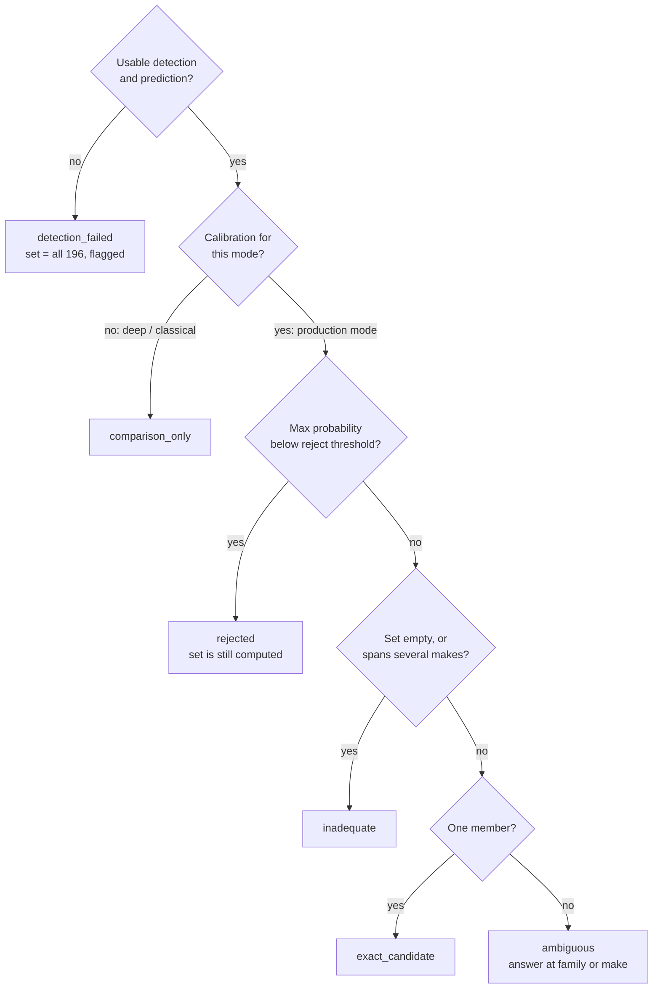

# Viva preparation

Short answers to the questions judges are most likely to ask. Each answer names the file that proves it.
**Do not quote numbers from memory**: open [eval_P5_T35.md](../eval_P5_T35.md) (generated by
`scripts/report.py`) or the `reports/*.json` file it cites, and read the value from the screen. The eval file is
generated for the released iteration r2 (bundle `ft_ckpt_4f3584f597d5_9662c2e703`, backbone tag
`ckpt_4f3584f597d5`); r1 is listed there under "Model iterations". Current r2 report files end in
`_ft_ckpt_4f3584f597d5_9662c2e703` (test), `_ft_ckpt_4f3584f597d5_c13883508a` (tune and calibration, bundle at
freeze) or `_ckpt_4f3584f597d5` (heads, references, optimization). r1's test reports stay in
`reports/*_ft_ckpt_2339418979e1_0920511710.json`.

Lane A (Aniket Kumar) answers sections 1-5 and 7; lane B (C Lakshanaa) answers sections 8-10; both answer
section 6 (Passport) and section 11. See [ownership.md](ownership.md).

## 1. Model choices

**Why EfficientNet-B0?**
It is a small ImageNet-pretrained CNN (1280-d pooled embedding) that runs on a CPU inside a 2-CPU, 4 GB
container (`compose.yaml`) and fine-tunes within the hackathon time on a laptop GPU (RTX 4050, 6 GB). It is torchvision's
`efficientnet_b0` with a new 196-way classifier (`src/models/backbone.py: build_model`). We chose a compact
backbone so the deployed latency stays low and the whole pipeline fits in a 24-hour hackathon.

**Why YOLO11n, and why not fine-tune it?**
We need a box around the car, not the car's identity, from the detector. YOLO11n with COCO weights already
finds cars; we map COCO car, bus and truck to one "vehicle" class (`configs/runtime.yaml: vehicle_coco_classes`;
truck is included because some Stanford categories are pickups and vans). It is frozen; its recall and AP on the
tune split are in `reports/detector_tune.json`, and its box quality on test is in section 2 of the eval file.
Code: `src/models/detector.py: VehicleDetector`. It always runs on CPU so offline evaluation measures the
deployed pipeline.

**How is the target car chosen when there are several?**
`select_target` in `src/models/detector.py`: the largest vehicle box with detector score >= 0.25, ties broken
by score, then index. It never uses ground truth. A wrong pick counts as a failure in the metrics.

**Why is the "deep" mode a logistic head and not the CNN's own classifier?**
So the comparison is fair. Deep and hybrid use the same cached 1280-d embedding, the same classifier family
(multinomial logistic regression), the same C grid and the same selection rule (`configs/heads.yaml`). The only
difference is the handcrafted branch. The CNN's own classifier is used during training (`src/models/training.py`).

## 2. Classical features

**What are the 1816 handcrafted features?** (`src/vision/features.py: extract_classical`, `configs/features.yaml`)

| Group | Size | What it captures |
|---|---|---|
| HOG | 1764 | Edge-orientation layout on a 128x128 grayscale ROI (9 orientations, 16 px cells, 2x2 blocks) |
| Uniform LBP | 10 | Local texture histogram (8 points, radius 1) |
| HSV histograms | 32 | Colour (16 hue, 8 saturation, 8 value bins) |
| Geometry | 8 | Crop aspect, largest-contour area fraction, solidity, extent, Canny edge density, box area fraction, box centre x and y |
| Flags | 2 | Empty contour, near-uniform crop |

Blank crops give finite zeros plus a flag, never NaN. The Canny edges and contours are shown in the app
(section 5 of the page).

**What is the classical localisation path?**
`src/vision/proposals.py: propose`: grayscale, blur, Canny, large morphological close, external contours,
bounding boxes scored by area and edge support. Classical mode uses this box instead of YOLO, so it is fully
classical end to end (`app/main.py: _run_pipeline`).

**Why is classical so far behind?**
Its contour box is often wrong (eval file, section 2), and these features separate few of 196 near-identical
classes. Section 1 also shows its annotation-crop (oracle) result, which isolates the feature effect from the box.

## 3. Hybrid fusion and ablations

**How does the hybrid fuse?**
`src/models/heads.py: FusionFeatures`. Learned 1280-d embedding, standardised; handcrafted 1816-d,
standardised, reduced by PCA to 64 components, standardised again; the two are concatenated (1344-d) and fed to
one logistic regression. All transforms are fit on train rows only.

**What changed between hybrid r1 and r2 of the heads?**
Not to be confused with the training r1/r2. In the first head run, "equal variance" balancing gave each of the
64 handcrafted dimensions far more weight than a learned one and the hybrid lost to deep-only. The one
recorded change was per-feature standardisation. The old setting is kept as the ablation
`hybrid_equal_variance` (`configs/heads.yaml`, change log in the comments).

**What did the ablations show?**
Variants drop HOG, colour/texture, or geometry, and one uses equal-variance balancing; each is refit with the
same grid (`configs/heads.yaml: ablations`, results in `reports/heads_tune_ckpt_4f3584f597d5.json` and section
7 "Ablations" of the eval file). Read the values from the eval file. For r2 (as for r1) its reading is that
fine-tuning the backbone gives by far the largest gain and the handcrafted branch adds little accuracy on top of
fine-tuned features. Say this plainly: the hybrid is a genuine fusion, but we do not claim it beats deep-only.

**Why is hybrid the production mode if deep was ahead on test?**
The production mode is fixed on the tune split before the test run (`artifacts/production_freeze.json`). For r2,
deep and hybrid were level on tune, and the project rule keeps hybrid unless deep is clearly better on tune;
the NEXT.md decision record ("Iteration r2 decision record") wrote this down before r2's test run. Switching
after seeing test results would be selecting on test. Section 1 of the eval file states which mode led on test.

## 4. Fine-tuning: r1 versus r2

| | r1 (`configs/train.yaml`, run `effb0_r1`) | r2 (`configs/train_v2.yaml`, run `effb0_r2`) |
|---|---|---|
| Stage 1 | Classifier only, 3 epochs | Classifier only, 2 epochs |
| Stage 2 | Last stage: `features.7`, `features.8` + classifier, 6 epochs | Whole network (`features`) + classifier, 24 epochs |
| Learning rates | Head 1e-3, backbone 1e-4, constant | Head 2e-3, backbone 5e-4, per-epoch cosine decay |
| Loss | Cross-entropy | Cross-entropy with label smoothing 0.1 (training only) |
| Early stopping | Patience 3 | Patience 6 |

Shared: annotation-box crops with 8% jitter, horizontal flip, brightness/contrast, light blur, AdamW, batch 32,
AMP on CUDA, resumable checkpoints (`python scripts/train.py --config <file> --resume auto`).

**Why r2?** The header of `configs/train_v2.yaml`: in r1, tune top-1 was still rising at the last epoch, so
training only the last stage looked like the limit. Every r2 setting was chosen from train/tune behaviour, but
be honest about timing: r2 was designed after r1's test result was known. r2 is the released iteration (backbone
tag `ckpt_4f3584f597d5`, model files in GitHub Release `model-v2`); r1 (tag `ckpt_2339418979e1`, Release
`model-v1`) is superseded. Training logs and summaries: `reports/training/effb0_r1_summary.json`,
`reports/training/effb0_r2_summary.json` and the matching `*_train_log.jsonl` files.

**How do you prove fine-tuning happened?** `src/models/training.py` hashes the pretrained `features.7` and
`features.8` weights before training and records `pretrained_changed` after every fine-tuning epoch; the summary
records `fine_tuning_requirement_met`. Frozen blocks keep BatchNorm in eval mode
(`src/models/backbone.py: train_mode_respecting_freeze`). The release uses `best_finetuned.pt`, the best tune
checkpoint after at least one fine-tuning epoch.

**Did you look at the test set twice?** Yes, honestly: once per iteration, twice in total. Order of events
(commits, IST, 2026-11-07):

| Time | Commit | Step |
|---|---|---|
| 02:20 | `92ffbae` | r1 single test run (after r1's freeze) |
| 02:43 | `1c9461d` | r1 live |
| 03:09 | `8e0c84b` | Negative suite and viewpoint label check added |
| 03:25 | `4043f4e` | r2 trained; decision record written in `NEXT.md` ("Iteration r2 decision record") |
| 03:30 | `38b1a62` | r2 freeze |
| 03:46 | `cadcdc3` | r2 single test run, stress, analysis, held-out negatives, Release `model-v2` |
| 03:47 | `ae9a00b` | r2 redeployed, live checks re-run |

r2 was designed after r1's test result was known, so the second test run is not fully independent of the first.
What protects it: the decision record, committed before r2's test run, fixed that r2 replaces r1 **whatever its
test result**, that hybrid stays the production mode and that the freeze uses the tune negatives. So r2 was not
chosen over r1 by comparing test scores. Every r2 choice (heads, temperature, reject threshold, conformal
quantile) uses train, tune and calibration data only. Both test results are reported (eval file, "Model
iterations").

## 5. Data partitions and leakage control

| Partition | Images | Used for |
|---|---|---|
| train | 6,514 | Network training, scalers, PCA, heads, reference index |
| tune | 815 | Choosing heads, mode, temperature and reject threshold |
| calibration | 815 | Conformal quantile only |
| test | 8,041 (official) | Final evaluation, once per frozen release |

* Built by `scripts/prepare_data.py` (`src/data/manifest.py: assign_partitions`): calibration is random from the
  official train pool (8,144 images), tune is class-stratified from the rest, seed 20261106. Keys are
  `split/filename` because file names repeat across the two official folders.
* `scripts/evaluate.py` refuses the calibration and test partitions until `artifacts/production_freeze.json`
  exists and its model fingerprint matches the bundle. The test negatives stay locked until the freeze file
  exists (`scripts/evaluate_negatives.py`).
* Caches and heads carry manifest, crop-policy, feature and backbone hashes and refuse mismatches
  (`src/models/cache_io.py`).
* The reference index may contain training keys only (`src/passport/references.py: validate_index`).
* Known dataset problems (`reports/data_audit.json`): 39 byte-identical groups, 37 with conflicting labels, and
  19 test images with exact copies in the train pool. We recorded them and kept the official test set unchanged;
  the current report has no duplicate-excluded figure.

## 6. The Identity Evidence Passport

**What is the freeze?** `scripts/freeze.py` fixes the production mode, temperature (fit on tune rows whose box
matched, IoU >= 0.5) and reject threshold, and stores a fingerprint of every asset that changes predictions
(`src/passport/calibration.py: model_fingerprint`: detector, backbone, heads, and the encoder runtime). Any change
after that invalidates the freeze and the test lock stays shut.

**What does the conformal calibration mean?** (`src/passport/conformal.py`, `scripts/calibrate.py --final`)
* Score per calibration image: 1 minus the calibrated probability of the true class. All 815 calibration images
  go through the frozen pipeline; a missed detection gets the fallback score 1 - 1/196.
* q is the k-th smallest score with k = ceil((n+1)(1-alpha)), alpha = 0.10, no interpolation.
* At run time the candidate set is every class with 1 - p <= q, ties included, never cut short.
* Meaning: over many supported-category photos exchangeable with the calibration partition, the set contains
  the true class at least about 90% of the time. It is **not** the probability that this photo is right, and it
  does not hold for unsupported vehicles, edited images or street photos unlike the dataset. Measured coverage
  on test is in the eval file, section 6.

**How are the states decided?** `src/passport/decision.py: make_passport`, in this order:

The family/make answer comes from `src/passport/hierarchy.py: Hierarchy.specificity` (make, then family of
categories that differ only by year, then category).

**What does the Evidence Challenge show?** `src/passport/challenge.py`: the crop is cut into a 2x3 grid; each
variant blurs one cell and is re-scored by the same `Predictor.score_crops`. Delta = original (zA - zB) minus the
variant's, in raw logits, with A and B fixed from the original result. It measures sensitivity to a region; the
cells are not car parts.

## 7. Reject threshold and negatives

* Rule: reject when the maximum calibrated probability is below a threshold from the grid in
  `configs/calibration.yaml` (`src/passport/calibration.py: choose_reject_threshold`).
* r1 had no negative images, so it took the largest threshold that keeps at least 90% of known tune images,
  and said so (`reject.rule` in r1's freeze file, archived as `artifacts/history/r1/production_freeze.json`).
* r2 uses the 80-image negative suite (`artifacts/negative_manifests/*.csv`; 40 tune + 40 test, 10 per bucket:
  non-vehicle, two-wheeler, unsupported vehicle type, unlisted car model; Wikimedia Commons with licence and
  author per row). At the r2 freeze the threshold was chosen with the 40 **tune** negatives
  (`artifacts/production_freeze.json`: `negatives_used: true`): it minimises false acceptance on them while
  keeping at least 90% known retention. Tune-negative results: `reports/negatives_tune_ft_ckpt_4f3584f597d5_c13883508a.json`.
  The 40 held-out **test** negatives were run once after the freeze:
  `reports/negatives_test_ft_ckpt_4f3584f597d5_9662c2e703.json`. False acceptance per bucket: eval file,
  section 6.
* Why it is weak: a softmax can be very confident on a car it has never seen (for example a post-2012 model). A
  two-wheeler is usually stopped earlier because the detector does not map motorcycles to "vehicle" (the Ducati
  tune negative `tw_tune_03.jpg` returns `no_vehicle` on the live container).
* The Passport is a second line of defence: the city-bus tune negative `uv_tune_01.jpg` is detected and passes
  the reject threshold (top guess "GMC Savana Van 2012"), but its candidate set spans two makes, so the Passport
  answers `inadequate` (`no_shared_make`) and claims no identity. Observed on the live r2 container; a demo fact,
  not a metric.

## 8. Metrics definitions

| Metric | Definition | Code |
|---|---|---|
| End-to-end top-1 / top-5 | Correct only if the **runtime** box has IoU >= 0.5 with the annotation **and** the true class is in the top-k; denominator = all images; misses count as wrong | `src/evaluation/metrics.py: end_to_end_topk` |
| Matched-primary top-1 | Same, over images whose box matched | `scripts/evaluate.py` |
| Oracle-crop top-1 | Head on the annotation crop; isolates the classifier | `reports/heads_tune_*.json` |
| IoU | Runtime box vs the single annotation; mean over valid boxes and with misses as 0; recall at 0.5 | `metrics.py: localization` |
| 196-class AP | COCO AP (pycocotools) over 196 categories, at most one prediction per image (top-1 class), score = box score x top-1 probability; AP50 and AP50:95 | `metrics.py: coco_ap` |
| Generic vehicle AP | All YOLO11n vehicle boxes as one class, tune only; unannotated background cars count as false positives | `scripts/evaluate_detector.py` |
| ECE | 10 equal-width bins, count-weighted, before and after temperature | `metrics.py: ece` |
| Set metrics | Coverage, mean and median size, singletons and their accuracy, empty sets | `metrics.py: set_metrics` |

## 9. Optimization, robustness, failures

**ONNX and INT8** (`scripts/optimize.py`, `scripts/optimize_head.py`; eval file section 4):
the encoder was exported to ONNX FP32 (parity checked) and quantised to INT8 three ways (static MinMax, static
percentile, dynamic). Policy fixed in advance: keep INT8 only if tune top-1 drops by at most 1.0 point. No INT8
encoder passed. The INT8 linear head passed but is a tiny share of run time, so we claim no speed gain from it.
The released runtime is the one named in section 4 of the eval file; changing it changes the model fingerprint
and needs a new freeze.

**Robustness** (`configs/evaluation.yaml`, `src/evaluation/stress.py`): a predeclared 392-image test subset
(2 per class) under clean, brightness x0.5 and x1.5, downsampling to 0.5 and 0.25, and a grey occluder covering
15% or 30% of the box. Corruptions are applied before detection, so the detector is stressed too. Darkening is
not real night and downsampling is not real distance. Results (r2):
`reports/robustness_stress_test_ft_ckpt_4f3584f597d5_9662c2e703.md` (and `.json`); eval file section 5.

**Viewpoint**: 60 predeclared test photos labelled by an AI agent before any test result
(`reports/viewpoint_labels.csv`). A blind second pass by six other agents is in
`reports/viewpoint_label_check.json`. No human reviewed them. Groups are small and unbalanced: descriptive only.

**Failure cases** (`scripts/analyze_results.py`, `src/evaluation/analysis.py: select_failures`): chosen by fixed
rules (worst localisation, most confident same-make error, most confident cross-make error). Each is re-scored on
the annotation crop to separate box errors from classifier errors. For r2
(`reports/analysis_test_ft_ckpt_4f3584f597d5_9662c2e703.json`, eval file section 8 "Failure analysis"):
`test/00076.jpg`, a 96x64 thumbnail where no box was selected (the annotation crop is classified correctly, so
localisation caused it); `test/00294.jpg`, an Audi TTS Coupe 2012 called an Audi TT Hatchback 2011 (same make);
and `test/06675.jpg`, a Chevrolet Express Cargo Van 2007 called a GMC Savana Van 2012 (badge-engineered twins).
The last two keep the same wrong answer on the annotation crop, so they are classifier confusions, not box
errors, and both are very confident. For r1 they were a tiny thumbnail with no box, an Aston Martin V8 Vantage
called a Virage, and a BMW M3 called a Lamborghini Aventador
(`reports/analysis_test_ft_ckpt_2339418979e1_0920511710.json`).

## 10. Deployment

* FastAPI app (`app/main.py`) with static HTML/JS (`app/static/`), one container (`Dockerfile`, `compose.yaml`:
  2 CPUs, 4 GB, one worker, one job at a time, queue of four, then "busy").
* The build downloads the release files listed in `artifacts/release_manifest.json` (r2 model files from GitHub
  Release `model-v2`) and checks SHA256 (`src/release.py`); the running container downloads nothing and
  `/readyz` fails if any hash is wrong. r1's release config and manifest are archived in `artifacts/history/r1/`.
* Public URL: <https://readings-agency-respond-bacteria.trycloudflare.com>, a Cloudflare quick tunnel to the r2
  container on the team laptop. Hugging Face Docker Spaces asked for payment, so we used the tunnel
  (`docs/hosting_lock.md`). The URL works only while the laptop, Docker and `cloudflared` run, and changes if the
  tunnel restarts. Live checks, both re-run on r2 after the redeploy: `reports/release_acceptance.json`
  (`scripts/check_release.py`) and `reports/container_check.json`.
* Endpoints: `/healthz`, `/readyz`, `/predict`, `/challenge`, `/benchmarks`, `/request-image/...`; contract in
  `docs/api_schema.json`.

## 11. Limitations and ethics

Limitations (say them before you are asked):
* Stanford Cars covers 196 categories up to model year 2012, mostly clean catalogue-style photos. Newer cars and
  street photos are out of scope.
* Duplicate images with conflicting labels (often adjacent years) make some year distinctions ambiguous.
* Only one annotated car per image, so detection AP penalises real background cars.
* Softmax rejection is a weak open-set detector; the negative suite is small (80 images).
* Viewpoint labels and their second pass were made by agents, not humans.
* No INT8 encoder met the accuracy policy.
* The public URL depends on one laptop and a quick tunnel with no uptime guarantee.
* The test set was evaluated once per release, so twice in total (r1, r2).

Ethics and privacy:
* Uploads stay in memory for 15 minutes and are never written to disk or logged
  (`app/main.py: RequestStore`, `configs/runtime.yaml: request_ttl_seconds`). The Passport JSON holds hashes,
  boxes and scores, not pixels.
* The app names vehicle models, not people or plates, and the page says the Passport is not a certificate. It
  must not be used for ownership, insurance or legal decisions.
* No reference thumbnails: Stanford Cars images are licensed for non-commercial research only, so references
  show identifiers, labels and similarity, and no dataset images are redistributed.
* Negative images are Wikimedia Commons files with licence and author recorded per row.
* YOLO11n / Ultralytics is AGPL-3.0.
* An AI coding agent helped write the code under our direction; we checked and can explain each lane.
